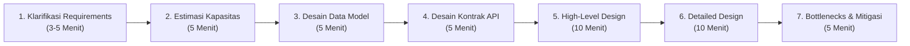

# 🇮🇩 Panduan Lengkap System Design (Bahasa Indonesia — Edisi Ramah Pemula hingga Siap Interview)

Selamat datang! 👋 Repositori ini adalah **Buku Pegangan Lengkap System Design berbahasa Indonesia** yang disusun dengan gaya *mentoring* **Senior / Principal Software Engineer** untuk membantu kamu—mulai dari **pemula (beginner)** hingga **menengah/senior**—memahami cara merancang sistem berskala besar dan **siap menghadapi System Design Interview**.

> _Materi ini diadaptasi, diterjemahkan, dan diperkaya secara mendalam dari repositori populer [karanpratapsingh/system-design](https://github.com/karanpratapsingh/system-design), dilengkapi dengan **Analogi Dunia Nyata untuk Pemula**, **Catatan Trade-off Arsitek**, **Tips Menjawab Interview**, serta **Cheat Sheet Perhitungan Kapasitas**._

---

## 🗺️ Peta Belajar (Learning Roadmap) & Navigasi Modul

Kamu bisa membaca keseluruhan materi langsung di halaman `README.md` ini dari atas ke bawah, atau membuka **file per bab yang sudah dipisahkan dengan rapi di folder [`/modul`](./modul)** agar lebih fokus saat belajar:

| Urutan Belajar | Modul / Bab | Apa yang Akan Kamu Kuasai? | Link File Modul |
| :---: | :--- | :--- | :--- |
| **Minggu 1** | **🌐 Bab I: Fundamental Jaringan & Infrastruktur** | IP (IPv4/IPv6), Model OSI 7 Layer, TCP vs UDP, Cara Kerja DNS, Load Balancing (L4 vs L7), Clustering, Caching (Redis, Strategi Tulis, LRU), CDN, Forward vs Reverse Proxy, Tabel Availability "The Nines", Vertical vs Horizontal Scaling, dan Storage (RAID, File, Block, Object S3). | [📖 Buka Bab I](./modul/01-fundamental-jaringan-dan-infrastruktur.md) |
| **Minggu 2** | **🗄️ Bab II: Database, Konsistensi & Skalabilitas Data** | SQL (Materialized View, N+1 Query Problem) vs NoSQL (Document, Key-Value, Graph, Time-Series, Wide-Column), Replikasi (Master-Slave vs Master-Master), Indexing (Dense vs Sparse), Normalisasi (1NF–BCNF) & Denormalisasi, ACID vs BASE, Teorema CAP & PACELC, Transaksi Terdistribusi (2PC, 3PC, Saga Pattern), Sharding, Consistent Hashing (VNodes), dan Federation. | [📖 Buka Bab II](./modul/02-database-dan-penyimpanan-data.md) |
| **Minggu 3** | **🏗️ Bab III: Arsitektur Aplikasi & Komunikasi** | N-Tier & Clean Architecture, Message Brokers, Message Queues (DLQ, Backpressure, At-Least-Once), Pub/Sub (Fanout), ESB, Monolith vs Modular Monolith vs Microservices, Event-Driven Architecture (EDA), Event Sourcing, CQRS, API Gateway & BFF, REST vs GraphQL vs gRPC, serta Real-Time (Long Polling, WebSockets, SSE). | [📖 Buka Bab III](./modul/03-arsitektur-dan-komunikasi-sistem.md) |
| **Minggu 4** | **🛡️ Bab IV: Keandalan, Operasional & Keamanan** | Geohashing & Quadtrees (Pencarian Lokasi), Circuit Breaker (Closed/Open/Half-Open), Rate Limiting (5 Algoritma & Masalah Race Condition), Idempotency (`Idempotency-Key`), Service Discovery & Service Mesh, SLA/SLO/SLI, Disaster Recovery (RTO & RPO), VM vs Containers, OAuth 2.0 & OIDC, Single Sign-On (SSO/SAML), dan SSL/TLS/mTLS. | [📖 Buka Bab IV](./modul/04-keandalan-keamanan-dan-operasional.md) |
| **Minggu 5** | **🎯 Bab V: Panduan Interview & 5 Studi Kasus Nyata** | Framework 7 Langkah Menaklukkan System Design Interview, ditambah pembahasan *end-to-end* (Estimasi RPS/Storage, Data Model, API, Arsitektur, Bottleneck): **1. URL Shortener (Bitly)**, **2. WhatsApp**, **3. Twitter / X**, **4. Netflix / YouTube**, dan **5. Uber / Gojek / Grab**. | [📖 Buka Bab V](./modul/05-panduan-dan-studi-kasus-interview.md) |
| **Persiapan H-1** | **⚡ Bab VI: Cheat Sheet & Matriks Pemilihan Teknologi** | Angka Latensi Penting (*Latency Numbers*), Rumus Pintas Hitung RPS & Storage, Tabel Matriks Pemilihan Database/Teknologi, dan Referensi Engineering Blog. | [📖 Buka Bab VI](./modul/06-cheatsheet-interview-dan-istilah.md) |

---

## 📑 Daftar Isi Lengkap (Klik untuk Langsung Melompat ke Topik)

- **Bab I: Fundamental Jaringan & Infrastruktur Sistem**
  - [1. Apa itu System Design?](#1-apa-itu-system-design)
  - [2. IP (Internet Protocol)](#2-ip-internet-protocol)
  - [3. Model OSI (Open Systems Interconnection)](#3-model-osi-open-systems-interconnection)
  - [4. TCP dan UDP](#4-tcp-dan-udp)
  - [5. Domain Name System (DNS)](#5-domain-name-system-dns)
  - [6. Load Balancing](#6-load-balancing)
  - [7. Clustering](#7-clustering)
  - [8. Caching](#8-caching)
  - [9. Content Delivery Network (CDN)](#9-content-delivery-network-cdn)
  - [10. Proxy (Forward vs Reverse Proxy)](#10-proxy)
  - [11. Availability (Ketersediaan Sistem)](#11-availability-ketersediaan-sistem)
  - [12. Scalability (Skalabilitas)](#12-scalability-skalabilitas)
  - [13. Storage (Penyimpanan Data)](#13-storage-penyimpanan-data)
- **Bab II: Database, Konsistensi Data & Skalabilitas Penyimpanan**
  - [1. Database dan DBMS](#1-database-dan-dbms)
  - [2. Database SQL (Relasional)](#2-database-sql-relasional)
  - [3. Database NoSQL (Non-Relasional)](#3-database-nosql-non-relasional)
  - [4. Perbandingan SQL vs NoSQL](#4-perbandingan-sql-vs-nosql)
  - [5. Replikasi Database (Database Replication)](#5-replikasi-database-database-replication)
  - [6. Database Indexes](#6-database-indexes)
  - [7. Normalisasi dan Denormalisasi](#7-normalisasi-dan-denormalisasi)
  - [8. Model Konsistensi ACID dan BASE](#8-model-konsistensi-acid-dan-base)
  - [9. Teorema CAP (CAP Theorem)](#9-teorema-cap-cap-theorem)
  - [10. Teorema PACELC (PACELC Theorem)](#10-teorema-pacelc-pacelc-theorem)
  - [11. Transaksi Database (Transactions)](#11-transaksi-database-transactions)
  - [12. Transaksi Terdistribusi (Distributed Transactions)](#12-transaksi-terdistribusi-distributed-transactions)
  - [13. Sharding (Partisi Database)](#13-sharding-partisi-database)
  - [14. Consistent Hashing](#14-consistent-hashing)
  - [15. Database Federation](#15-database-federation)
- **Bab III: Pola Arsitektur Aplikasi & Komunikasi Antar-Layanan**
  - [1. N-Tier Architecture](#1-n-tier-architecture)
  - [2. Message Brokers](#2-message-brokers)
  - [3. Message Queues](#3-message-queues)
  - [4. Publish-Subscribe (Pub/Sub)](#4-publish-subscribe-pubsub)
  - [5. Enterprise Service Bus (ESB)](#5-enterprise-service-bus-esb)
  - [6. Monolith, Modular Monolith, dan Microservices](#6-monolith-modular-monolith-dan-microservices)
  - [7. Event-Driven Architecture (EDA)](#7-event-driven-architecture-eda)
  - [8. Event Sourcing](#8-event-sourcing)
  - [9. Command and Query Responsibility Segregation (CQRS)](#9-command-and-query-responsibility-segregation-cqrs)
  - [10. API Gateway & Backend For Frontend (BFF)](#10-api-gateway--backend-for-frontend-bff)
  - [11. REST vs GraphQL vs gRPC](#11-rest-vs-graphql-vs-grpc)
  - [12. Long Polling, WebSockets, dan Server-Sent Events (SSE)](#12-long-polling-websockets-dan-server-sent-events-sse)
- **Bab IV: Komponen Sistem Lanjut, Keandalan (Resiliency) & Keamanan**
  - [1. Geohashing dan Quadtrees](#1-geohashing-dan-quadtrees)
  - [2. Circuit Breaker](#2-circuit-breaker)
  - [3. Rate Limiting](#3-rate-limiting)
  - [4. Idempotency (Idempotensi)](#4-idempotency-idempotensi)
  - [5. Service Discovery & Service Mesh](#5-service-discovery--service-mesh)
  - [6. SLA, SLO, dan SLI](#6-sla-slo-dan-sli)
  - [7. Disaster Recovery (Pemulihan Bencana)](#7-disaster-recovery-pemulihan-bencana)
  - [8. Virtual Machines (VMs) dan Containers](#8-virtual-machines-vms-dan-containers)
  - [9. OAuth 2.0 dan OpenID Connect (OIDC)](#9-oauth-20-dan-openid-connect-oidc)
  - [10. Single Sign-On (SSO) dan SAML](#10-single-sign-on-sso-dan-saml)
  - [11. SSL, TLS, dan mTLS](#11-ssl-tls-dan-mtls)
- **Bab V: Panduan System Design Interview & 5 Studi Kasus Dunia Nyata**
  - [1. Strategi & Kerangka Kerja 7 Langkah System Design Interview](#1-strategi--kerangka-kerja-7-langkah-system-design-interview)
  - [2. Studi Kasus 1: Merancang URL Shortener (Bitly / TinyURL)](#2-studi-kasus-1-merancang-url-shortener-bitly--tinyurl)
  - [3. Studi Kasus 2: Merancang Aplikasi Chat (WhatsApp)](#3-studi-kasus-2-merancang-aplikasi-chat-whatsapp)
  - [4. Studi Kasus 3: Merancang Social Media & Newsfeed (Twitter / X)](#4-studi-kasus-3-merancang-social-media--newsfeed-twitter--x)
  - [5. Studi Kasus 4: Merancang Video Streaming (Netflix / YouTube)](#5-studi-kasus-4-merancang-video-streaming-netflix--youtube)
  - [6. Studi Kasus 5: Merancang Layanan Ride-Hailing (Uber / Gojek / Grab)](#6-studi-kasus-5-merancang-layanan-ride-hailing-uber--gojek--grab)
- **Bab VI: Cheat Sheet Wawancara, Angka Penting & Matriks Teknologi**
  - [1. Angka Latensi yang Wajib Dihafal](#1-angka-latensi-yang-wajib-dihafal-latency-numbers-every-programmer-should-know)
  - [2. Tabel Konversi Satuan Data & Rumus Cepat RPS](#2-tabel-konversi-satuan-data--waktu-untuk-hitung-cepat-back-of-the-envelope)
  - [3. Matriks Keputusan Pemilihan Teknologi](#3-matriks-keputusan-pemilihan-teknologi-cheat-sheet-arsitek)
  - [4. Sumber Belajar Lanjutan & Referensi](#4-sumber-belajar-lanjutan--referensi-resmi)

---


---

# 🌐 Bab I: Fundamental Jaringan & Infrastruktur Sistem

> **🎯 Tujuan Belajar Bab Ini:**
> Sebelum merancang sistem berskala besar seperti WhatsApp, Netflix, atau Gojek, seorang *Software Engineer* wajib memahami bagaimana sebuah *request* dari perangkat pengguna (HP/Laptop) bisa sampai ke server kita dengan cepat, aman, dan tidak mati meskipun diakses jutaan orang bersamaan.

---

## Daftar Isi Bab I
1. [Pengantar: Apa itu System Design?](#1-apa-itu-system-design)
2. [IP (Internet Protocol)](#2-ip-internet-protocol)
3. [Model OSI (7 Layer Jaringan)](#3-model-osi-open-systems-interconnection)
4. [TCP dan UDP](#4-tcp-dan-udp)
5. [Domain Name System (DNS)](#5-domain-name-system-dns)
6. [Load Balancing (Penyeimbang Beban)](#6-load-balancing)
7. [Clustering (Pengelompokan Server)](#7-clustering)
8. [Caching (Penyimpanan Cepat Sementara)](#8-caching)
9. [Content Delivery Network (CDN)](#9-content-delivery-network-cdn)
10. [Proxy (Forward Proxy vs Reverse Proxy)](#10-proxy)
11. [Availability (Ketersediaan Sistem & Tabel "The Nines")](#11-availability-ketersediaan-sistem)
12. [Scalability (Skalabilitas Vertikal vs Horizontal)](#12-scalability-skalabilitas)
13. [Storage (Penyimpanan Data: RAID, Block, File, Object)](#13-storage-penyimpanan-data)

---

## 1. Apa itu System Design?

**System Design** (Perancangan Sistem) adalah proses mendefinisikan **arsitektur**, **komponen**, **antarmuka (API)**, dan **aliran data** untuk sebuah sistem agar dapat memenuhi kebutuhan bisnis maupun teknis tertentu.

> **💡 Analogi Pemula:**
> Bayangkan kamu diminta membangun gedung perkantoran:
> - **Coding / Algoritma** ibarat keahlian memasang batu bata, menyambung pipa air, atau memasang kabel listrik.
> - **System Design** ibarat **cetak biru arsitektur gedung**: Berapa lantai gedungnya? Di mana letak tangga darurat? Bagaimana agar lift tidak macet saat jam masuk kantor? Bagaimana jika listrik PLN mati (apakah ada genset cadangan)?
> Tanpa cetak biru yang matang, gedung setinggi 50 lantai akan roboh meskipun batu batanya dipasang dengan rapi.

### Mengapa System Design Sangat Penting?
1. **Keputusan Awal Sulit Diubah Belakangan**: Mengubah fondasi arsitektur saat aplikasi sudah dipakai jutaan pengguna jauh lebih mahal dan berisiko dibanding merancangnya dengan benar sejak awal.
2. **Menjembatani Kebutuhan Bisnis & Teknis**: System design menerjemahkan keinginan bisnis (misal: *"Aplikasi harus tetap jalan saat Flash Sale 12.12"*) menjadi solusi teknis (*Auto-scaling, Load Balancer, Caching, Message Queue*).
3. **Kunci Utama Naik Level Karier**: Di hampir semua perusahaan teknologi, kemampuan System Design adalah pembeda utama antara *Junior/Mid Engineer* dengan *Senior/Principal Engineer*.

---

## 2. IP (Internet Protocol)

**Alamat IP (*IP Address*)** adalah alamat unik yang mengidentifikasi sebuah perangkat di internet atau jaringan lokal. **IP (*Internet Protocol*)** adalah seperangkat aturan yang mengatur format data yang dikirim melalui internet.

> **💡 Analogi Pemula:**
> Alamat IP ibarat **alamat rumah lengkap beserta kode pos**. Jika kamu ingin mengirim paket ke temanmu, kurir butuh alamat tujuan (IP penerima) dan alamat pengirim (IP kamu) agar paket tidak nyasar.

### Versi Alamat IP

| Fitur | IPv4 | IPv6 |
| :--- | :--- | :--- |
| **Tahun Diperkenalkan** | 1981 (Standar awal internet) | 1998 (Mulai diadopsi luas pertengahan 2000-an) |
| **Ukuran Bit** | **32-bit** (4 angka desimal dipisah titik) | **128-bit** (8 blok heksadesimal dipisah titik dua) |
| **Jumlah Alamat Unik** | $\sim 4,3 \text{ Miliar}$ alamat ($2^{32}$) | $\sim 340 \text{ Undesiliun}$ ($3,4 \times 10^{38}$ atau $2^{128}$) |
| **Contoh Format** | `102.22.192.181` | `2001:0db8:85a3:0000:0000:8a2e:0370:7334` |
| **Status Saat Ini** | Sudah hampir habis secara global (dibantu teknologi NAT) | Masa depan internet karena jumlah perangkat IoT & HP melonjak |

### Jenis-Jenis Alamat IP

1. **Public IP (IP Publik)**:
   - Alamat IP utama yang diberikan oleh penyedia internet (ISP seperti IndiHome, Biznet, Telkomsel) ke *router* kamu.
   - Alamat inilah yang dikenali oleh dunia luar (internet). Seluruh perangkat di satu Wi-Fi rumah biasanya berbagi 1 IP Publik yang sama saat mengakses internet.
2. **Private IP (IP Privat)**:
   - Alamat IP internal yang diberikan oleh *router* Wi-Fi rumah/kantor ke masing-masing perangkat di dalamnya (laptop, HP, Smart TV, printer).
   - Contoh rentang IP Privat: `192.168.1.x`, `10.0.0.x`, `172.16.x.x`. IP ini tidak bisa diakses langsung dari internet luar.
3. **Static IP (IP Statis)**:
   - Alamat IP yang **tidak pernah berubah** dan dikonfigurasi secara manual/khusus.
   - Lebih mahal, namun wajib digunakan untuk **server produksi, DNS server, VPN kantor, atau layanan pembayaran (whitelist IP)** agar alamat server tidak berubah-ubah.
4. **Dynamic IP (IP Dinamis)**:
   - Alamat IP yang **berubah secara berkala** dan diberikan otomatis oleh server **DHCP (*Dynamic Host Configuration Protocol*)**.
   - Lebih hemat biaya bagi ISP karena alamat IP yang sedang tidak terpakai (misal modem dimatikan) bisa dipinjamkan ke pelanggan lain. Umum dipakai untuk internet rumahan/konsumen.

---

## 3. Model OSI (Open Systems Interconnection)

**Model OSI** adalah kerangka konseptual yang membagi proses komunikasi jaringan menjadi **7 lapisan (layer)** abstrak, dari lapisan fisik (kabel) hingga aplikasi yang dilihat pengguna.


> **💡 Analogi Pemula & Cara Cepat Menghafal:**
> Bayangkan seorang Direktur di lantai 7 gedung A ingin mengirim surat rahasia ke Direktur di lantai 7 gedung B:
> - **L7 (Application)**: Direktur menulis isi surat.
> - **L6 (Presentation)**: Sekretaris menerjemahkan surat ke bahasa Inggris & memasukkannya ke amplop bersegel (enkripsi) serta melipatnya (kompresi).
> - **L5 (Session)**: Bagian resepsionis menelepon gedung B untuk memastikan kantor mereka sedang buka.
> - **L4 (Transport)**: Bagian ekspedisi memotong dokumen tebal menjadi beberapa bundel bernomor urut (Segmen) agar kalau ada bundel yang hilang bisa diminta kirim ulang.
> - **L3 (Network)**: Kurir kota menempelkan alamat jalan & kode pos gedung B (IP Address) dan memilih rute jalan raya tercepat (Routing).
> - **L2 (Data Link)**: Kurir gedung memindahkan paket antar-pos di dalam satu komplek yang sama (MAC Address).
> - **L1 (Physical)**: Jalan aspal, ban motor kurir, atau kabel serat optik yang membawa sinyal listrik/cahaya `1` dan `0`.
>
> **Jembatan Keledai (Dari Layer 1 ke 7):** **P**lease **D**o **N**ot **T**hrow **S**ausage **P**izza **A**way (*Physical, Data Link, Network, Transport, Session, Presentation, Application*).

### Penjelasan 7 Layer OSI (Dari Atas ke Bawah)

| Layer | Nama Lapisan | Unit Data | Protokol / Contoh | Tugas Utama |
| :---: | :--- | :--- | :--- | :--- |
| **Layer 7** | **Application** | Data | `HTTP`, `HTTPS`, `SMTP`, `DNS`, `WebSocket` | Berinteraksi langsung dengan aplikasi pengguna (browser, aplikasi email). |
| **Layer 6** | **Presentation** | Data | `TLS/SSL`, `JPEG`, `JSON`, `Gzip` | **Translasi** format data, **Enkripsi/Dekripsi**, dan **Kompresi**. |
| **Layer 5** | **Session** | Data | `NetBIOS`, `RPC`, `PPTP` | Membuka, menjaga, menyinkronkan (*checkpoint*), dan menutup sesi komunikasi antar dua perangkat. |
| **Layer 4** | **Transport** | Segment (TCP) / Datagram (UDP) | `TCP`, `UDP` | Komunikasi *end-to-end* antar proses, memecah data menjadi segmen, mengatur *port* (`80`, `443`), kontrol aliran & perbaikan error. |
| **Layer 3** | **Network** | Packet | `IP (IPv4/IPv6)`, `ICMP`, Router | Mentransfer paket antar jaringan yang berbeda dan menentukan jalur fisik terbaik (**Routing**). |
| **Layer 2** | **Data Link** | Frame | `Ethernet`, `Wi-Fi`, Switch, MAC Address | Mentransfer data antar dua perangkat di dalam **satu jaringan yang sama**. |
| **Layer 1** | **Physical** | Bit (`1` & `0`) | Kabel LAN (UTP), Fiber Optik, Gelombang Radio | Perangkat keras fisik yang mengubah data menjadi aliran bit sinyal listrik/cahaya. |

> **🎯 Tips Mentor untuk Interview:**
> Dalam *System Design Interview*, kamu hampir selalu akan ditanya perbedaan **Layer 4 (Transport)** dan **Layer 7 (Application)**—terutama saat membahas **Load Balancer** atau **Firewall**. Ingat:
> - **Layer 4** hanya tahu **IP Address + Port** (`TCP/UDP`). Dia sangat cepat karena tidak membuka isi paket.
> - **Layer 7** tahu **isi HTTP Request** (URL path `/api/users`, Header, Cookie, JSON body). Dia lebih pintar tapi butuh komputasi sedikit lebih besar.

---

## 4. TCP dan UDP

Keduanya berada di **Layer 4 (Transport Layer)** dan bertugas mengirimkan data melalui jaringan, tetapi memiliki filosofi yang bertolak belakang: **Keandalan (TCP)** vs **Kecepatan (UDP)**.

### TCP (Transmission Control Protocol)

TCP adalah protokol **berorientasi koneksi (*connection-oriented*)**. Sebelum mengirim data, pengirim dan penerima wajib melakukan "jabat tangan" (**TCP 3-Way Handshake**: `SYN` → `SYN-ACK` → `ACK`).


- **Karakteristik**:
  - Menjamin semua paket data sampai secara **utuh** dan **sesuai urutan** (*ordered delivery*).
  - Jika ada paket yang hilang di jalan, TCP otomatis meminta pengiriman ulang (*retransmission*).
  - Memiliki kontrol kemacetan jaringan (*congestion control*).
- **Konsekuensi (*Trade-off*)**: Memiliki *overhead* (beban tambahan) lebih besar dan latensi lebih tinggi dibanding UDP.

### UDP (User Datagram Protocol)

UDP adalah protokol **tanpa koneksi (*connectionless*)** yang bekerja dengan prinsip *"kirim saja terus tanpa peduli sampai atau tidak"* (*fire and forget*).


- **Karakteristik**:
  - Tidak ada *handshake* pembuka koneksi.
  - Tidak ada pengiriman ulang jika paket hilang.
  - Sangat ringan dan memiliki **latensi paling rendah**.
- **Kapan memilih UDP dibanding TCP?** Ketika **data yang datang terlambat lebih buruk daripada data yang hilang sedikit**. Contoh: Saat *video call* WhatsApp/Zoom atau *game online* (Mobile Legends/Valorant), kalau ada 1 frame gambar macet 2 detik lalu, kamu tidak butuh frame basi tersebut dikirim ulang—kamu butuh gambar detik ini juga!

### Tabel Perbandingan TCP vs UDP

| Fitur | TCP (Transmission Control Protocol) | UDP (User Datagram Protocol) |
| :--- | :--- | :--- |
| **Koneksi** | Wajib membuat koneksi dulu (*Connection-oriented*) | Tanpa koneksi (*Connectionless*) |
| **Jaminan Sampai** | **Ya** (Setiap paket dikonfirmasi dengan `ACK`) | **Tidak** (Paket bisa hilang tanpa pemberitahuan) |
| **Urutan Data** | Dijamin berurutan sesuai pengiriman | Tidak dijamin berurutan |
| **Pengiriman Ulang** | Paket hilang otomatis dikirim ulang (*Retransmission*) | Tidak ada pengiriman ulang |
| **Kecepatan / Latensi** | Lebih lambat (karena *handshake* & pengecekan error) | **Sangat cepat** (overhead minimal) |
| **Broadcasting** | Tidak mendukung *broadcast* (hanya *one-to-one*) | Mendukung *broadcast* & *multicast* (*one-to-many*) |
| **Contoh Penggunaan** | Web (`HTTP/HTTPS`), Email (`SMTP`), Transfer File (`FTP`), Database Query | *Live Video Streaming*, *Voice/Video Call* (`VoIP`), *Online Gaming*, `DNS` lookup |

---

## 5. Domain Name System (DNS)

Manusia mudah mengingat nama seperti `tokopedia.com` atau `google.com`, sedangkan komputer hanya mengerti alamat IP seperti `142.250.192.232`. **DNS** adalah sistem penamaan hierarkis dan terdesentralisasi yang menerjemahkan nama domain manusia menjadi alamat IP komputer.

> **💡 Analogi Pemula:**
> DNS adalah **Buku Kontak di HP kamu**. Saat kamu ingin menelepon "Ibu", kamu cukup mengetik nama "Ibu" di layar. HP kamu yang akan mencari nomor telepon `0812-xxxx-xxxx` di balik nama tersebut lalu melakukan panggilan.

### Bagaimana Cara Kerja DNS? (8 Langkah Resolusi DNS)


Ketika kamu mengetik `example.com` di browser (dan belum ada di *cache*):
1. **Browser → DNS Resolver**: Browser mengirim pertanyaan *"Berapa IP dari `example.com`?"* ke **DNS Recursive Resolver** (biasanya milik ISP atau layanan seperti Cloudflare `1.1.1.1` / Google `8.8.8.8`).
2. **Resolver → Root Server**: Karena Resolver belum tahu, ia bertanya ke **DNS Root Nameserver** (`.`): *"Siapa yang mengurus domain `.com`?"*
3. **Root Server → Resolver**: Root Server menjawab: *"Saya tidak tahu IP `example.com`, tapi ini alamat **TLD Nameserver** untuk `.com`."*
4. **Resolver → TLD Server**: Resolver bertanya ke **TLD Server `.com`**: *"Siapa yang mengurus `example.com`?"*
5. **TLD Server → Resolver**: TLD Server menjawab: *"Ini alamat **Authoritative Nameserver** milik domain `example.com`."*
6. **Resolver → Authoritative Server**: Resolver bertanya langsung ke **Authoritative Nameserver**: *"Berapa IP untuk `example.com`?"*
7. **Authoritative Server → Resolver**: Authoritative Nameserver melihat catatan resminya (*A Record*) dan menjawab: *"IP-nya adalah `93.184.216.34`."*
8. **Resolver → Browser**: Resolver menyimpan jawaban tersebut di memori (*cache*) untuk sementara waktu, lalu memberikan IP `93.184.216.34` ke browser. Browser pun langsung menghubungi server `93.184.216.34` untuk menampilkan halaman web!

### 4 Komponen Server Utama DNS
1. **DNS Recursive Resolver**: Perantara pertama yang menerima permintaan dari perangkat pengguna dan bekerja keras mencari jawaban ke server-server DNS lainnya (atau langsung menjawab jika sudah ada di *cache*).
2. **Root Nameserver**: Puncak hierarki DNS yang mengarahkan pencarian ke TLD yang sesuai. Ada 13 jenis Root Server di dunia (dilambangkan huruf A sampai M) yang diawasi oleh **ICANN**, namun secara fisik memiliki ratusan salinan server di seluruh dunia menggunakan teknologi **Anycast Routing**.
3. **TLD (Top-Level Domain) Nameserver**: Mengelola semua domain dengan akhiran yang sama, dikelola oleh **IANA** (cabang ICANN). Dibagi menjadi dua:
   - **gTLD (*Generic TLD*)**: `.com`, `.org`, `.net`, `.edu`, `.gov`.
   - **ccTLD (*Country Code TLD*)**: `.id` (Indonesia), `.sg` (Singapura), `.jp` (Jepang), `.uk` (Inggris).
4. **Authoritative Nameserver**: Server terakhir yang memegang data resmi (*zone file*) dari domain tersebut. Jika domain tidak ditemukan, ia mengembalikan pesan error `NXDOMAIN` (*Non-Existent Domain*).

### 3 Jenis Query DNS
- **Recursive Query**: Klien meminta DNS Resolver memberikan jawaban tuntas (berupa IP yang dicari atau pesan error jika tidak ada). Resolver tidak boleh menyuruh klien bertanya sendiri ke server lain.
- **Iterative Query**: Resolver bertanya ke Root/TLD server, dan jika server tersebut tidak punya jawabannya langsung, ia memberikan rujukan (*referral*): *"Coba tanya ke server X."*
- **Non-Recursive Query**: Terjadi ketika DNS Resolver **sudah tahu jawabannya** di dalam *cache* lokalnya, sehingga langsung membalas ke klien tanpa perlu bertanya ke server lain.

### Jenis-Jenis DNS Record yang Wajib Diketahui

| Jenis Record | Kepanjangan | Fungsi & Contoh Penggunaan |
| :--- | :--- | :--- |
| **`A`** | *Address Record* | Menyimpan alamat **IPv4** dari sebuah domain (misal: `example.com` → `93.184.216.34`). |
| **`AAAA`** | *IPv6 Address Record* | Menyimpan alamat **IPv6** dari sebuah domain. |
| **`CNAME`** | *Canonical Name* | Mengarahkan satu domain/subdomain (alias) ke **nama domain lain**, bukan ke IP (misal: `www.example.com` → `example.com`). |
| **`MX`** | *Mail Exchanger* | Mengarahkan email yang dikirim ke domain tersebut menuju server email tujuan. |
| **`TXT`** | *Text Record* | Menyimpan catatan teks untuk verifikasi kepemilikan domain dan keamanan email (`SPF`, `DKIM`, `DMARC`). |
| **`NS`** | *Name Server* | Menentukan server DNS mana yang berwenang (*authoritative*) atas domain tersebut. |
| **`SOA`** | *Start of Authority* | Menyimpan informasi administratif domain (email admin, nomor seri pembaruan zona). |
| **`SRV`** | *Service Location* | Menentukan *host* dan *port* spesifik untuk layanan tertentu (misal VoIP/XMPP). |
| **`PTR`** | *Pointer Record* | Kebalikan dari `A Record`: digunakan untuk **Reverse DNS Lookup** (mencari nama domain dari alamat IP, sering dipakai server email untuk menangkal spam). |
| **`CERT`** | *Certificate Record* | Menyimpan sertifikat kunci publik (*public key certificates*). |

### Konsep Penting Lainnya di DNS
- **Subdomain**: Bagian tambahan di depan domain utama untuk memisahkan fungsi layanan, misalnya `blog.example.com`, `api.example.com`, atau `karir.example.com`.
- **DNS Zone**: Bagian administratif dari ruang nama domain yang didelegasikan ke satu entitas/organisasi untuk dikelola sendiri.
- **DNS Caching & TTL (*Time-To-Live*)**: Agar tidak perlu melakukan 8 langkah pencarian setiap kali membuka halaman web, hasil pencarian DNS disimpan sementara di **OS komputer, Browser, dan ISP Resolver** selama durasi **TTL** (dalam satuan detik). Jika TTL habis (mencapai 0), barulah pencarian DNS dilakukan ulang.
- **Contoh Layanan Managed DNS**: Amazon Route53, Cloudflare DNS, Google Cloud DNS, Azure DNS, NS1.

---

## 6. Load Balancing

Ketika aplikasi kita tumbuh dari 100 pengguna menjadi 10 juta pengguna, satu server saja pasti akan kewalahan (*overload*) dan mati. Kita perlu menambah banyak server di belakang layar, dan di sinilah **Load Balancer (Penyeimbang Beban)** berperan.

**Load Balancer** adalah komponen yang berada di depan sekumpulan server untuk mendistribusikan trafik jaringan yang masuk secara merata ke server-server yang sehat (*online*).


> **💡 Analogi Pemula:**
> Bayangkan antrean kasir di supermarket besar saat akhir pekan. Jika hanya ada 1 kasir, antrean akan mengular sampai ke pintu keluar. Maka supermarket membuka **10 meja kasir**, dan menaruh **1 petugas pengatur antrean (Load Balancer)** di depan yang mengarahkan pelanggan: *"Silakan ke Kasir 3 karena sedang kosong, Kasir 2 sedang istirahat (offline) jadi jangan ke sana."*

Untuk ketahanan dan skalabilitas maksimal, kita bisa memasang Load Balancer di **setiap lapisan sistem** (antara User → Web Server, Web Server → App Server, dan App Server → Database):


### Cara Distribusi Beban Kerja (*Workload Distribution*)
- **Host-based**: Mengarahkan *request* berdasarkan nama domain/host yang diminta (misal `api.toko.com` ke grup server A, `web.toko.com` ke grup server B).
- **Path-based**: Mengarahkan *request* berdasarkan jalur URL (misal `/pembayaran` ke server khusus transaksi, `/katalog` ke server produk).
- **Content-based**: Memeriksa isi pesan *request* (seperti parameter query atau HTTP header) sebelum menentukan server tujuan.

### Lapisan Operasi Load Balancer: Layer 4 vs Layer 7

| Aspek | Network Load Balancer (Layer 4) | Application Load Balancer (Layer 7) |
| :--- | :--- | :--- |
| **Basis Routing** | Hanya melihat **IP Address** dan **Port TCP/UDP**. | Membaca keseluruhan isi HTTP/HTTPS (**Header, URL Path, Cookie, Body**). |
| **Kecepatan** | Sangat cepat (tidak perlu mendekripsi/membaca paket aplikasi). | Sedikit lebih lambat dari L4, namun jauh lebih cerdas. |
| **Content Routing** | Tidak bisa merutekan berdasarkan URL `/video` vs `/gambar`. | Bisa melakukan routing pintar berdasarkan URL, header, atau tipe pengguna. |
| **Contoh** | AWS NLB, HAProxy (mode TCP). | AWS ALB, Nginx, Envoy, Traefik. |

### Jenis Load Balancer
1. **Software Load Balancer**: Berupa perangkat lunak yang diinstal di server atau layanan Cloud. Sangat fleksibel, hemat biaya, dan mudah dikonfigurasi (Contoh: **Nginx, HAProxy, Envoy, AWS ELB, GCP Load Balancing**).
2. **Hardware Load Balancer**: Perangkat fisik khusus (*dedicated appliance* seperti F5 BIG-IP) yang dipasang di ruang data center. Mampu menangani trafik raksasa dengan sangat cepat, tetapi harganya sangat mahal dan kurang fleksibel.
3. **DNS Load Balancing**: Mengonfigurasi satu domain agar mengembalikan beberapa alamat IP server secara bergantian. **Kelemahan utamanya**: DNS tidak tahu apakah sebuah server sedang mati (*down*), dan karena adanya *DNS caching* di perangkat pengguna, trafik bisa tetap dikirim ke server yang sudah mati!

### 6 Algoritma Routing pada Load Balancer
1. **Round-Robin**: Membagikan *request* secara bergiliran satu per satu (Server 1 → Server 2 → Server 3 → kembali ke Server 1). Cocok jika semua server punya spesifikasi identik.
2. **Weighted Round-Robin**: Sama seperti Round-Robin, tetapi setiap server diberi **bobot (*weight*)** sesuai kapasitas CPU/RAM-nya. Server berspesifikasi 2x lebih besar akan menerima 2x lebih banyak *request*.
3. **Least Connections**: Mengirim *request* baru ke server yang saat ini memiliki **jumlah koneksi aktif paling sedikit**. Sangat cocok jika durasi tiap *request* berbeda-beda (misal koneksi panjang).
4. **Least Response Time**: Mengirim *request* ke server dengan kombinasi **waktu respons tercepat** dan **koneksi aktif paling sedikit**.
5. **Least Bandwidth**: Mengirim *request* ke server yang sedang menggunakan trafik bandwidth (Mbps) paling kecil saat itu.
6. **Hashing (IP Hash / URL Hash)**: Menghitung nilai *hash* dari IP klien atau URL *request* untuk menentukan server tujuan. Memastikan pengguna yang sama cenderung diarahkan ke server yang sama.

### Menghindari Single Point of Failure: Redundant Load Balancers
Bagaimana jika Load Balancer itu sendiri yang mati? Jika hanya ada 1 Load Balancer, seluruh sistem tetap akan lumpuh (**Single Point of Failure / SPOF**)!
Solusinya adalah memasang minimal **2 Load Balancer dalam mode Cluster (Active-Passive atau Active-Active)** yang saling memantau detak jantung (*heartbeat*). Jika Load Balancer utama (*Active*) mati, Load Balancer cadangan (*Passive*) langsung mengambil alih IP mengambang (*Floating IP*).


### Fitur-Fitur Penting Load Balancer Modern
- **Health Checks**: Mengecek kesehatan server secara berkala (misal memanggil endpoint `/health` tiap 5 detik). Jika server gagal merespons, Load Balancer otomatis berhenti mengirim trafik ke server tersebut.
- **Autoscaling**: Menambah server baru secara otomatis saat trafik melonjak, dan mematikan server saat trafik sepi.
- **SSL/TLS Termination**: Mengambil alih tugas dekripsi enkripsi HTTPS di Load Balancer sehingga server backend tidak terbebani komputasi kriptografi.
- **Sticky Sessions (Session Affinity)**: Mengarahkan pengguna yang sama ke server yang sama terus-menerus. *(Catatan Arsitek: Sebaiknya hindari Sticky Sessions! Rancang server secara **Stateless** dan simpan session di **Redis** agar jika satu server mati, user tidak ter-logout).*

---

## 7. Clustering

**Cluster komputer** adalah sekumpulan dua atau lebih komputer (*nodes*) yang terhubung dalam jaringan dan bekerja secara paralel untuk mencapai satu tujuan bersama, sehingga dari luar terlihat seolah-olah hanya sebagai **satu sistem tunggal**.


Biasanya terdapat minimal satu node yang ditunjuk sebagai **Leader Node** yang bertugas menerima pekerjaan, membagikannya ke node pekerja (*worker nodes*), dan menggabungkan hasilnya.

### Kategori Cluster
1. **High Availability (HA) / Fail-over Cluster**: Menjamin layanan tetap hidup meskipun ada mesin yang rusak.
2. **Load Balancing Cluster**: Membagi beban kerja ke banyak node agar performa dan *throughput* meningkat.
3. **High-Performance Computing (HPC) Cluster**: Menggabungkan kekuatan CPU dan RAM ratusan mesin untuk komputasi ilmiah/AI yang sangat berat.

### Konfigurasi High Availability Cluster

#### 1. Active-Active Cluster
Semua node (minimal 2 node) sama-sama aktif melayani trafik secara bersamaan di bawah koordinasi Load Balancer.
- **Kelebihan**: Kapasitas dan kecepatan meningkat karena semua mesin bekerja; tidak ada mesin yang menganggur.


#### 2. Active-Passive Cluster
Node utama (**Active**) melayani seluruh trafik, sedangkan node cadangan (**Passive**) bersiaga (*standby*) dan baru akan aktif menggantikan jika node utama mati (*failover*).
- **Kelebihan**: Konsistensi data lebih mudah dijaga karena hanya ada satu node aktif yang memodifikasi data pada satu waktu.


### Apa Bedanya Load Balancing vs Clustering?
- **Load Balancing**: Server-server di belakang Load Balancer **tidak saling mengenal** satu sama lain. Mereka hanya merespons perintah yang dikirim oleh Load Balancer.
- **Clustering**: Server-server di dalam sebuah cluster **saling menyadari keberadaan satu sama lain** (*heartbeats*, *gossip protocol*, *leader election*), berbagi status, dan bekerja sama sebagai satu kesatuan (Contoh: **Kubernetes Cluster, Redis Cluster, Apache Cassandra, MongoDB Replica Set**).

---

## 8. Caching

> *"Ada dua hal paling sulit dalam Ilmu Komputer: Cache Invalidation dan memberi nama variabel."* — Phil Karlton

**Cache** adalah lapisan penyimpanan data berkecepatan sangat tinggi (biasanya di dalam memori **RAM**) yang menyimpan sebagian data sementara waktu agar permintaan data berikutnya dapat dilayani jauh lebih cepat tanpa harus membaca ke database utama (disk) yang lambat.


Caching memanfaatkan prinsip **Locality of Reference**: *"Data yang baru saja diminta memiliki kemungkinan besar untuk diminta kembali dalam waktu dekat."*

> **💡 Analogi Pemula:**
> - **Database (SSD/Harddisk)** ibarat **Perpustakaan Kota** yang menyimpan jutaan buku lengkap, tapi butuh waktu 30 menit perjalanan untuk mengambil satu buku.
> - **Cache (RAM/Redis)** ibarat **Meja Belajar di kamarmu**. Buku-buku yang paling sering kamu baca minggu ini kamu taruh di atas meja belajar, sehingga kamu bisa mengambilnya hanya dalam **1 detik**!

### Hierarki Memori & Cache Hit vs Cache Miss
Di dalam perangkat keras komputer maupun sistem terdistribusi, cache disusun bertingkat mulai dari **L1, L2, L3** (di dalam prosesor) hingga **RAM / In-Memory Cache (Redis/Memcached)**.

- **Cache Hit**: Data yang dicari **ditemukan** di dalam cache!
  - **Hot Cache**: Data dibaca dengan kecepatan paling maksimal (dari memori terdepan/L1 atau cache yang sudah terisi penuh oleh data populer).
  - **Warm Cache**: Data ditemukan di level memori menengah (L2/L3), lebih cepat dari database tapi belum secepat *hot cache*.
  - **Cold Cache**: Kondisi ketika cache baru saja dinyalakan/kosong atau berada di level paling lambat sehingga hampir semua request awal harus mengambil dari database terlebih dahulu.
- **Cache Miss**: Data yang dicari **tidak ditemukan** di dalam cache, sehingga sistem terpaksa mengambilnya dari database utama lalu menyimpannya ke cache untuk permintaan berikutnya.

### Strategi Penulisan & Cache Invalidation
Jika data di database berubah (misal harga barang diupdate), data di dalam cache menjadi basi (*stale*). Berikut adalah **4 pola utama arsitektur caching**:

#### 1. Cache-Aside (Lazy Loading) — *Paling Populer di Industri*
Aplikasi mengecek Cache terlebih dahulu. Jika *Cache Miss*, aplikasi membaca dari Database, lalu aplikasi menulis hasilnya ke Cache untuk request berikutnya. Saat ada update data, aplikasi mengupdate Database lalu **menghapus (invalidate)** entri di Cache.

#### 2. Write-Through Cache
Setiap kali ada data baru/perubahan, data ditulis ke **Cache dan Database secara bersamaan (sinkron)**.


- **Kelebihan**: Data di cache dan database selalu 100% konsisten; pembacaan selalu cepat.
- **Kekurangan**: Operasi tulis (*write*) menjadi lebih lambat karena harus menunggu penulisan di dua tempat selesai.

#### 3. Write-Around Cache
Operasi tulis (*write*) langsung masuk ke **Database saja**, melewati (*bypass*) Cache. Cache hanya diisi ketika ada pembacaan (*read*) yang mengalami *Cache Miss*.


- **Kelebihan**: Cache tidak dipenuhi oleh data yang baru ditulis tapi jarang dibaca.
- **Kekurangan**: Pembacaan pertama setelah data ditulis pasti mengalami *Cache Miss* dan terasa lambat.

#### 4. Write-Back (Write-Behind) Cache
Aplikasi hanya menulis data ke **Cache**, dan langsung dianggap selesai (*sukses*)! Selanjutnya, Cache yang akan menyinkronkan data tersebut ke Database secara **asinkron** di belakang layar (misal secara berkala/*batch*).


- **Kelebihan**: Kecepatan tulis (*write throughput*) luar biasa cepat! Cocok untuk *workload* tulis masif (seperti *counter* jumlah *view* atau *like*).
- **Kekurangan**: **Berisiko kehilangan data** jika server Cache tiba-tiba mati sebelum sempat menyalin data ke Database.

### 6 Kebijakan Penghapusan Cache (*Cache Eviction Policies*)
Karena ukuran RAM terbatas dan mahal, ketika Cache penuh kita harus memilih data mana yang harus dibuang:
1. **LRU (*Least Recently Used*)** ⭐ *(Paling sering dipakai)*: Membuang data yang **paling lama tidak disentuh/diakses**.
2. **LFU (*Least Frequently Used*)**: Menghitung berapa kali tiap data diakses, lalu membuang data yang **frekuensi aksesnya paling jarang**.
3. **FIFO (*First In First Out*)**: Membuang data yang paling pertama masuk ke cache tanpa peduli seberapa sering data itu dipakai.
4. **LIFO (*Last In First Out*)**: Membuang data yang paling terakhir masuk ke cache.
5. **MRU (*Most Recently Used*)**: Kebalikan LRU, membuang data yang baru saja diakses (berguna untuk pola akses di mana data yang sudah dilihat tidak akan dilihat lagi dalam waktu dekat).
6. **RR (*Random Replacement*)**: Memilih dan membuang data secara acak saat ruang penuh.

### Distributed Cache vs Global Cache
- **Distributed Cache**: Menggabungkan RAM dari banyak server komputer menjadi satu klaster cache raksasa (menggunakan *Consistent Hashing*), sehingga kapasitas cache bisa diperbesar tanpa batas.


- **Global Cache**: Satu ruang cache terpusat yang dipakai bersama oleh seluruh node aplikasi. Jika data tidak ada di Global Cache, cache itu sendiri yang bertanggung jawab mengambil data dari database.


### Kapan TIDAK Boleh Menggunakan Caching?
- Ketika waktu akses ke cache sama lamanya dengan akses ke penyimpanan utama.
- Ketika permintaan data sangat acak (jarang ada data yang diminta berulang kali).
- Ketika data berubah setiap detik dan menuntut konsistensi mutlak tanpa toleransi jeda.

> **Contoh Teknologi Caching**: **Redis**, **Memcached**, Amazon ElastiCache, Aerospike.

---

## 9. Content Delivery Network (CDN)

**CDN** adalah jaringan server yang tersebar secara geografis di berbagai belahan dunia (*Edge Servers / Points of Presence*) yang bekerja sama untuk mengirimkan konten internet (terutama aset statis seperti HTML, CSS, JavaScript, Gambar, dan Video) dari lokasi terdekat dengan pengguna.


> **💡 Analogi Pemula:**
> Bayangkan pabrik pusat sepatu ada di **Amerika Serikat (Origin Server)**. Jika setiap pembeli di Jakarta harus menunggu kiriman langsung dari gudang Amerika, paket baru sampai 2 minggu kemudian (latensi tinggi). Maka perusahaan membuka **Gudang Cabang (Edge Server CDN) di Jakarta, Singapura, dan Surabaya** yang menyimpan stok sepatu populer. Pembeli di Jakarta cukup dikirim dari gudang Jakarta dalam waktu 1 jam!

### Bagaimana Cara Kerja CDN?


1. Server utama kita disebut **Origin Server** (menyimpan versi asli seluruh konten).
2. CDN menyimpan salinan (*cache*) aset statis di banyak lokasi geografis yang disebut **Edge Locations**.
3. Saat pengguna di Indonesia membuka website yang server aslinya di Amerika Serikat, DNS mengarahkan permintaan aset statis ke **Edge Server terdekat** (misal di Jakarta atau Singapura).
4. Hasilnya: Waktu muat halaman jauh lebih cepat, beban *Origin Server* turun drastis, dan biaya bandwidth lintas benua lebih hemat.

### 2 Jenis CDN: Push CDN vs Pull CDN

| Karakteristik | Push CDN | Pull CDN |
| :--- | :--- | :--- |
| **Cara Kerja** | Developer/Server kita **mengunggah (*push*)** konten baru secara aktif ke CDN setiap kali ada perubahan. | CDN **mengambil sendiri (*pull*)** aset dari *Origin Server* hanya ketika ada pengguna pertama yang memintanya (*Cache Miss*). |
| **Biaya & Trafik** | Hemat trafik jaringan, tetapi memakan ruang penyimpanan lebih besar. | Sangat mudah dikelola (*low maintenance*), hanya menyimpan konten yang benar-benar diakses pengguna. |
| **Cocok Untuk** | Website dengan trafik kecil atau konten yang jarang berubah. | **Website trafik tinggi** dengan jutaan aset (seperti e-commerce atau media sosial). |

### Kekurangan CDN
- **Biaya Tambahan**: Bisa cukup mahal untuk layanan dengan trafik video/unduhan masif.
- **Pemblokiran Wilayah**: Beberapa negara/organisasi kadang memblokir IP CDN tertentu.
- **Lokasi**: Jika audiens kita berada di wilayah yang tidak memiliki *Edge Server* CDN tersebut, rute data justru bisa memutar lebih jauh.

> **Contoh Layanan CDN**: **Cloudflare CDN**, **Amazon CloudFront**, **Google Cloud CDN**, **Fastly**, **Akamai**.

---

## 10. Proxy

**Proxy Server** adalah perangkat keras/lunak perantara yang duduk di antara **Client (Pengguna)** dan **Server Backend**. Proxy menerima *request*, lalu dapat memfilter, mencatat log, mengenkripsi, mengompresi, atau meneruskannya ke server tujuan.

Ada dua jenis Proxy yang **sangat sering ditanyakan saat interview** karena arah kerjanya berkebalikan:

### 1. Forward Proxy (Mewakili Sisi Client)
**Forward Proxy** duduk **di depan sekumpulan Client** (misal komputer-komputer karyawan di kantor). Ketika klien mengakses internet, Forward Proxy mencegat permintaan tersebut dan menghubungi server di internet **atas nama klien**.


- **Intinya**: Server di internet **tidak pernah tahu siapa klien aslinya**; server hanya melihat IP milik Forward Proxy.
- **Kegunaan Utama**:
  - Memblokir akses karyawan/siswa ke situs tertentu (misal memblokir situs judi/sosmed di jaringan kantor).
  - Menyembunyikan identitas/IP asli pengguna (anonimitas).
  - Menembus pembatasan geografis (*geo-restriction*).

### 2. Reverse Proxy (Mewakili Sisi Server)
**Reverse Proxy** duduk **di depan satu atau lebih Web Server kita**. Ketika pengguna di internet mengakses website kita, permintaan mereka dicegat oleh Reverse Proxy, lalu diteruskan ke server backend yang sesuai.


- **Intinya**: Pengguna di internet **tidak pernah berkomunikasi langsung dengan Origin Server kita**; mereka hanya tahu alamat Reverse Proxy.
- **Kegunaan Utama**:
  - **Keamanan Tinggi**: Menyembunyikan IP asli server backend dari serangan DDoS langsung.
  - **SSL Termination & Kompresi**: Menangani enkripsi HTTPS dan kompresi `Gzip/Brotli`.
  - **Caching**: Menyimpan halaman/aset statis agar tidak perlu membebani server aplikasi.
  - **Load Balancing**: Membagi trafik ke banyak server di belakangnya.

### Pertanyaan Klasik Interview: "Apa Bedanya Reverse Proxy vs Load Balancer?"
> **🎯 Jawaban Terbaik saat Interview:**
> - **Load Balancer** baru berguna jika kita memiliki **dua atau lebih server** yang menjalankan fungsi yang sama untuk membagi beban trafik.
> - **Reverse Proxy** tetap sangat berguna **meskipun kita hanya punya 1 server saja** (untuk menyembunyikan IP server, menangani SSL/HTTPS, caching, dan kompresi).
> - Dalam praktiknya, **Reverse Proxy modern (seperti Nginx, HAProxy, Envoy, Traefik) hampir selalu dapat berfungsi sekaligus sebagai Load Balancer**, tetapi tidak semua Load Balancer (seperti L4 Hardware Load Balancer murni) memiliki fitur lengkap Reverse Proxy.

---

## 11. Availability (Ketersediaan Sistem)

**Availability** adalah persentase waktu suatu sistem tetap beroperasi secara normal untuk menjalankan fungsinya dalam periode waktu tertentu.

$$
\text{Availability} = \frac{\text{Uptime}}{\text{Uptime} + \text{Downtime}} \times 100\%
$$

### Tabel "The Nines of Availability" (Wajib Tahu!)
Dalam industri Cloud & Backend, tingkat ketersediaan diukur dari jumlah angka **9 ("Nines")**. Standar emas untuk sistem *enterprise/production* umumnya adalah **"Four Nines" (99.99%)** atau **"Five Nines" (99.999%)**.

| Availability (%) | Sebutan | Maksimal Downtime / Tahun | Maksimal Downtime / Bulan | Maksimal Downtime / Minggu |
| :--- | :--- | :--- | :--- | :--- |
| **90%** | *One Nine* | 36,53 hari | 72 jam | 16,8 jam |
| **99%** | *Two Nines* | 3,65 hari | 7,20 jam | 1,68 jam |
| **99.9%** | *Three Nines* | 8,77 jam | 43,8 menit | 10,1 menit |
| **99.99%** | *Four Nines* ⭐ | **52,6 menit** | **4,32 menit** | **1,01 menit** |
| **99.999%** | *Five Nines* 🏆 | **5,25 menit** | **25,9 detik** | **6,05 detik** |
| **99.9999%** | *Six Nines* | 31,56 detik | 2,59 detik | 604,8 milidetik |
| **99.99999%** | *Seven Nines* | 3,15 detik | 263 milidetik | 60,5 milidetik |
| **99.999999%** | *Eight Nines* | 315,6 milidetik | 26,3 milidetik | 6 milidetik |
| **99.9999999%** | *Nine Nines* | 31,6 milidetik | 2,6 milidetik | 0,6 milidetik |

### Menghitung Availability: Komponen Berurutan (Sequence) vs Paralel (Parallel)

Jika sistem kita terdiri dari dua komponen (`Foo` dan `Bar`), bagaimana total *availability*-nya?

#### 1. Disusun Berurutan (Sequence / Seri) — *Availability Menurun!*
Jika `Foo` membutuhkan `Bar` untuk bekerja (jika salah satu mati, layanan gagal):

$$
\text{Availability (Total)} = \text{Availability (Foo)} \times \text{Availability (Bar)}
$$

- **Contoh**: Jika `Foo` = `99.9%` dan `Bar` = `99.9%`, maka totalnya dalam seri adalah $0.999 \times 0.999 = 99.8\%$. Semakin banyak komponen yang saling bergantung secara sinkron, semakin turun total *availability* sistem!

#### 2. Disusun Paralel (Redundan) — *Availability Meningkat Drastis!*
Jika `Foo` dan `Bar` adalah dua server kembar yang berjalan paralel (layanan tetap hidup selama minimal salah satu masih nyala):

$$
\text{Availability (Total)} = 1 - (1 - \text{Availability (Foo)}) \times (1 - \text{Availability (Bar)})
$$

- **Contoh**: Jika dua server yang masing-masing hanya punya availability `99.9%` dipasang paralel dengan failover otomatis, total availability-nya melonjak menjadi:
  $$1 - (1 - 0.999) \times (1 - 0.999) = 1 - 0.000001 = 99.9999\% \text{ (Six Nines!)}$$

### Perbedaan Istilah Penting
- **Availability vs Reliability**:
  - **Reliability (Keandalan)** adalah probabilitas sistem berjalan **tanpa kegagalan sedikit pun** selama periode tertentu.
  - Jika sistem *reliable*, pasti *available*. Namun sistem yang *tidak reliable* (sering crash) tetap bisa mencapai *high availability* jika kita memasang banyak server cadangan yang mengambil alih dalam milidetik!
- **High Availability vs Fault Tolerance**:
  - **High Availability (HA)** meminimalkan waktu gangguan (*minimal downtime*, misal butuh beberapa detik untuk *failover* ke server cadangan).
  - **Fault Tolerance** menjamin **nol gangguan sama sekali (*zero downtime*)** ketika komponen rusak (misal mesin pesawat terbang yang memiliki 3 komputer identik yang menyala bersamaan), namun biayanya jauh lebih mahal.

---

## 12. Scalability (Skalabilitas)

**Scalability** adalah kemampuan sebuah sistem untuk menangani peningkatan beban kerja dengan cara menambahkan sumber daya (*resources*).


> **💡 Analogi Pemula:**
> Bayangkan bisnis kateringmu kebanjiran pesanan:
> - **Vertical Scaling (*Scale Up*)**: Kamu mengganti 1 koki biasa dengan **1 MasterChef super cepat** dan memberinya kompor raksasa. (Simpel, tapi ada batas kemampuan fisik 1 manusia, dan kalau koki itu sakit, katering tutup total!).
> - **Horizontal Scaling (*Scale Out*)**: Kamu merekrut **10 koki tambahan** yang memasak bersama-sama di dapur menggunakan buku resep yang sama. (Kalau 1 koki sakit, 9 koki lain tetap masak!).

### Perbandingan Vertical Scaling vs Horizontal Scaling

| Aspek | Vertical Scaling (Scale Up) | Horizontal Scaling (Scale Out) |
| :--- | :--- | :--- |
| **Definisi** | Menambah kapasitas perangkat keras pada **1 mesin yang sudah ada** (Upgrade CPU, RAM, SSD). | Menambah **jumlah mesin/instance server baru** ke dalam kumpulan server (*pool*). |
| **Kemudahan Implementasi** | Sangat mudah (tidak perlu mengubah kode aplikasi). | Lebih kompleks (server harus *Stateless*, butuh Load Balancer & sinkronisasi data). |
| **Batas Maksimal** | Ada batas fisik maksimal spesifikasi 1 mesin (dan harganya makin mahal secara eksponensial). | Hampir **tak terbatas** (bisa menambah ribuan server murah sesuai kebutuhan). |
| **Downtime & SPOF** | Sering butuh *restart* saat upgrade hardware, dan menjadi **Single Point of Failure (SPOF)**. | **Zero downtime** saat menambah server, dan tahan banting (*fault-tolerant*). |
| **Konsistensi Data** | Mudah karena semua data berada di 1 mesin yang sama. | Menantang karena data tersebar di banyak mesin. |

> **🎯 Prinsip Arsitektur Utama:**
> Untuk sistem berskala besar, **selalu rancang layanan aplikasi secara Stateless** agar siap melakukan **Horizontal Scaling** kapan saja di belakang Load Balancer.

---

## 13. Storage (Penyimpanan Data)

Pemahaman tentang lapisan penyimpanan fisik maupun virtual sangat penting untuk memilih teknologi penyimpanan yang tepat bagi database, log, maupun file media.

### 1. RAID (Redundant Array of Independent Disks)
**RAID** adalah teknologi menggabungkan beberapa *hard disk* atau SSD fisik menjadi satu kesatuan logis untuk meningkatkan **kecepatan baca/tulis** dan/atau **keamanan data jika ada disk yang rusak**.

- **RAID 0 (Striping)**: Memecah data secara merata ke semua disk. Sangat cepat, kapasitas 100% terpakai, tetapi **nol toleransi kegagalan** (jika 1 disk rusak, seluruh data hilang!).
- **RAID 1 (Mirroring)**: Menyalin data yang persis sama (*mirror*) ke minimal 2 disk. Sangat aman jika 1 disk rusak, tapi kapasitas efektif terpotong menjadi **50%**.
- **RAID 5 (Striping with Parity)**: Memecah data beserta informasi pemulihan (*parity*) ke minimal 3 disk. Tahan terhadap kerusakan **1 disk**.
- **RAID 6 (Striping with Double Parity)**: Seperti RAID 5 tetapi menyimpan 2 blok *parity* (minimal 4 disk). Tahan terhadap kerusakan **2 disk sekaligus**.
- **RAID 10 (RAID 1+0: Striping + Mirroring)**: Menggabungkan kecepatan RAID 0 dan keamanan RAID 1 (minimal 4 disk). Pilihan terbaik untuk **Database berkinerja tinggi**.

| Fitur | RAID 0 | RAID 1 | RAID 5 | RAID 6 | RAID 10 |
| :--- | :--- | :--- | :--- | :--- | :--- |
| **Teknik Utama** | *Striping* | *Mirroring* | *Striping + 1 Parity* | *Striping + 2 Parity* | *Striping + Mirroring* |
| **Jumlah Disk Minimal** | 2 | 2 | 3 | 4 | 4 |
| **Performa Baca (Read)** | Tinggi | Tinggi | Tinggi | Tinggi | **Sangat Tinggi** |
| **Performa Tulis (Write)** | Tinggi | Sedang | Tinggi | Tinggi | Sedang - Tinggi |
| **Toleransi Kerusakan** | **Tidak ada** (0 disk) | 1 disk rusak | 1 disk rusak | 2 disk rusak | 1 disk di tiap sub-array |
| **Kapasitas Efektif** | 100% | 50% | 67% - 94% | 50% - 80% | 50% |

### 2. Perbandingan File Storage vs Block Storage vs Object Storage

Dalam dunia Cloud Computing (AWS, GCP, Azure), terdapat 3 jenis penyimpanan utama yang wajib kamu bedakan saat wawancara:

| Jenis Penyimpanan | Cara Kerja | Analogi | Kapan Digunakan? | Contoh Layanan |
| :--- | :--- | :--- | :--- | :--- |
| **File Storage** | Menyimpan data sebagai file di dalam struktur folder/direktori hierarkis (`/folder/sub/file.txt`). Bisa diakses bersama lewat jaringan (NFS/SMB). | Lemari arsip kantor dengan map bertingkat yang bisa dibuka banyak staf. | Ketika banyak server membutuhkan akses bersama (*shared filesystem*) ke folder yang sama. | **Amazon EFS**, Azure Files, Google Cloud Filestore, **NAS**. |
| **Block Storage** | Memecah data menjadi blok-blok berukuran tetap dengan ID unik. Dipasang ke server seolah-olah seperti *hard disk* lokal. | Hard disk / SSD internal yang dicolok langsung ke komputer. | Untuk **menyimpan Sistem Operasi VM dan Database Transaksional (SQL/NoSQL)** yang butuh latensi sangat rendah. | **Amazon EBS**, Azure Managed Disks, Google Persistent Disk. |
| **Object Storage** | Menyimpan file utuh sebagai **Objek** datar (*flat*) beserta *Metadata* dan *Unique ID*, diakses melalui REST API (`HTTP GET/PUT`). | Gudang penitipan barang raksasa: kamu menyerahkan koper, lalu diberi **nomor tiket (URL)** untuk mengambilnya lagi nanti. | Untuk menyimpan **file statis dan media berukuran masif** (Foto profil, Video Netflix, Backup DB, File PDF). Tidak cocok untuk diedit baris per baris. | **Amazon S3**, Google Cloud Storage (GCS), Azure Blob Storage, MinIO. |

### 3. NAS dan HDFS
- **NAS (*Network Attached Storage*)**: Perangkat penyimpanan khusus yang terhubung ke jaringan lokal kantor/data center sehingga pengguna resmi dapat menyimpan dan mengambil file dari satu lokasi terpusat.
- **HDFS (*Hadoop Distributed File System*)**: Sistem penyimpanan file terdistribusi yang dirancang untuk menyimpan file berukuran raksasa (Terabyte hingga Petabyte) di atas ratusan komputer standar (*commodity hardware*). HDFS memecah setiap file besar menjadi blok-blok besar (misal 128 MB per blok) dan mereplikasi setiap blok ke beberapa mesin agar tahan terhadap kerusakan perangkat keras.


---

# 🗄️ Bab II: Database, Konsistensi Data & Skalabilitas Penyimpanan

> **🎯 Tujuan Belajar Bab Ini:**
> Hampir setiap aplikasi adalah sistem pengolah data. Di bab ini kita mempelajari cara memilih database yang tepat (SQL vs NoSQL), cara mempercepat query (Indexing, Materialized View, Denormalisasi), menjaga integritas transaksi (ACID, BASE, CAP, PACELC, 2PC, Saga), serta menskalakan database ke jutaan pengguna per detik (Replikasi, Sharding, Consistent Hashing, Federation).

---

## Daftar Isi Bab II
1. [Database dan DBMS](#1-database-dan-dbms)
2. [Database SQL (Relasional)](#2-database-sql-relasional)
3. [Database NoSQL (Non-Relasional)](#3-database-nosql-non-relasional)
4. [Perbandingan SQL vs NoSQL](#4-perbandingan-sql-vs-nosql)
5. [Replikasi Database (Master-Slave & Master-Master)](#5-replikasi-database-database-replication)
6. [Database Indexes (Dense vs Sparse Index)](#6-database-indexes)
7. [Normalisasi dan Denormalisasi](#7-normalisasi-dan-denormalisasi)
8. [Model Konsistensi ACID dan BASE](#8-model-konsistensi-acid-dan-base)
9. [Teorema CAP (CAP Theorem)](#9-teorema-cap-cap-theorem)
10. [Teorema PACELC (PACELC Theorem)](#10-teorema-pacelc-pacelc-theorem)
11. [Transaksi Database (Database Transactions)](#11-transaksi-database-transactions)
12. [Transaksi Terdistribusi (2PC, 3PC, dan Saga Pattern)](#12-transaksi-terdistribusi-distributed-transactions)
13. [Sharding (Partisi Database Horizontal)](#13-sharding-partisi-database)
14. [Consistent Hashing (Hash Ring & Virtual Nodes)](#14-consistent-hashing)
15. [Database Federation (Partisi Fungsional)](#15-database-federation)

---

## 1. Database dan DBMS

- **Database (Basis Data)**: Kumpulan informasi atau data terorganisir yang disimpan secara elektronik di dalam sistem komputer.
- **DBMS (*Database Management System*)**: Perangkat lunak yang menjadi perantara antara pengguna/aplikasi dengan data di dalam disk. DBMS bertugas menerima query, mengoptimalkan pencarian, mengatur hak akses keamanan, memonitor performa, hingga melakukan *backup & recovery* (Contoh DBMS: PostgreSQL, MySQL, MongoDB, Redis).

### Komponen Dasar Database
1. **Schema (Skema)**: Cetak biru atau aturan struktur yang mendefinisikan bentuk data dan tipe data apa yang boleh masuk ke mana.
2. **Table (Tabel)**: Kumpulan data yang tersusun seperti lembar *spreadsheet* (baris dan kolom), mewakili satu entitas bisnis (misal tabel `users` atau `orders`).
3. **Column (Kolom / Atribut)**: Menyimpan satu jenis nilai data spesifik untuk setiap baris (misal `email VARCHAR`, `created_at TIMESTAMP`).
4. **Row (Baris / Record / Tuple)**: Satu entri data utuh di dalam tabel (misal data milik satu pelanggan bernama Budi).


### Tantangan Mengelola Database Berskala Besar
- Menyerap lonjakan volume data yang masif (jutaan transaksi atau log sensor per detik).
- Menjaga keamanan data (*data security*) dan privasi (enkripsi data sensitif/PII).
- Memenuhi tuntutan akses *real-time* dengan latensi milidetik.
- Kepatuhan regulasi lokasi data (*Data Residency / Data Sovereignty*, misal aturan pemerintah bahwa data warga negara wajib disimpan di data center dalam negeri).

---

## 2. Database SQL (Relasional)

**Database SQL (Relasional / RDBMS)** menyimpan data dalam tabel-tabel yang memiliki **relasi yang telah ditentukan sebelumnya** menggunakan **Primary Key** (pengenal unik baris) dan **Foreign Key** (penghubung ke tabel lain). Database SQL mematuhi jaminan transaksi **ACID** secara ketat.

### Konsep Penting pada SQL Database

#### 1. Materialized Views
- **View Biasa**: Hanyalah *query* SQL yang disimpan sebagai nama alias; setiap kali dipanggil, database tetap menjalankan *query* berat dari awal.
- **Materialized View**: Hasil *query* kompleks (misal laporan penjualan bulanan hasil `JOIN` 5 tabel) **dihitung di awal (*pre-computed*) dan disimpan secara fisik di disk** sebagai tabel bayangan.
- **Keuntungan**: Membaca *Materialized View* berkali-kali lipat lebih cepat dibanding menjalankan ulang query `JOIN` dan agregasi (`SUM`, `COUNT`) pada jutaan baris data.

#### 2. Masalah Query N+1 (*N+1 Query Problem*) ⚠️ *(Wajib Dihindari!)*
Masalah klasik yang sangat sering terjadi saat developer menggunakan **ORM** (seperti Hibernate/JPA, Prisma, GORM) atau **GraphQL**:
- **Bagaimana terjadinya?** Misalnya kita ingin menampilkan 50 artikel beserta nama penulisnya:
  1. Aplikasi menjalankan **1 query utama**: `SELECT * FROM articles LIMIT 50;`
  2. Lalu di dalam perulangan (`for loop`), aplikasi menjalankan **50 query tambahan (N query)** untuk mengambil penulis tiap artikel: `SELECT * FROM users WHERE id = ?;` (dieksekusi 50 kali!).
  3. Total ada **1 + 50 = 51 query** bolak-balik ke database! Jika `N = 1000`, database langsung lumpuh!
- **Solusi Arsitek**:
  - Gunakan **Eager Loading / `JOIN FETCH`** dalam 1 query tunggal: `SELECT * FROM articles a JOIN users u ON a.author_id = u.id LIMIT 50;`
  - Atau gunakan **Batching / DataLoader** (`WHERE id IN (1, 2, 3, ..., 50)`).

### Kelebihan & Kekurangan Database SQL
- **Kelebihan**: Konsistensi data sangat kuat (ACID), mendukung query kompleks (`JOIN`, agregasi), skema terstruktur rapi dan tervalidasi.
- **Kekurangan**: Sulit melakukan *Horizontal Scaling* (umumnya mengandalkan *Vertical Scaling*), migrasi skema (`ALTER TABLE`) pada tabel ratusan juta baris membutuhkan kehati-hatian tinggi, biaya `JOIN` antar tabel raksasa bisa memperlambat performa.
- **Contoh**: **PostgreSQL**, **MySQL**, **MariaDB**, **Amazon Aurora**, **CockroachDB / Google Cloud Spanner** (NewSQL).

---

## 3. Database NoSQL (Non-Relasional)

**NoSQL** (*Not Only SQL*) mencakup semua jenis database yang tidak menggunakan tabel relasional tradisional. Data tidak dipaksa mengikuti skema kaku (*schemaless/dynamic schema*) dan dirancang sejak awal untuk mudah di-*scale out* secara horizontal mengikuti model **BASE**.

Berikut adalah **6 jenis utama Database NoSQL** beserta karakteristik dan contohnya:

### 1. Document Database
Menyimpan data dalam bentuk dokumen mirip objek **JSON / BSON**. Setiap dokumen bersifat mandiri dan bisa memiliki atribut yang berbeda-beda.
- **Kelebihan**: Sangat intuitif bagi programmer (mirip objek di kode), skema fleksibel, mudah di-*scale* horizontal.
- **Kekurangan**: Tidak dirancang untuk `JOIN` kompleks antar banyak koleksi; rawan duplikasi data.
- **Contoh**: **MongoDB**, **Amazon DocumentDB**, **CouchDB**, **Firestore**.

### 2. Key-Value Database
Bentuk NoSQL paling sederhana dan paling cepat: menyimpan data sebagai pasangan **Kunci (`Key`)** dan **Nilai (`Value`)** layaknya *Hash Map / Dictionary*.
- **Kelebihan**: Kecepatan baca/tulis luar biasa tinggi ($O(1)$ lookup), sangat ideal untuk **Caching, Session Management, Shopping Cart, Rate Limiting, dan Leaderboard**.
- **Kekurangan**: Hanya bisa mencari berdasarkan `Key`; tidak bisa melakukan *filter* kompleks pada isi `Value`.
- **Contoh**: **Redis**, **Memcached**, **Amazon DynamoDB**, **Aerospike**.

### 3. Graph Database
Menyimpan data menggunakan struktur graf yang terdiri dari **Nodes (Titik/Entitas)**, **Edges (Garis Hubungan)**, dan **Properties**.
- **Kelebihan**: Sangat cepat untuk menelusuri hubungan berlapis-lapis (misal: *"Cari teman dari temannya Budi yang menyukai restoran Jepang"*). Di SQL biasa, ini butuh berkali-kali `JOIN` yang lambat; di Graph DB, hubungan sudah tersimpan langsung secara fisik.
- **Kekurangan**: Bahasa query belum seragam (Cypher, Gremlin), lebih kompleks untuk kasus CRUD biasa.
- **Use Cases**: **Jejaring Sosial (Mutual Friends)**, **Mesin Rekomendasi**, **Deteksi Penipuan Finansial (*Fraud Detection*)**, Pemetaan Jaringan.
- **Contoh**: **Neo4j**, **Amazon Neptune**, **ArangoDB**, **JanusGraph**.

### 4. Time-Series Database (TSDB)
Dioptimalkan khusus untuk data yang selalu memiliki **stempel waktu (*timestamp*)** dan terus bertambah setiap detik (*append-only*).
- **Kelebihan**: Kecepatan tulis (*ingestion*) sangat tinggi, kompresi data waktu sangat efisien, mendukung query agregasi waktu otomatis (misal rata-rata per 5 menit).
- **Use Cases**: **Sensor IoT**, **Monitoring Server & Aplikasi (CPU/RAM metrics)**, **Grafik Harga Saham/Kripto**.
- **Contoh**: **InfluxDB**, **Prometheus**, **TimescaleDB**, **Apache Druid**.

### 5. Wide-Column Store (Column-Family)
Menyimpan data dalam *column families* yang terdistribusi, bukan baris-dan-kolom kaku. Dirancang untuk menangani volume tulis raksasa hingga skala **Petabyte** tanpa *Single Point of Failure*.
- **Kelebihan**: Skalabilitas horizontal luar biasa tinggi, kecepatan tulis (*write throughput*) sangat kencang, cocok untuk *real-time big data*.
- **Kekurangan**: Pola query harus dirancang sejak awal (tidak fleksibel untuk query *ad-hoc* sembarangan).
- **Use Cases**: Menyimpan riwayat pesan chat miliaran pengguna (Discord/WhatsApp), log aktivitas, analitik skala besar.
- **Contoh**: **Apache Cassandra**, **ScyllaDB**, **Google Cloud Bigtable**, **Apache HBase**.

### 6. Multi-Model Database
Menggabungkan beberapa model database (Relasional, Dokumen, Graf, Key-Value) ke dalam satu mesin backend terpadu.
- **Contoh**: **ArangoDB**, **Azure Cosmos DB**, **Couchbase**.

---

## 4. Perbandingan SQL vs NoSQL

| Dimensi | Database SQL (Relasional) | Database NoSQL (Non-Relasional) |
| :--- | :--- | :--- |
| **Model Penyimpanan** | Tabel dengan Baris (*Rows*) dan Kolom (*Columns*). | Dokumen JSON, Key-Value, Graph, Wide-Column, atau Time-Series. |
| **Skema Data** | **Kaku (*Strict/Fixed Schema*)**: Kolom harus didefinisikan di awal; perubahan butuh *migration*. | **Dinamis (*Flexible/Schemaless*)**: Field baru bisa ditambahkan kapan saja tanpa migrasi tabel. |
| **Bahasa Query** | Standar universal menggunakan **SQL** (sangat kuat untuk `JOIN` & analitik). | Berbeda-beda tergantung produk (fokus pada koleksi/key, minim dukungan `JOIN`). |
| **Skalabilitas** | Umumnya **Vertikal** (menambah spesifikasi mesin). Skalabilitas horizontal membutuhkan *sharding* manual yang rumit. | Dirancang untuk **Horizontal Scaling** otomatis sejak awal di atas banyak mesin murah. |
| **Jaminan Transaksi** | **ACID Compliant** (Integritas dan konsistensi data terjamin 100%). | Umumnya **BASE** (Mengorbankan konsistensi instan demi performa dan ketersediaan tinggi, meski beberapa kini mendukung transaksi terbatas). |

### 🎯 Panduan Arsitek: Kapan Memilih SQL vs NoSQL?
- **Pilih SQL (PostgreSQL / MySQL) sebagai DEFAULT ketika:**
  - Data memiliki relasi yang jelas dan membutuhkan integritas ketat.
  - Aplikasi menangani **transaksi keuangan, saldo dompet digital, akuntansi, atau inventori stok barang** (Wajib ACID!).
  - Membutuhkan query kompleks dan `JOIN` antar banyak entitas.
- **Pilih NoSQL ketika:**
  - Struktur data sangat dinamis/tidak terstruktur (misal katalog produk dengan ribuan atribut berbeda untuk pakaian vs elektronik).
  - Laju penulisan (*write throughput*) sangat ekstrem (puluhan ribu pesan chat atau log sensor IoT per detik → pilih **Cassandra/ScyllaDB/InfluxDB**).
  - Membutuhkan akses *key-value* sub-milidetik untuk *caching/session* (pilih **Redis**).

---

## 5. Replikasi Database (Database Replication)

**Replikasi** adalah proses menyalin dan menjaga sinkronisasi data di beberapa server database yang berbeda untuk meningkatkan **ketersediaan (*availability*)**, **keandalan (*fault-tolerance*)**, dan **kecepatan baca (*read performance*)**.

### 1. Master-Slave (Leader-Follower / Primary-Replica) Replication

Satu node database bertindak sebagai **Master (Primary)** yang menerima seluruh operasi **Tulis (`WRITE`: Insert, Update, Delete)**, lalu menyalin perubahan tersebut ke satu atau lebih **Slave (Read Replicas)** yang hanya melayani operasi **Baca (`READ`: Select)**.


- **Kelebihan**:
  - Sangat efektif untuk aplikasi **Read-Heavy** (banyak baca, sedikit tulis): kita bisa menambah banyak *Read Replica* agar Master tidak kewalahan.
  - Proses *backup* database bisa dilakukan di node *Slave* tanpa mengganggu performa *Master*.
- **Kekurangan**:
  - Jika *Master* mati, sistem tidak bisa menerima penulisan baru (*read-only mode*) sampai salah satu *Slave* dipromosikan menjadi *Master* baru (*Failover*).
  - Semakin banyak *Read Replica*, semakin besar risiko terjadinya **Replication Lag** (jeda waktu beberapa milidetik/detik di mana data yang baru ditulis di Master belum sempat sampai ke Slave).

### 2. Master-Master (Multi-Leader / Active-Active) Replication

Dua atau lebih node database sama-sama bertindak sebagai **Master** yang bisa menerima operasi **Baca (`READ`) sekaligus Tulis (`WRITE`)**, serta saling menyinkronkan data satu sama lain.


- **Kelebihan**:
  - Membagi beban penulisan (*write load*) ke beberapa node.
  - Jika salah satu Master mati, Master lainnya langsung melayani baca dan tulis tanpa jeda *downtime*.
- **Kekurangan**:
  - **Masalah Konflik Penulisan (*Write Conflict*)**: Bagaimana jika dua pengguna mengubah baris data yang sama secara bersamaan di Master A dan Master B? Membutuhkan mekanisme *Conflict Resolution* yang rumit (seperti *Last-Write-Wins / LWW* atau *CRDT*).

### Synchronous vs Asynchronous Replication

| Jenis Replikasi | Cara Kerja | Kelebihan | Kekurangan |
| :--- | :--- | :--- | :--- |
| **Synchronous (Sinkron)** | Saat aplikasi menulis ke Master, Master **menunggu sampai Slave selesai menyalin data** sebelum memberi respons "Sukses" ke aplikasi. | **Zero Data Loss**: Data di Master dan Slave dijamin selalu 100% sama setiap saat. | **Latensi Tulis Tinggi**: Jika jaringan ke Slave lambat atau Slave mati, proses tulis di Master ikut terhambat. |
| **Asynchronous (Asinkron)** | Master langsung memberi respons "Sukses" ke aplikasi begitu data tersimpan di Master, lalu menyalinnya ke Slave di belakang layar. | **Sangat Cepat**: Performa tulis di Master tidak terpengaruh oleh jarak atau kondisi Slave. | Risiko **Replication Lag** (baca data lama di Slave) dan potensi kehilangan sedikit data terbaru jika Master tiba-tiba terbakar sebelum sempat menyalin ke Slave. |

---

## 6. Database Indexes

**Index** pada database adalah struktur data khusus (umumnya berbentuk pohon **B-Tree** atau **B+ Tree**) yang berfungsi mempercepat operasi pencarian data (`SELECT ... WHERE ...`) tanpa harus memeriksa setiap baris satu per satu dari awal sampai akhir tabel (*Full Table Scan*).


> **💡 Analogi Pemula:**
> Bayangkan kamu punya buku ensiklopedia setebal 1.000 halaman dan ingin mencari pembahasan tentang **"Fotosintesis"**:
> - **Tanpa Index (*Full Table Scan*)**: Kamu harus membuka halaman 1, halaman 2, halaman 3... satu per satu sampai halaman 1.000. Sangat lambat ($O(N)$)!
> - **Dengan Index**: Kamu langsung membuka halaman **Indeks Abjad** di bagian belakang buku, mencari huruf **F → Fotosintesis → Halaman 412**, lalu langsung membuka halaman 412 ($O(\log N)$)!

### Trade-off Penggunaan Index (Wajib Disebutkan Saat Interview!)
- **Keuntungan**: Mempercepat operasi **Baca (`SELECT`, `WHERE`, `JOIN`, `ORDER BY`)** secara drastis.
- **Harga yang Harus Dibayar (*Trade-off*)**:
  1. **Memakan Ruang Penyimpanan Tambahan** (RAM dan Disk) untuk menyimpan struktur pohon index.
  2. **Memperlambat Operasi Tulis (`INSERT`, `UPDATE`, `DELETE`)** karena setiap kali data di tabel berubah, database juga wajib memperbarui dan menyeimbangkan ulang pohon index-nya!
  - *Aturan Praktis*: Pasang index pada kolom **Foreign Key**, kolom pencarian unik (**Email, Username, Kode Transaksi**), dan kolom yang sering masuk klausa `WHERE`/`ORDER BY`. Jangan mengindeks semua kolom secara membabi buta!

### Dense Index vs Sparse Index

#### 1. Dense Index (Indeks Padat)
Membuat catatan index (berisi nilai kunci pencarian + pointer alamat baris) untuk **setiap baris data** yang ada di dalam tabel.


- **Kelebihan**: Pencarian data sangat cepat (cukup *binary search* pada index langsung ketemu alamat barisnya); data di tabel utama tidak wajib berurutan.
- **Kekurangan**: Memakan memori/disk lebih besar dan beban pemeliharaan saat *write* lebih berat.

#### 2. Sparse Index (Indeks Jarang)
Hanya membuat catatan index untuk **sebagian baris data saja** (misalnya hanya 1 entri index untuk setiap blok/halaman data yang sudah terurut).


- **Kelebihan**: Sangat hemat memori dan proses *insert/update/delete* lebih ringan.
- **Kekurangan**: Pencarian sedikit lebih lambat dibanding Dense Index (setelah menemukan blok terdekat di index, database harus memindai beberapa baris di dalam blok tersebut), serta mewajibkan data fisik di tabel tersimpan secara berurutan (*sorted*).

---

## 7. Normalisasi dan Denormalisasi

### Istilah Kunci (Keys) dalam Database Relasional
- **Primary Key (PK)**: Satu kolom (atau gabungan kolom) yang secara unik mengidentifikasi setiap baris dalam tabel (tidak boleh `NULL` dan tidak boleh kembar).
- **Composite Key**: *Primary Key* yang terbentuk dari gabungan dua atau lebih kolom.
- **Super Key**: Himpunan satu atau lebih kolom yang jika digabungkan dapat mengidentifikasi baris secara unik.
- **Candidate Key**: *Super Key* paling minimal yang memenuhi syarat untuk dipilih menjadi *Primary Key* (misal: `id`, `nik`, atau `email`).
- **Alternate Key**: *Candidate Key* yang tidak terpilih menjadi *Primary Key*.
- **Foreign Key (FK)**: Kolom pada suatu tabel yang merujuk pada *Primary Key* di tabel lain untuk membentuk relasi.
- **Surrogate Key**: Kunci buatan yang di-generate oleh sistem (seperti `AUTO_INCREMENT` angka atau `UUID`) ketika tidak ada kolom alami yang cocok menjadi Primary Key.

### Jenis Ketergantungan (*Dependencies*)
- **Functional Dependency ($X \to Y$)**: Nilai kolom $X$ menentukan nilai kolom $Y$ (misal `id_karyawan` menentukan `nama_karyawan`).
- **Partial Dependency**: Terjadi pada *Composite Primary Key* $(A, B)$ ketika sebuah kolom non-kunci hanya bergantung pada sebagian kunci saja (misal hanya bergantung pada $A$, tidak butuh $B$).
- **Transitive Dependency**: Terjadi ketika kolom non-kunci $Y$ bergantung pada kolom non-kunci lain $Z$ ($X \to Y \to Z$).

### 3 Anomali Database (Akibat Tabel Tidak Dinormalisasi)
Perhatikan tabel karyawan yang **belum dinormalisasi** berikut:

| ID | Nama | Jabatan | Tim | Lokasi Gedung Tim |
| :---: | :--- | :--- | :---: | :--- |
| 1 | Peter | Software Engineer | A | Gedung Utara |
| 2 | Brian | DevOps Engineer | B | Gedung Selatan |
| 3 | Hailey | Product Manager | C | Gedung Timur |
| 4 | Hailey | Product Manager | A | Gedung Utara |

Jika semua data digabung dalam satu tabel datar seperti di atas, akan muncul 3 masalah (**Anomali**):
1. **Insertion Anomaly (Anomali Penyisipan)**: Kita tidak bisa menambahkan data "Tim D yang berlokasi di Gedung Barat" ke dalam database sebelum ada minimal 1 karyawan yang masuk ke Tim D!
2. **Update Anomaly (Anomali Pembaruan)**: Jika "Tim A" pindah kantor ke "Gedung Pusat", kita harus mencari dan mengubah semua baris karyawan yang berada di Tim A. Jika ada 1 baris saja yang terlewat, data menjadi tidak konsisten!
3. **Deletion Anomaly (Anomali Penghapusan)**: Jika Brian (ID 2) mengundurkan diri dan barisnya dihapus, maka informasi bahwa "Tim B berlokasi di Gedung Selatan" ikut terhapus selamanya dari database!

### Normalisasi & Bentuk-Bentuk Normal (*Normal Forms*)

**Normalisasi** adalah proses mengorganisir tabel dan kolom dalam database relasional untuk **meminimalkan duplikasi data (redundansi)** dan menghilangkan anomali di atas.

| Bentuk Normal | Syarat & Aturan Utama |
| :--- | :--- |
| **1NF (*First Normal Form*)** | 1. Setiap kolom hanya boleh menyimpan **1 nilai tunggal (*atomic*)**—tidak boleh ada array/daftar nilai berulang dalam 1 sel.<br>2. Setiap baris diidentifikasi secara unik oleh *Primary Key*.<br>3. Tidak boleh mencampur tipe data berbeda dalam satu kolom. |
| **2NF (*Second Normal Form*)** | 1. Sudah memenuhi **1NF**.<br>2. **Tidak boleh ada *Partial Dependency***: Semua kolom non-kunci harus bergantung sepenuhnya pada keseluruhan *Primary Key* (jika PK berupa gabungan kolom, pisahkan data yang hanya bergantung pada sebagian kunci ke tabel tersendiri). |
| **3NF (*Third Normal Form*)** | 1. Sudah memenuhi **2NF**.<br>2. **Tidak boleh ada *Transitive Dependency***: Kolom non-kunci tidak boleh bergantung pada kolom non-kunci lainnya (pisahkan ke tabel referensi tersendiri). *Catatan: Database yang mencapai 3NF sudah dianggap ternormalisasi dengan baik di industri.* |
| **BCNF (*Boyce-Codd Normal Form / 3.5NF*)** | Versi lebih ketat dari 3NF: Untuk setiap ketergantungan fungsional $X \to Y$, $X$ **wajib merupakan sebuah Super Key**. |

### Denormalisasi

**Denormalisasi** adalah teknik optimasi database di mana kita **secara sengaja menambahkan data redundan (duplikat)** ke satu atau beberapa tabel untuk **menghindari operasi `JOIN` yang mahal** dan mempercepat pembacaan (*read performance*).

> **🎯 Perbandingan Trade-off Normalisasi vs Denormalisasi:**
> - **Normalisasi**: Hemat ruang penyimpanan, konsistensi data terjaga, `INSERT/UPDATE` cepat, tetapi **`SELECT` lebih lambat** karena harus melakukan banyak `JOIN`. Cocok untuk sistem **OLTP (*Online Transaction Processing*)** yang banyak melakukan tulis/update.
> - **Denormalisasi**: **`SELECT` (pembacaan) sangat cepat** dan query sederhana tanpa `JOIN`, tetapi memakan ruang lebih besar dan `UPDATE` lebih lambat karena harus mengubah data di beberapa tempat sekaligus. Sangat cocok untuk sistem **Read-Heavy, Pelaporan, atau Data Warehouse (OLAP)** serta database yang sudah di-*sharding* lintas server.

---

## 8. Model Konsistensi ACID dan BASE

### ACID (Standar Database Relasional / SQL)
Untuk menjaga keutuhan data dalam pemrosesan transaksi (seperti transfer uang di bank), database relasional mematuhi 4 sifat **ACID**:

1. **A — Atomicity (Atomisitas / "Semua atau Tidak Sama Sekali")**:
   - Seluruh operasi di dalam satu transaksi harus berhasil semuanya. Jika ada 1 langkah saja yang gagal di tengah jalan, seluruh perubahan yang sudah telanjur dilakukan wajib dibatalkan (**Rollback**) kembali ke kondisi awal.
   - *Contoh*: Saat Budi mentransfer Rp100.000 ke Siti, ada 2 operasi: (1) Potong saldo Budi Rp100.000, dan (2) Tambah saldo Siti Rp100.000. Jika langkah ke-2 gagal karena error server, maka potongan saldo Budi di langkah ke-1 wajib dikembalikan!
2. **C — Consistency (Konsistensi Struktur & Aturan)**:
   - Setiap transaksi harus membawa database dari satu kondisi valid ke kondisi valid lainnya sesuai seluruh aturan skema (*constraints, foreign keys, triggers*). Misalnya aturan "Saldo tidak boleh negatif".
3. **I — Isolation (Isolasi Antar Transaksi Bersamaan)**:
   - Jika ada banyak transaksi yang berjalan secara bersamaan (*concurrent*), mereka tidak boleh saling mengacaukan. Hasil akhirnya harus sama seolah-olah transaksi-transaksi tersebut dijalankan mengantre satu per satu.
4. **D — Durability (Daya Tahan Permanen)**:
   - Begitu sebuah transaksi dinyatakan berhasil (**Committed**), perubahannya telah ditulis ke penyimpanan non-volatil (Disk / *Write-Ahead Log*) dan **tidak akan hilang** meskipun detik berikutnya listrik data center padam!

### BASE (Standar Database NoSQL Terdistribusi)
Untuk mencapai skalabilitas ekstrem dan ketersediaan tinggi di ratusan server, banyak sistem NoSQL melonggarkan aturan ACID dan mengadopsi model **BASE**:

1. **BA — Basic Availability (Ketersediaan Dasar)**:
   - Database menjamin akan selalu merespons setiap permintaan (tetap hidup dan bisa diakses setiap saat) meskipun ada sebagian node yang sedang gangguan.
2. **S — Soft-state (Kondisi Lunak)**:
   - Kondisi data di dalam sistem dapat berubah seiring waktu (karena proses sinkronisasi latar belakang antar replika) meskipun sedang tidak ada input baru dari pengguna.
3. **E — Eventual Consistency (Konsistensi pada Akhirnya)**:
   - Saat data baru ditulis ke satu node, node lain mungkin belum langsung memiliki data terbaru tersebut dalam beberapa milidetik pertama. Namun sistem menjamin bahwa **pada akhirnya (*eventually*)** semua node replika akan menerima pembaruan tersebut dan menjadi konsisten.

> **💡 Analogi Pemula ACID vs BASE:**
> - **ACID** seperti **Transfer Saldo Bank**: Saat uang berpindah, angka di rekening pengirim dan penerima wajib langsung tepat detik itu juga. Tidak boleh uangnya "hilang sebentar di udara".
> - **BASE (Eventual Consistency)** seperti **Jumlah Like / View di Postingan Instagram atau YouTube**: Kalau kamu melihat jumlah *like* artis 1.000.005 sementara temanmu di kota lain melihat 1.000.002, lalu 3 detik kemudian angkanya sama-sama menjadi 1.000.010, tidak ada yang dirugikan! Sebagai gantinya, Instagram bisa melayani ratusan juta pengguna tanpa lemot.

---

## 9. Teorema CAP (CAP Theorem)

**Teorema CAP** (diperkenalkan oleh Eric Brewer) menyatakan bahwa dalam sebuah **sistem data terdistribusi**, kita hanya bisa menjamin maksimal **2 dari 3** karakteristik berikut pada saat yang bersamaan:


1. **C — Consistency (Konsistensi)**:
   - Setiap pembacaan data di node mana pun selalu mengembalikan data paling baru yang terakhir ditulis (atau mengembalikan error). Semua klien melihat data yang persis sama pada waktu yang sama.
2. **A — Availability (Ketersediaan)**:
   - Setiap permintaan (*request*) ke node yang tidak mati pasti mendapatkan respons sukses (bukan pesan error/penolakan), meskipun tanpa jaminan bahwa data tersebut adalah versi paling baru.
3. **P — Partition Tolerance (Toleransi Partisi Jaringan)**:
   - Sistem tetap terus beroperasi meskipun kabel jaringan antar node terputus (*network partition*) sehingga node-node tidak bisa saling berkomunikasi.

### Mengapa di Dunia Nyata Kita Hanya Bisa Memilih CP atau AP?
Di dunia nyata, **jaringan komputer pasti suatu saat bisa mengalami gangguan atau putus (*Network Partition*)**. Kita tidak bisa mencegah kabel bawah laut putus atau switch jaringan macet. Oleh karena itu, setiap sistem terdistribusi **WAJIB mendukung P (Partition Tolerance)**.

Ketika jaringan antar Server A dan Server B terputus (*Partition terjadi*), sang Arsitek harus mengambil keputusan sulit:
- **Pilih CP (*Consistency + Partition Tolerance*)**:
  - Demi menjaga data tetap konsisten dan tidak terjadi konflik, sistem memilih **menolak permintaan tulis/baca pada node yang terisolasi** sampai jaringan pulih kembali (mengorbankan *Availability*).
  - **Kapan dipilih?** Sistem perbankan, pembayaran, pemesanan kursi bioskop/tiket pesawat, stok gudang e-commerce.
  - **Contoh Database CP**: MongoDB (konfigurasi default primary), Apache HBase, Redis Cluster / Zookeeper / etcd.
- **Pilih AP (*Availability + Partition Tolerance*)**:
  - Demi menjaga layanan tetap hidup, semua node tetap menerima baca dan tulis meskipun kabel antar node sedang putus (mengorbankan *Consistency* sementara waktu karena node yang terpisah bisa mengembalikan data versi lama). Saat jaringan pulih, data akan disinkronkan kembali.
  - **Kapan dipilih?** Feed sosial media, katalog produk, keranjang belanja Amazon, metrik analitik.
  - **Contoh Database AP**: Apache Cassandra, ScyllaDB, Amazon DynamoDB, CouchDB.
- **Bagaimana dengan CA (*Consistency + Availability*)?**
  - Hanya mungkin terjadi jika **tidak ada partisi jaringan**, yaitu pada database **Single-Node (1 server tunggal)** seperti PostgreSQL/MySQL standar tanpa klaster terdistribusi.

---

## 10. Teorema PACELC (PACELC Theorem)

**Teorema PACELC** (diperkenalkan oleh Daniel J. Abadi) menyempurnakan Teorema CAP. Mengapa? Karena Teorema CAP hanya menjelaskan apa yang terjadi **saat jaringan sedang putus (Partition)**, padahal 99,9% waktu sistem berjalan dalam keadaan **normal tanpa partisi jaringan**!


Rumusan **PACELC** berbunyi:
- **PAC**: **Jika ada Partisi Jaringan (P)**, bagaimana sistem memilih antara **Availability (A)** dan **Consistency (C)**?
- **ELC**: **Else (E — Jika jaringan normal/tidak ada partisi)**, bagaimana sistem memilih antara **Latency / Kecepatan (L)** dan **Consistency (C)**?

> **💡 Penjelasan Intuitif PACELC:**
> Bayangkan jaringan sedang normal (tidak putus). Saat ada data baru masuk ke Server Utama:
> - Apakah kita langsung membalas ke pengguna dalam **2 milidetik (Pilih L = Low Latency)** sebelum menyalin data ke 3 server replika lainnya?
> - Ataukah kita menyuruh pengguna menunggu **50 milidetik (Pilih C = Consistency)** sampai ke-3 server replika selesai menyalin data secara sinkron?
> Itulah *trade-off* **L vs C** saat kondisi normal!

### Klasifikasi Database Berdasarkan PACELC
- **PC/EC** (*Partition → Consistency; Else → Consistency*): Selalu mengutamakan konsistensi baik saat jaringan putus maupun saat jaringan normal (Contoh: **Google Cloud Spanner, CockroachDB, VoltDB, HBase**).
- **PA/EL** (*Partition → Availability; Else → Latency*): Saat jaringan putus memilih tetap hidup (A), dan saat jaringan normal memilih respons secepat mungkin (L) dengan replikasi asinkron (Contoh: **Apache Cassandra, Amazon DynamoDB, Cosmos DB mode Eventual**).
- **PA/EC** (*Partition → Availability; Else → Consistency*): Contoh: **MongoDB** (tergantung konfigurasi *write/read concern*).

---

## 11. Transaksi Database (Transactions)

**Transaksi Database** adalah sekumpulan operasi baca/tulis database yang diperlakukan sebagai **satu unit pekerjaan tunggal (*single unit of work*)**. Semuanya harus berhasil bersama, atau gagal bersama.

### 6 Siklus Status Transaksi (*Transaction States*)


1. **Active**: Status awal ketika transaksi sedang dieksekusi dan menjalankan perintah baca/tulis di memori.
2. **Partially Committed**: Perintah terakhir dalam transaksi selesai dijalankan, namun perubahan masih berada di *buffer* memori dan sedang menunggu proses penulisan permanen (*flush*) ke disk.
3. **Committed**: Seluruh pemeriksaan lolos dan perubahan telah tertulis permanen di disk. Transaksi dinyatakan berhasil secara sah!
4. **Failed**: Terjadi kesalahan (misal melanggar *constraint*, saldo kurang, atau listrik mati saat status *Active/Partially Committed*) sehingga transaksi tidak bisa dilanjutkan.
5. **Aborted**: Setelah masuk status *Failed*, *Recovery Manager* database melakukan **Rollback** (membatalkan seluruh perubahan untuk mengembalikan database ke kondisi semula sebelum transaksi dimulai). Setelah *Aborted*, sistem dapat memilih untuk mengulang (*restart*) atau menghentikan (*kill*) transaksi.
6. **Terminated**: Siklus hidup transaksi resmi berakhir (baik setelah *Committed* maupun setelah selesai *Aborted*), dan sistem siap melayani transaksi baru.

---

## 12. Transaksi Terdistribusi (Distributed Transactions)

Ketika arsitektur kita menggunakan **Microservices** (di mana Layanan Order, Layanan Pembayaran, dan Layanan Gudang masing-masing punya database sendiri yang terpisah), bagaimana cara memastikan bahwa saat pelanggan membeli barang, stok berkurang DAN saldo terpotong secara konsisten di 3 database berbeda? Kita tidak bisa memakai `BEGIN ... COMMIT` SQL biasa!

Berikut adalah **3 solusi utama Transaksi Terdistribusi**:

### 1. Two-Phase Commit (2PC)

Protokol algoritma terdistribusi yang menggunakan satu **Coordinator Node** untuk memimpin proses *commit* atau *abort* di seluruh database peserta (*Participant Nodes*) melalui **2 Tahap**:


1. **Tahap 1 — Prepare Phase (Pemungutan Suara)**:
   - Coordinator bertanya ke semua node database peserta: *"Apakah kalian semua siap melakukan commit transaksi ini?"*
   - Setiap node memeriksa aturan dan mengunci (*lock*) baris data terkait, lalu menjawab `YES (Prepared)` atau `NO (Abort)`.
2. **Tahap 2 — Commit / Abort Phase (Keputusan Akhir)**:
   - **Jika SEMUA node menjawab `YES`**: Coordinator mengirim perintah `COMMIT` ke semua node.
   - **Jika ADA SATU SAJA node yang menjawab `NO` (atau timeout)**: Coordinator mengirim perintah `ROLLBACK (ABORT)` ke seluruh node agar membatalkan transaksi.

**Kelemahan Besar 2PC**:
- **Bersifat Blocking (Mengunci Sumber Daya)**: Selama menunggu jawaban dari node lain, baris database tetap terkunci (*locked*) sehingga pengguna lain tidak bisa mengaksesnya (latensi tinggi).
- **Single Point of Failure pada Coordinator**: Jika Coordinator tiba-tiba mati setelah mengirim pesan *Prepare*, seluruh node peserta akan terkatung-katung (*blocked*) menunggu aba-aba selanjutnya!

### 2. Three-Phase Commit (3PC)

Pengembangan dari 2PC yang memecah tahap kedua menjadi dua bagian untuk mengatasi masalah *blocking* tak berujung jika Coordinator mati:


1. **Prepare Phase**: Sama seperti 2PC.
2. **Pre-Commit Phase**: Coordinator mengirim pesan `Pre-Commit` untuk memberi tahu semua peserta bahwa seluruh node sudah bulat menjawab `YES` di tahap pertama.
3. **Commit Phase**: Setelah semua peserta mengakui pesan `Pre-Commit`, barulah eksekusi `Commit` dilakukan.
- **Keuntungan**: Setiap tahap memiliki batas waktu (*timeout*) yang jelas; jika sebuah node berada di tahap *Pre-Commit*, dijamin 100% bahwa seluruh node lain sudah menyelesaikan tahap *Prepare*, sehingga tidak menggantung selamanya.

### 3. Saga Pattern ⭐ *(Standar Emas Microservices Modern)*

Karena 2PC dan 3PC bersifat sinkron, lambat, dan mengunci lintas database, sistem *microservices* modern hampir selalu memilih **Saga Pattern**.

**Saga** adalah rangkaian **transaksi lokal (*local transactions*)** di masing-masing service. Setiap transaksi lokal mengubah database miliknya sendiri, lalu mengirim pesan/*event* untuk memicu transaksi lokal di service berikutnya.


**Bagaimana jika terjadi kegagalan di langkah ke-3?**
Karena langkah ke-1 dan ke-2 sudah telanjur di-*commit* di database masing-masing, Saga akan menjalankan **Compensating Transactions (Transaksi Kompensasi / Pembatalan)** secara mundur untuk menetralkan perubahan sebelumnya!
- *Contoh*: `Order Dibuat` → `Stok Dikurangi 1` → `Pembayaran Gagal (Saldo Kurang!)` → Jalankan Kompensasi: **`Kembalikan Stok +1`** → **`Ubah Status Order menjadi Dibatalkan`**.

#### 2 Cara Mengoordinasikan Saga:
1. **Choreography (Tanpa Pemimpin Pusat)**: Setiap service mempublikasikan *domain event* ke Message Broker (misal Kafka/RabbitMQ), dan service lain mendengarkan *event* tersebut untuk bekerja secara mandiri. Cocok untuk alur sederhana (2–4 service), tapi berisiko memicu ketergantungan melingkar (*cyclic dependency*) jika terlalu banyak service.
2. **Orchestration (Dengan Pemimpin Pusat / Orchestrator)**: Ada satu service khusus (*Saga Orchestrator*, misal menggunakan Temporal.io atau AWS Step Functions) yang memberi perintah satu per satu ke tiap service peserta dan memicu kompensasi jika ada yang gagal. Jauh lebih rapi dan mudah di-*debug* untuk alur bisnis kompleks!

---

## 13. Sharding (Partisi Database)

Ketika sebuah tabel database sudah berisi miliaran baris (misal puluhan Terabyte), 1 server database fisik tidak akan sanggup lagi menampungnya. Kita harus memecah database tersebut menjadi potongan-potongan yang lebih kecil (**Data Partitioning**).

### Metode Partisi Data
1. **Vertical Partitioning (Partisi Vertikal — Berdasarkan Kolom)**:
   - Memecah satu tabel lebar yang memiliki banyak kolom menjadi beberapa tabel lebih ramping di server terpisah. Contoh: Kolom profil singkat (`id`, `username`, `email`) disimpan di Tabel A yang cepat, sedangkan kolom berukuran besar (`bio_panjang`, `foto_ktp_blob`) dipisah ke Tabel B.
2. **Horizontal Partitioning / Sharding (Partisi Horizontal — Berdasarkan Baris)**:
   - Memecah baris-baris dari satu tabel raksasa ke dalam banyak tabel/server database berbeda yang disebut **Shards**. Setiap *Shard* memiliki skema dan kolom yang persis sama, tetapi menyimpan **potongan baris data yang berbeda** dan independen.


### 4 Kriteria Pembagian Shard (*Partitioning Criteria*)
1. **Hash-Based Sharding**: Memasukkan *Partition Key* (misal `user_id`) ke dalam fungsi hash untuk menentukan nomor shard tujuan. Menyebarkan data secara merata, tapi sulit saat menambah jumlah server baru jika tidak memakai *Consistent Hashing*.
2. **Range-Based Sharding**: Membagi baris berdasarkan rentang nilai yang berurutan (misal: User dengan ID `1 – 1.000.000` di Shard 1, ID `1.000.001 – 2.000.000` di Shard 2; atau berdasarkan bulan transaksi). Mudah diimplementasikan, tetapi rawan terjadi **Hotspot** (misal Shard bulan berjalan menerima 100% trafik tulis sedangkan Shard tahun lalu menganggur).
3. **List-Based (Directory/Geography) Sharding**: Membagi shard berdasarkan daftar nilai diskrit, misalnya berdasarkan negara/wilayah (`Indonesia` → Shard Asia, `Jerman` → Shard Eropa).
4. **Composite Sharding**: Menggabungkan dua teknik partisi sekaligus (misal dibagi berdasarkan Wilayah terlebih dahulu, lalu di dalam tiap wilayah dibagi lagi menggunakan Hash).

### Kelebihan & Tantangan Besar Sharding
- **Kelebihan**: Kapasitas penyimpanan dan kecepatan tulis meningkat secara horizontal tanpa batas; query lebih cepat karena setiap shard hanya mencari di sebagian kecil data; jika 1 shard gangguan, pengguna di shard lain tetap aman.
- **Tantangan & Kekurangan Sharding (Sering Ditanyakan Interviewer!)**:
  1. **Cross-Shard Joins Sangat Lambat**: Melakukan `JOIN` data yang tersebar di 5 server shard berbeda lewat jaringan sangat tidak efisien (sering kali harus diatasi dengan *Denormalisasi*).
  2. **Masalah Rebalancing & Hotspot (Celebrity Problem)**: Jika kita membagi shard secara kurang tepat (misal shard tempat akun Justin Bieber dan Cristiano Ronaldo berada), satu shard tersebut akan kebanjiran trafik sedangkan shard lain sepi. Memindahkan data antar shard (*rebalancing*) tanpa *downtime* membutuhkan **Consistent Hashing**.

---

## 14. Consistent Hashing

### Masalah pada Hashing Tradisional (`Hash(key) % N`)
Bayangkan kita punya $N = 4$ server cache/shard, dan kita memetakan data menggunakan rumus modulo sederhana:

$$
\text{Server Tujuan} = \text{Hash}(\text{key}) \bmod N
$$


**Apa bencana yang terjadi jika 1 server mati (sehingga $N$ berubah dari $4$ menjadi $3$) atau kita menambah 1 server baru ($N$ menjadi $5$)?**
Karena pembagi $N$ berubah, hasil dari $\text{Hash}(\text{key}) \bmod N$ untuk **hampir 100% kunci data akan berubah total!** Akibatnya, seluruh data di cache mendadak salah alamat (*Cache Miss* massal secara serentak) dan menyerbu database utama hingga mati (**Cache Stampede**)!

### Solusi: Bagaimana Cara Kerja Consistent Hashing?

**Consistent Hashing** memetakan baik **Server (Nodes)** maupun **Kunci Data (Keys)** ke atas sebuah lingkaran imajiner yang disebut **Hash Ring** (misal rentang nilai hash dari $0$ hingga $2^{32}-1$).


1. Setiap **Server** di-hash berdasarkan IP/namanya dan ditempatkan pada titik tertentu di keliling lingkaran.
2. Setiap **Kunci Data (Request/Key)** juga di-hash menggunakan fungsi yang sama sehingga jatuh pada suatu titik di lingkaran.
3. Untuk mengetahui server mana yang menyimpan kunci tersebut, kita cukup **berjalan searah jarum jam (*clockwise*)** dari titik kunci tersebut sampai menemukan **Server terdekat pertama**!

**Mengapa Consistent Hashing Luar Biasa?**
Ketika kita menambah 1 server baru atau 1 server mati di atas lingkaran *Hash Ring*, **hanya sebagian kecil data ($R = K / N$) yang perlu berpindah ke server tetangganya**, sedangkan mayoritas data lainnya tetap berada di server yang sama!

$$
R = \frac{K}{N}
$$
*(Di mana $K$ = jumlah total kunci data, dan $N$ = jumlah server).*

### Mengatasi Distribusi Tidak Merata dengan Virtual Nodes (VNodes)
Jika kita hanya menaruh sedikit server fisik di atas lingkaran, jarak antar server bisa tidak sama rata, sehingga ada satu server yang menampung porsi lingkaran terlalu besar (**Hotspot**).

Solusinya adalah **Virtual Nodes (VNodes)**:
Setiap 1 server fisik dipetakan ke **banyak titik bayangan (misal 100 titik VNode)** yang tersebar acak di seluruh keliling *Hash Ring* menggunakan $k$ fungsi hash berbeda.


- **Keuntungan VNodes**:
  - Beban data terbagi **sangat merata** di semua server fisik.
  - Server yang punya spesifikasi hardware 2x lebih kuat bisa diberi jumlah VNode 2x lebih banyak!
  - Saat 1 server fisik mati, bebannya otomatis terbagi rata ke seluruh server lain di klaster, bukan menimpa 1 server tetangga saja.

### Replikasi Data pada Hash Ring
Untuk mencegah kehilangan data ketika sebuah node mati, setiap data tidak hanya disimpan di 1 node pertama searah jarum jam, melainkan disalin ke **$N$ node berikutnya searah jarum jam** (di mana $N$ adalah **Replication Factor**, misalnya $N = 3$).
- **Contoh Pengguna Consistent Hashing**: **Apache Cassandra**, **Amazon DynamoDB**, **Discord**, **Akamai CDN**.

---

## 15. Database Federation

**Database Federation** (atau *Functional Partitioning*) adalah teknik memecah database **berdasarkan fungsi atau domain bisnisnya**, bukan memecah satu tabel yang sama.


- **Contoh**: Daripada menaruh seluruh tabel aplikasi e-commerce di dalam 1 database raksasa tunggal, kita membaginya menjadi:
  - **Users DB**: Khusus menyimpan tabel pengguna dan profil.
  - **Products DB**: Khusus menyimpan katalog barang dan kategori.
  - **Orders & Payments DB**: Khusus menyimpan transaksi pembelian.
- Selain itu, arsitektur *Federated Database* juga dapat menyatukan tampilan dari berbagai sumber data yang berbeda (heterogen) sehingga tampak seperti satu database logis bagi aplikasi.
- **Kelebihan**: Setiap database lebih kecil sehingga muat di memori (cache hit meningkat), beban tulis terbagi per domain bisnis, dan kegagalan pada *Products DB* tidak merusak *Users DB*.
- **Kekurangan**: Tidak bisa melakukan `JOIN` langsung antar dua database berbeda (data harus digabungkan di level kode aplikasi/backend).


---

# 🏗️ Bab III: Pola Arsitektur Aplikasi & Komunikasi Antar-Layanan

> **🎯 Tujuan Belajar Bab Ini:**
> Setelah memahami jaringan dan database, kini saatnya merancang bagaimana kode aplikasi kita disusun (N-Tier, Clean Architecture, Monolith vs Microservices) dan bagaimana layanan-layanan tersebut saling berbicara—baik secara **sinkron** (REST, GraphQL, gRPC), **asinkron berbasis pesan** (Message Queue, Pub/Sub, Event-Driven, Event Sourcing, CQRS), maupun **real-time** (Long Polling, WebSockets, SSE).

---

## Daftar Isi Bab III
1. [N-Tier Architecture & Clean Architecture](#1-n-tier-architecture)
2. [Message Brokers (Perantara Pesan)](#2-message-brokers)
3. [Message Queues (Antrean Pesan Point-to-Point)](#3-message-queues)
4. [Publish-Subscribe (Pub/Sub)](#4-publish-subscribe-pubsub)
5. [Enterprise Service Bus (ESB)](#5-enterprise-service-bus-esb)
6. [Monolith, Modular Monolith, dan Microservices](#6-monolith-modular-monolith-dan-microservices)
7. [Event-Driven Architecture (EDA)](#7-event-driven-architecture-eda)
8. [Event Sourcing](#8-event-sourcing)
9. [Command and Query Responsibility Segregation (CQRS)](#9-command-and-query-responsibility-segregation-cqrs)
10. [API Gateway & Pola Backend For Frontend (BFF)](#10-api-gateway--backend-for-frontend-bff)
11. [REST vs GraphQL vs gRPC](#11-rest-vs-graphql-vs-grpc)
12. [Komunikasi Real-Time: Long Polling, WebSockets, dan Server-Sent Events (SSE)](#12-long-polling-websockets-dan-server-sent-events-sse)

---

## 1. N-Tier Architecture

**N-Tier Architecture** membagi sebuah aplikasi menjadi **Lapisan Logis (*Logical Layers*)** dan **Tingkatan Fisik (*Physical Tiers*)** untuk memisahkan tanggung jawab (*Separation of Concerns*) serta mengelola ketergantungan antar bagian kode.


- **Layer (Lapisan Logis)**: Pembagian tanggung jawab di dalam struktur kode. Layer yang lebih atas boleh memanggil layanan di layer bawahnya, tetapi tidak sebaliknya.
  - **Closed Layer Architecture**: Suatu layer hanya boleh memanggil layer tepat satu tingkat di bawahnya (meminimalkan ketergantungan/coupling).
  - **Open Layer Architecture**: Suatu layer boleh memanggil layer mana pun di bawahnya secara langsung (mengurangi loncatan perantara).
- **Tier (Tingkatan Fisik)**: Mesin/server fisik tempat kode dijalankan. Memisahkan *tier* ke mesin berbeda meningkatkan skalabilitas dan keamanan, namun menambah sedikit latensi jaringan.

### Jenis-Jenis N-Tier Architecture
1. **1-Tier (Single-Tier)**: Seluruh antarmuka, logika bisnis, dan database berjalan di dalam 1 komputer yang sama (contoh: aplikasi desktop Microsoft Excel atau game offline).
2. **2-Tier**: Aplikasi klien (Presentation) berkomunikasi langsung dengan server Database tanpa perantara server aplikasi terpisah.
3. **3-Tier Architecture** *(Paling Umum)*:
   - **Presentation Layer (Tier 1 — Frontend)**: Menangani tampilan UI dan interaksi pengguna (Web Browser, Aplikasi Mobile iOS/Android).
   - **Business Logic / Application Layer (Tier 2 — Backend)**: Menerima permintaan dari UI, memvalidasi aturan bisnis, melakukan perhitungan, dan mengatur alur kerja.
   - **Data Access Layer (Tier 3 — Database/Storage)**: Menyimpan dan mengambil data dari Database, Cache, atau Object Storage.

> **🎯 Catatan Arsitek (Hexagonal / Clean Architecture):**
> Di dalam *Business Logic Layer*, praktik terbaik modern adalah menerapkan **Clean / Hexagonal Architecture (Ports & Adapters)**: pisahkan **Logika Bisnis Inti (*Domain*)** agar tidak bergantung langsung pada framework HTTP atau jenis database tertentu. Dengan begitu, logika bisnis mudah diuji (*Unit Test*) dan database bisa diganti tanpa merombak aturan bisnis!

---

## 2. Message Brokers

**Message Broker** adalah perangkat lunak perantara yang memungkinkan berbagai aplikasi, sistem, dan *microservices* untuk saling berkomunikasi dan bertukar pesan secara **asinkron**, meskipun masing-masing layanan ditulis menggunakan bahasa pemrograman atau platform yang berbeda.


Message Broker bertugas memvalidasi, menyimpan sementara, merutekan (*routing*), dan mengirimkan pesan ke tujuan yang tepat. Pengirim pesan (*Producer*) tidak perlu tahu di mana penerima (*Consumer*) berada atau apakah penerima sedang sibuk/mati.

### 2 Pola Utama Distribusi Pesan
1. **Point-to-Point Messaging (*Message Queue*)**: Hubungan **1-ke-1** di mana satu pesan di dalam antrean hanya akan diambil dan diproses oleh **tepat satu Consumer**.
2. **Publish-Subscribe Messaging (*Pub/Sub*)**: Hubungan **1-ke-Banyak** di mana satu pesan yang dikirim ke sebuah *Topic* akan disiarkan (*broadcast*) ke **semua Subscriber** yang berlangganan topik tersebut.

### Perbedaan Penting: Message Broker vs Event Streaming Platform

| Aspek | Message Broker Tradisional (RabbitMQ, ActiveMQ) | Event Streaming Platform (Apache Kafka, Pulsar) |
| :--- | :--- | :--- |
| **Perlakuan pada Pesan** | Pesan **dihapus dari antrean** segera setelah berhasil diproses (*acknowledged*) oleh Consumer. | Pesan disimpan sebagai **Log Berurutan (*Append-only Log*)** di dalam disk selama periode tertentu (misal 7 hari atau selamanya), sehingga **bisa diputar ulang (*replay*)**! |
| **Kecerdasan Routing** | *Smart Broker, Dumb Consumer*: Broker bisa melakukan routing kompleks dan melacak status tiap pesan per consumer. | *Dumb Broker, Smart Consumer*: Broker fokus pada kecepatan *throughput* raksasa; Consumer sendiri yang mencatat posisi baca (*offset*). |
| **Skala & Throughput** | Sangat baik untuk antrean tugas (*task queue*) puluhan ribu pesan/detik. | Luar biasa masif (ratusan ribu hingga jutaan *event* per detik). |

---

## 3. Message Queues

**Message Queue (Antrean Pesan)** memfasilitasi komunikasi **asinkron** antar layanan: *Producer* menaruh pekerjaan (*job/message*) ke dalam antrean lalu langsung lanjut melayani pengguna tanpa harus menunggu pekerjaan berat tersebut selesai!


> **💡 Analogi Pemula:**
> Bayangkan kamu memesan kopi di Starbucks:
> - **Tanpa Message Queue (Sinkron)**: Kasir menerima pembayaranmu, lalu kasir itu sendiri pergi menggiling kopi, menyeduh susu, dan membuat kopi selama 5 menit. Selama 5 menit itu, pelanggan di belakangmu tidak bisa dilayani!
> - **Dengan Message Queue (Asinkron)**: Kasir menerima pesananmu dalam 10 detik, menempelkan **struk pesanan ke meja antrean (Message Queue)**, lalu langsung melayani pelanggan berikutnya! Di belakang, para **Barista (Worker/Consumer)** mengambil struk satu per satu dan meracik kopi secara paralel.

### Mengapa Message Queue Wajib untuk Proses Lambat?
Semua proses yang memakan waktu lama—seperti **mengirim email/WA OTP, men-generate laporan PDF, memproses/mengompresi video, atau memanggil API pihak ketiga yang lambat**—WAJIB dipisahkan dari *thread* HTTP utama menggunakan Message Queue agar respons API ke pengguna tetap instan!

### Fitur-Fitur Penting Message Queue
1. **Push vs Pull Delivery**: Consumer bisa menarik pesan sendiri saat siap (*Pull*) atau dikirimi langsung oleh antrean (*Push*).
2. **FIFO (*First-In-First-Out*)**: Pesan yang masuk paling awal diproses paling awal.
3. **Schedule / Delay Queue**: Menunda pengiriman pesan selama waktu tertentu (misal: *"Cek apakah order sudah dibayar setelah 15 menit; jika belum, otomatis batalkan order"*).
4. **Jaminan Pengiriman (*Delivery Guarantees*)**:
   - **At-Most-Once**: Pesan dikirim maksimal 1 kali (bisa hilang jika jaringan gagal, tapi tidak pernah duplikat).
   - **At-Least-Once** *(Paling Umum)*: Pesan dijamin sampai minimal 1 kali (jika tidak ada `ACK`, pesan dikirim ulang). *Catatan: Consumer wajib bersifat **Idempotent** karena pesan yang sama bisa diterima lebih dari sekali!*
   - **Exactly-Once**: Pesan diproses tepat 1 kali tanpa duplikasi (paling sulit dan membutuhkan koordinasi/deduplikasi otomatis).
5. **Dead-Letter Queue (DLQ)**: Antrean khusus tempat memindahkan pesan-pesan yang **terus-menerus gagal diproses** setelah beberapa kali percobaan (*retry*). Dengan DLQ, pesan error tidak menyumbat antrean utama dan bisa dianalisis oleh developer.
6. **Poison-Pill Messages**: Pesan rusak yang tidak bisa diproses, atau pesan khusus yang sengaja dikirim untuk memberi sinyal kepada *Consumer* agar menghentikan pekerjaannya dengan aman (*graceful shutdown*).
7. **Backpressure (Tekanan Balik)**: Jika jumlah pesan yang masuk jauh lebih cepat daripada kemampuan *Consumer* memprosesnya, memori antrean bisa meluap. *Backpressure* membatasi kapasitas antrean dan mengembalikan status `HTTP 503 Service Unavailable (Server Busy)` ke pengirim agar melakukan percobaan ulang nanti dengan strategi **Exponential Backoff** (menunggu 1 detik, 2 detik, 4 detik, 8 detik, dst.).

> **Contoh Teknologi Message Queue**: **RabbitMQ**, **Amazon SQS**, **ActiveMQ**, **ZeroMQ**, **BullMQ (Redis)**.

---

## 4. Publish-Subscribe (Pub/Sub)

Dalam model **Publish-Subscribe (Pub/Sub)**, pengirim pesan (**Publisher**) mempublikasikan pesan ke sebuah saluran bernama **Topic**, dan pesan tersebut langsung didorong (*pushed*) secara serentak ke **semua penerima (Subscribers)** yang berlangganan *Topic* tersebut.


> **💡 Analogi Pemula: Message Queue vs Pub/Sub**
> - **Message Queue** ibarat **Tumpukan Cucian Piring di Dapur Restoran**: Jika ada 3 pencuci piring, piring nomor 1 yang diambil oleh Pencuci A tidak perlu dicuci lagi oleh Pencuci B dan C.
> - **Pub/Sub** ibarat **Siaran Radio / Grup WhatsApp Pengumuman**: Saat penyiar berbicara di frekuensi 101 FM (*Topic*), **semua orang** yang menyetel radionya ke 101 FM (*Subscribers*) akan mendengar suara yang sama secara bersamaan, dan masing-masing pendengar bisa melakukan reaksi yang berbeda!

### Fitur & Keunggulan Utama Pub/Sub
- **Fanout (Penyebaran Paralel)**: Satu kejadian bisnis (misal: `OrderPaidEvent` saat pelanggan membayar pesanan) dikirim ke 1 Topic, lalu otomatis digandakan (*fanout*) ke:
  1. *Notification Service* (mengirim email struk pembayaran),
  2. *Warehouse Service* (menyiapkan pengiriman barang),
  3. *Analytics Service* (mencatat omzet harian), dan
  4. *Loyalty Service* (menambah poin reward pelanggan) — **semuanya berjalan paralel tanpa saling menunggu!**
- **Message Filtering**: Subscriber dapat memasang kebijakan filter agar hanya menerima pesan yang relevan dari sebuah Topic.
- **Menghilangkan Polling**: Pengiriman berbasis *push* instan tanpa perlu cek berkala.
- **Contoh Layanan Pub/Sub**: **Google Cloud Pub/Sub**, **Amazon SNS**, **Apache Kafka**, **Redis Pub/Sub**, **NATS**.

---

## 5. Enterprise Service Bus (ESB)

**Enterprise Service Bus (ESB)** adalah pola arsitektur era *Service-Oriented Architecture (SOA)* di mana terdapat satu komponen perangkat lunak terpusat yang sangat pintar untuk menghubungkan berbagai aplikasi di perusahaan—mulai dari mengubah format data (XML ke JSON), mengonversi protokol komunikasi, hingga mengatur alur orkestrasi bisnis.


- **Mengapa ESB Mulai Ditinggalkan di Era Microservices?**
  - Karena ESB menaruh terlalu banyak logika bisnis dan transformasi di satu pipa tengah (*Smart Pipes, Dumb Endpoints*), ESB akhirnya menjadi **bottleneck raksasa**, **Single Point of Failure**, sangat mahal, dan sulit di-update lintas tim.
  - Arsitektur Microservices modern beralih ke filosofi kebalikannya: **"Smart Endpoints and Dumb Pipes"** (gunakan Message Broker ringan seperti Kafka/RabbitMQ atau REST/gRPC yang hanya bertugas mengantar pesan, sementara logika bisnis tetap berada di masing-masing service).

---

## 6. Monolith, Modular Monolith, dan Microservices

Memilih antara **Monolith**, **Modular Monolith**, dan **Microservices** adalah salah satu keputusan arsitektur paling krusial.

### 1. Monolith (Arsitektur Monolitik)
Seluruh fitur aplikasi (Autentikasi, Profil, Katalog Produk, Keranjang, Pembayaran, Notifikasi) dibangun di dalam **satu repositori kode tunggal**, dikompilasi menjadi **satu unit aplikasi**, dan dijalankan sebagai **satu proses server** yang terhubung ke satu database.


- **Kelebihan**:
  - Sangat mudah dikembangkan, dijalankan di laptop lokal, di-test, dan di-*deploy* saat awal membangun produk.
  - Komunikasi antar fungsi terjadi di dalam memori (*in-memory function call*) tanpa latensi jaringan.
  - Sangat mudah menjaga konsistensi data dengan **transaksi ACID (`BEGIN ... COMMIT`)** karena semuanya berada di satu database.
- **Kekurangan**:
  - Ketika kode membesar hingga jutaan baris dan dikerjakan puluhan developer, kode mudah menjadi kusut (*spaghetti code*).
  - Perubahan satu baris kode saja mengharuskan kita men-*deploy* ulang seluruh aplikasi.
  - Satu *bug* fatal (misal *memory leak* di fitur cetak laporan PDF) bisa membuat seluruh aplikasi mati total termasuk fitur pembayaran!

### 2. Modular Monolith ⭐ *(Rekomendasi Terbaik untuk Startup & Sistem Baru)*
**Modular Monolith** adalah jalan tengah yang sangat cerdas: aplikasi tetap di-*deploy* sebagai **satu unit tunggal (Monolith)**, tetapi di dalam kodenya dipecah secara ketat menjadi **modul-modul independen** sesuai domain bisnis (misal modul `user`, modul `order`, modul `payment`) yang tidak boleh saling mengintip tabel database secara sembarangan.
- **Keuntungan**: Kamu mendapatkan kesederhanaan operasional Monolith (tidak pusing mengurus ratusan server dan jaringan terdistribusi), sekaligus mendapatkan kerapian kode ala Microservices. Jika suatu saat satu modul butuh dipisah menjadi Microservice mandiri, proses ekstraksinya sangat mudah!

### 3. Microservices Architecture
Aplikasi dipecah menjadi sekumpulan **layanan kecil yang otonom (*autonomous services*)**, di mana setiap service hanya fokus menangani **satu kapabilitas bisnis spesifik (*Bounded Context*)**, memiliki codebase sendiri, dikelola oleh tim kecil mandiri, di-*deploy* secara terpisah, dan **wajib memiliki database sendiri (*Database-per-Service*)**.


- **Kelebihan**:
  - **Independent Deployment & Scaling**: Jika hanya layanan *Flash Sale* yang kebanjiran trafik, kita cukup memperbanyak server *Flash Sale Service* tanpa perlu memperbanyak server *User Profile*.
  - **Fault Isolation**: Jika *Recommendation Service* mati, pengguna masih tetap bisa mencari barang dan membayar.
  - **Otonomi Tim & Fleksibilitas Teknologi**: Tim A bisa menulis *Payment Service* dengan Go/Java, sementara Tim B menulis *AI Search Service* dengan Python.
- **Kekurangan**:
  - Kompleksitas sistem terdistribusi sangat tinggi (butuh *Service Discovery, Distributed Tracing, API Gateway, Circuit Breaker*).
  - Menjaga konsistensi data lintas database sangat menantang (harus memakai *Saga Pattern / Eventual Consistency*).
  - Biaya infrastruktur dan pemeliharaan DevOps lebih mahal.

### ⚠️ Bahaya "Distributed Monolith" (Monolit Terdistribusi)
Jebakan paling mematikan saat tim buru-buru mengadopsi Microservices adalah menciptakan **Distributed Monolith**: secara fisik terpisah menjadi 20 service berbeda, tetapi:
1. Semua service masih **membaca/menulis ke 1 database yang sama (*shared database*)**, ATAU
2. Setiap *request* harus memanggil 10 service lain secara berantai dan sinkron, sehingga jika 1 service mati atau di-*deploy*, ke-19 service lainnya ikut lumpuh!
- *Distributed Monolith* menggabungkan **semua keburukan Monolith** dan **semua kerumitan Microservices** tanpa mendapatkan keuntungannya sama sekali.

### Kapan Kamu TIDAK Butuh Microservices?


> **🎯 Nasihat Senior Engineer:**
> *"Jangan meniru arsitektur Netflix di hari pertama jika jumlah penggunamu dan ukuran tim engineer-mu belum sebesar Netflix!"*
> Microservices pada dasarnya memecahkan **masalah skala organisasi (ratusan engineer yang bekerja paralel)** dan **skala beban tidak merata**. Saat memulai sistem baru di dunia nyata, mulailah dengan **Modular Monolith yang bersih (Clean/Hexagonal Architecture)**, dan pecah menjadi Microservices hanya ketika benar-benar dibutuhkan! *(Namun dalam sesi System Design Interview untuk perusahaan besar, tetap gunakan pendekatan Microservices/komponen terdistribusi jika skala soalnya mencapai puluhan juta pengguna).*

---

## 7. Event-Driven Architecture (EDA)

**Event-Driven Architecture (EDA)** adalah paradigma arsitektur di mana komponen-komponen sistem berkomunikasi dengan cara memproduksi dan merespons **Events (Kejadian Perubahan Status)** secara asinkron.

- **Apa itu Event?** Sebuah fakta yang mencatat bahwa *"sesuatu baru saja terjadi di dalam sistem"* pada waktu lampau (biasanya diberi nama bentuk lampau seperti `UserRegistered`, `OrderPlaced`, `PaymentSucceeded`, `DriverArrived`).
- Event **tidak memberi perintah** kepada siapa pun tentang apa yang harus dilakukan; Event hanya mengumumkan fakta perubahan status.

### 3 Komponen Utama EDA
1. **Event Producer**: Layanan yang mendeteksi adanya aksi/perubahan lalu menerbitkan *event* ke router.
2. **Event Router (Broker / Bus)**: Menyaring dan menyalurkan *event* ke konsumen yang tertarik (Contoh: Apache Kafka, Amazon EventBridge, RabbitMQ, Google Pub/Sub).
3. **Event Consumer**: Layanan yang menerima *event* dan menjalankan reaksi bisnis masing-masing.


- **Keunggulan**: Sangat *loosely coupled* (Producer dan Consumer tidak saling kenal); menambah fitur baru sangat mudah (cukup tambahkan Consumer baru yang mendengarkan event yang sudah ada tanpa menyentuh kode Producer sama sekali!).
- **Tantangan**: Alur sistem lebih sulit dilacak (*debugging* butuh *Correlation ID / Distributed Tracing*), serta harus menangani urutan event (*ordering*) dan duplikasi event (*idempotency*).

---

## 8. Event Sourcing

Pada database tradisional (CRUD), kita hanya menyimpan **kondisi terakhir (*current state*)** dari sebuah data dengan menimpa nilai lama (`UPDATE accounts SET balance = 150000 WHERE id = 1`). Akibatnya, kita kehilangan sejarah bagaimana saldo tersebut bisa menjadi Rp150.000!

**Event Sourcing** mengambil pendekatan radikal yang berbeda: **Kita tidak menimpa state terakhir, melainkan menyimpan seluruh urutan kejadian (*events*) yang pernah terjadi sejak awal di dalam penyimpanan *Append-Only (Event Store)***.


> **💡 Analogi Pemula (Buku Tabungan Bank):**
> Event Sourcing persis seperti **Mutasi Rekening Bank / Buku Besar Akuntansi**:
> Bank tidak hanya menulis satu angka *"Saldo Budi = Rp150.000"* lalu menghapus angka kemarin. Bank mencatat daftar mutasi yang tidak pernah boleh dihapus:
> 1. `AccountOpened (+Rp0)`
> 2. `MoneyDeposited (+Rp200.000)`
> 3. `MoneyWithdrawn (-Rp50.000)`
> Dari deretan *event* di atas, kapan pun kita menjumlahkannya dari awal (*replay events*), kita pasti mendapatkan saldo saat ini yaitu **Rp150.000**!

### Perbedaan Event-Driven Architecture (EDA) vs Event Sourcing
- **EDA**: Menggunakan *event* sebagai **cara komunikasi antar-service** melewati jaringan.
- **Event Sourcing**: Menggunakan *event* sebagai **cara menyimpan data di dalam database (*state storage*)** pengganti `UPDATE/DELETE` tradisional.

### Kelebihan & Kekurangan Event Sourcing
- **Kelebihan**:
  - **100% Audit Trail Akurat**: Sangat ideal untuk sistem perbankan, dompet digital, akuntansi, dan medis yang wajib memiliki bukti histori lengkap yang tidak bisa dimanipulasi.
  - **Time Travel & Debugging**: Kita bisa merekonstruksi kondisi sistem pada detik mana pun di masa lalu hanya dengan memutar ulang (*replay*) event sampai titik waktu tersebut!
- **Kekurangan**:
  - Untuk mengetahui status saat ini dari akun yang sudah punya 10.000 transaksi, menjumlahkan dari awal akan lambat—sehingga membutuhkan mekanisme **Snapshot** berkala (misal menyimpan saldo akhir tiap tutup hari) dan pola **CQRS**.
  - Mengubah format/skema event lama membutuhkan *Schema Registry* dan versi event yang rapi.

---

## 9. Command and Query Responsibility Segregation (CQRS)

**CQRS** (diperkenalkan oleh Greg Young) adalah pola arsitektur yang **memisahkan model dan jalur untuk mengubah data (Command / Write)** dari **model dan jalur untuk membaca data (Query / Read)**.


- **Command (Perintah Tulis)**: Instruksi untuk mengubah status sistem (misal `CreateOrder`, `UpdateAddress`). Memvalidasi aturan bisnis yang ketat, menulis ke **Write Database** (misal PostgreSQL yang ternormalisasi 3NF atau Event Store), dan tidak mengembalikan data selain status berhasil/gagal.
- **Query (Permintaan Baca)**: Permintaan untuk melihat data tanpa mengubah apa pun. Membaca langsung dari **Read Database** khusus (misal Elasticsearch, Redis, atau tabel SQL/MongoDB yang sudah sangat ter-denormalisasi / *Materialized View*) sehingga super cepat tanpa `JOIN`!

### Mengapa Menggabungkan CQRS + Event Sourcing?
Pada sistem *Event Sourcing*, menulis event baru sangat cepat, tetapi melakukan query pencarian (misal *"Tampilkan semua pengguna yang saldonya di atas Rp10 juta"*) sangat sulit jika hanya punya daftar mutasi event.
Dengan **CQRS + Event Sourcing**:
1. **Write Side** menyimpan mutasi di *Event Store*.
2. Setiap ada event baru, *Event Store* menyiarkan event tersebut ke **Read Side** untuk memperbarui tampilan data siap saji (*Denormalized Read View*).
3. Aplikasi yang butuh membaca data tinggal mengambil dari *Read View* dalam hitungan milidetik!

> **⚠️ Catatan Trade-off CQRS:**
> Karena pembaruan dari *Write DB* ke *Read DB* biasanya berjalan secara asinkron melalui event, akan ada jeda **Eventual Consistency** (beberapa milidetik). Jangan gunakan CQRS untuk aplikasi CRUD sederhana karena akan menambah kompleksitas yang tidak perlu.

---

## 10. API Gateway & Backend For Frontend (BFF)

### 1. API Gateway
Dalam arsitektur Microservices yang memiliki 50 layanan berbeda, tidak mungkin aplikasi HP pengguna harus menghafal alamat 50 server dan memanggilnya satu per satu.

**API Gateway** adalah **pintu gerbang tunggal (*Single Entry Point*)** yang duduk di antara klien luar dan seluruh *microservices* di belakang layar.


#### Tanggung Jawab Utama API Gateway:
- **Routing & Reverse Proxy**: Mengarahkan `/users/*` ke *User Service*, `/orders/*` ke *Order Service*.
- **Authentication & Authorization**: Memverifikasi token login (JWT / OAuth) di gerbang depan sehingga setiap microservice di belakang tidak perlu memvalidasi ulang dari nol.
- **Rate Limiting & Throttling**: Mencegah serangan spam/DDoS dan membatasi kuota request per pengguna.
- **SSL/TLS Termination**: Menangani enkripsi HTTPS dari publik.
- **API Composition / Aggregation**: Menggabungkan respons dari beberapa microservice menjadi 1 paket respons ke klien.
- **Caching, Logging, Distributed Tracing (Correlation ID), dan Circuit Breaking**.
- **Contoh Teknologi API Gateway**: **Kong**, **Amazon API Gateway**, **Apigee (Google Cloud)**, **Azure API Management**, **KrakenD**, **Envoy**.

### 2. Pola Backend For Frontend (BFF)
Terkadang, kebutuhan tampilan **Aplikasi Mobile (HP)** sangat berbeda dengan **Aplikasi Web Desktop** maupun **Smartwatch/TV**:
- Layar HP kecil dan koneksinya terbatas, sehingga butuh data ringkas.
- Layar Web Desktop lebar dan butuh tabel analitik lengkap dari banyak service.

Jika kita memaksakan hanya 1 API Gateway umum untuk semua jenis perangkat, kode gateway tersebut akan penuh dengan percabangan `if (device == mobile) ... else if (device == web)`.
Solusinya adalah pola **Backend For Frontend (BFF)** (diperkenalkan oleh Sam Newman): kita membuat **layanan perantara (BFF) terpisah khusus untuk masing-masing antarmuka frontend** (1 BFF khusus Mobile, 1 BFF khusus Web Desktop).


> *Tips: **GraphQL** sangat populer digunakan sebagai lapisan BFF karena memungkinkan frontend meminta field yang dibutuhkan saja!*

---

## 11. REST vs GraphQL vs gRPC

Memilih protokol komunikasi API yang tepat adalah pertanyaan wajib dalam setiap sesi System Design Interview.

### 1. REST (Representational State Transfer)
Gaya arsitektur API paling populer di dunia web (diperkenalkan oleh Roy Fielding tahun 2000) yang berpusat pada konsep **Resource (Sumber Daya, misal `/users`, `/products`)** yang dimanipulasi menggunakan metode standar **HTTP Verbs**.

- **HTTP Verbs Utama**:
  - `GET`: Membaca/mengambil data resource (Aman & Idempotent).
  - `POST`: Membuat resource baru atau memicu aksi pemrosesan.
  - `PUT`: Mengganti seluruh representasi resource secara utuh (Idempotent).
  - `PATCH`: Mengubah sebagian atribut dari resource.
  - `DELETE`: Menghapus resource (Idempotent).
- **Kelas HTTP Status Codes**:
  - `1xx`: Informasi sementara.
  - `2xx`: **Sukses** (`200 OK`, `201 Created`, `204 No Content`).
  - `3xx`: **Redirection / Pengalihan** (`301 Moved Permanently`, `302 Found`, `304 Not Modified`).
  - `4xx`: **Kesalahan dari sisi Client** (`400 Bad Request`, `401 Unauthorized`, `403 Forbidden`, `404 Not Found`, `409 Conflict`, `429 Too Many Requests`).
  - `5xx`: **Kesalahan dari sisi Server** (`500 Internal Server Error`, `502 Bad Gateway`, `503 Service Unavailable`, `504 Gateway Timeout`).
- **Kelebihan REST**: Sangat sederhana, mudah dibaca manusia (JSON), didukung oleh semua browser/bahasa, dan memiliki dukungan **HTTP Caching** bawaan yang luar biasa.
- **Kekurangan REST**:
  - **Over-fetching**: Klien hanya butuh `id` dan `name`, tapi endpoint `GET /users/1` mengembalikan 50 kolom lengkap.
  - **Under-fetching & Multiple Round-Trips**: Untuk menampilkan halaman profil beserta daftar pesanan dan ulasan, klien harus memanggil 3 endpoint berbeda secara berurutan.

### 2. GraphQL
Bahasa query untuk API (dikembangkan oleh Facebook/Meta, 2015) yang memungkinkan klien **meminta struktur dan field data persis seperti yang dibutuhkan—tidak lebih dan tidak kurang—dalam 1 kali request tunggal**.

```graphql
# Contoh Query dari Klien (Hanya meminta id, name, dan city)
{
  getUser {
    id
    name
    city
  }
}
```

- **Kelebihan GraphQL**: Menghilangkan *over-fetching* dan *under-fetching*, menghemat kuota/bandwidth aplikasi mobile, memiliki skema bertipe kuat (*Strongly Typed Schema*).
- **Kekurangan GraphQL**:
  - Memindahkan kompleksitas ke sisi server.
  - Rawan terkena masalah **N+1 Query** pada resolver jika tidak memakai *DataLoader*.
  - Lebih sulit melakukan *HTTP Caching* standar karena semua query biasanya dikirim lewat `POST /graphql`.

### 3. gRPC (Google Remote Procedure Call)
Framework RPC modern berkinerja super tinggi buatan Google yang berjalan di atas **HTTP/2** dan menggunakan **Protocol Buffers (Protobuf)** sebagai format serialisasi data biner.

```protobuf
service HelloService {
  rpc SayHello (HelloRequest) returns (HelloResponse);
}
```

- **Kelebihan gRPC**:
  - **Performa & Kecepatan Luar Biasa**: Karena Protobuf dikompilasi menjadi format **biner** (bukan teks JSON yang gemuk), ukuran paketnya jauh lebih kecil dan proses serialisasinya hingga **5–10x lebih cepat dari JSON REST**!
  - **Code Generation Otomatis**: Dari satu file kontrak `.proto`, kita langsung bisa men-generate kode klien & server di Go, Java, Python, C++, Rust, maupun TypeScript.
  - **Mendukung Bi-directional Streaming** penuh berkat HTTP/2.
- **Kekurangan gRPC**: Format biner tidak bisa dibaca langsung oleh mata manusia saat *debugging*, dan dukungan langsung dari browser web masih terbatas (membutuhkan proxy *gRPC-Web*).

### Tabel Perbandingan Lengkap: REST vs GraphQL vs gRPC

| Parameter | REST | GraphQL | gRPC |
| :--- | :--- | :--- | :--- |
| **Format Data** | Teks (`JSON` / `XML`) | Teks (`JSON`) | **Biner (`Protocol Buffers`)** |
| **Coupling (Keterikatan)** | Rendah | Sedang | Tinggi (kontrak `.proto` ketat) |
| **Chattiness (Bolak-balik Request)** | Tinggi (sering butuh banyak call) | **Rendah** (1 query bisa ambil banyak relasi) | Sedang (mendukung *streaming*) |
| **Performa & Kecepatan** | Baik | Baik | **Sangat Cepat (Terbaik)** 🏆 |
| **Kemudahan HTTP Caching** | **Sangat Mudah (Bawaan)** 🏆 | Sulit (Butuh mekanisme kustom) | Sulit (Kustom) |
| **Code Generation** | Butuh tool tambahan (OpenAPI) | Baik | **Bawaan (Sangat Kuat)** 🏆 |
| **Rekomendasi Penggunaan Utama** | **Public API** & komunikasi standar Browser/Mobile ke Server. | **Backend For Frontend (BFF)** & aplikasi Mobile dengan relasi data kompleks. | **Komunikasi Internal Antar-Microservices** yang butuh latensi super rendah! |

---

## 12. Long Polling, WebSockets, dan Server-Sent Events (SSE)

Secara tradisional, HTTP bekerja searah: **Server hanya bisa menjawab jika ditanya terlebih dahulu oleh Client**. Lalu bagaimana cara membuat fitur *real-time* seperti **chat WhatsApp, pelacakan lokasi driver ojek online, atau notifikasi skor sepak bola langsung** di mana Server harus mengirim pembaruan ke Client kapan saja?

Ada **3 teknik utama** yang wajib kamu pahami:

### 1. HTTP Long Polling


- **Cara Kerja**:
  1. Client mengirim HTTP request ke Server: *"Ada pesan baru belum?"*
  2. Berbeda dengan polling biasa yang langsung menjawab *"Belum ada"*, pada **Long Polling**, Server **menahan koneksi tetap terbuka (menggantung)** sampai benar-benar ada data baru masuk atau batas waktu (*timeout*, misal 30 detik) habis.
  3. Begitu ada pesan baru, Server langsung membalas request tersebut.
  4. Segera setelah menerima balasan, Client langsung mengirim request baru lagi untuk menunggu pesan berikutnya.
- **Kelebihan**: Sangat mudah dibuat dan berjalan di semua browser lawas.
- **Kekurangan**: Tidak efisien untuk skala besar karena terus-menerus membuka-tutup koneksi HTTP baru setiap kali pesan terkirim.

### 2. WebSockets ⭐ *(Standar Utama untuk Komunikasi 2 Arah Real-Time)*

**WebSocket** menyediakan saluran komunikasi **Full-Duplex (Dua Arah Secara Bersamaan)** melalui satu koneksi TCP tunggal yang terus terbuka (*persistent connection*).


- **Cara Kerja**:
  1. Client mengirim HTTP request awal yang menyertakan header `Connection: Upgrade` dan `Upgrade: websocket` (**WebSocket Handshake**).
  2. Server menyetujui (`HTTP 101 Switching Protocols`), dan protokol berubah dari `http://` menjadi `ws://` (atau `wss://` yang terenkripsi TLS).
  3. Koneksi tetap terbuka! Kini baik **Client maupun Server bebas saling mengirim pesan kapan saja dengan latensi sangat rendah** tanpa overhead header HTTP yang besar.
- **Kapan Menggunakan WebSockets?** Aplikasi **Chatting (WhatsApp/Telegram)**, **Multiplayer Online Game**, **Kolaborasi Dokumen Real-time (Google Docs/Figma)**, **Live Location Tracking (Uber/Gojek)**.

### 3. Server-Sent Events (SSE)

**Server-Sent Events (SSE)** adalah standar HTTP yang memungkinkan **Server mendorong (*push*) aliran data secara terus-menerus ke Client secara Satu Arah (Unidirectional: Server → Client saja)**.


- **Cara Kerja**: Client membuka satu koneksi HTTP bertipe `text/event-stream`, lalu Server dapat mengirimkan *stream* event teks berkali-kali melalui koneksi tersebut.
- **Kelebihan**: Jauh lebih ringan dan sederhana dibanding WebSockets jika Client hanya butuh **mendengarkan** tanpa perlu mengirim banyak pesan balik; memiliki fitur *auto-reconnect* bawaan di browser dan berjalan mulus melewati firewall HTTP standar.
- **Kekurangan**: Hanya **satu arah** (Server ke Client) dan tidak mendukung pengiriman data biner mentah.
- **Kapan Menggunakan SSE?** **Streaming jawaban AI (seperti efek ketikan ChatGPT)**, **Live Ticker Harga Saham**, **Update Feed Notifikasi Sosial Media**, **Live Skor Pertandingan**.

### Tabel Ringkasan: Kapan Memilih Long Polling vs WebSockets vs SSE?

| Kriteria | HTTP Long Polling | Server-Sent Events (SSE) | WebSockets |
| :--- | :--- | :--- | :--- |
| **Arah Komunikasi** | Request-Response (Ditahan) | **Satu Arah** (*Server → Client*) | **Dua Arah Penuh (*Full-Duplex*)** |
| **Protokol** | HTTP Standar | HTTP (`text/event-stream`) | `ws://` atau `wss://` di atas TCP |
| **Format Data** | Teks / JSON | Hanya Teks (UTF-8) | **Teks maupun Biner** |
| **Beban Server & Latensi** | Tinggi (buka-tutup koneksi) | Rendah | **Sangat Rendah (Paling Cepat)** |
| **Contoh Kasus Terbaik** | Sistem legacy sederhana atau pengecekan status pembayaran pendek. | **Streaming teks AI (ChatGPT)**, notifikasi dashboard, harga saham live. | **Aplikasi Chat (WhatsApp)**, **Game Online**, **Lokasi Driver Gojek/Uber**. |


---

# 🛡️ Bab IV: Komponen Sistem Lanjut, Keandalan (Resiliency) & Keamanan

> **🎯 Tujuan Belajar Bab Ini:**
> Apa yang membedakan aplikasi tugas kuliah dengan sistem kelas industri (Production-Grade)? Jawabannya ada di bab ini: kemampuan mencari lokasi spasial secara cepat (**Geohashing & Quadtrees**), bertahan saat ada komponen yang gagal (**Circuit Breaker, Rate Limiting, Idempotency, Disaster Recovery**), menemukan layanan secara dinamis (**Service Discovery & Service Mesh**), serta mengamankan identitas dan trafik pengguna (**OAuth 2.0, OIDC, SSO, SAML, TLS/mTLS**).

---

## Daftar Isi Bab IV
1. [Geohashing dan Quadtrees (Pencarian Lokasi Spasial)](#1-geohashing-dan-quadtrees)
2. [Circuit Breaker (Pemutus Arus Kegagalan Berantai)](#2-circuit-breaker)
3. [Rate Limiting (Pembatasan Laju Request)](#3-rate-limiting)
4. [Idempotency (Keamanan Eksekusi Berulang)](#4-idempotency-idempotensi)
5. [Service Discovery & Service Mesh](#5-service-discovery--service-mesh)
6. [SLA, SLO, dan SLI](#6-sla-slo-dan-sli)
7. [Disaster Recovery (Pemulihan Bencana: RTO & RPO)](#7-disaster-recovery-pemulihan-bencana)
8. [Virtual Machines (VMs) vs Containers](#8-virtual-machines-vms-dan-containers)
9. [OAuth 2.0 dan OpenID Connect (OIDC)](#9-oauth-20-dan-openid-connect-oidc)
10. [Single Sign-On (SSO) dan SAML](#10-single-sign-on-sso-dan-saml)
11. [SSL, TLS, dan mTLS](#11-ssl-tls-dan-mtls)

---

## 1. Geohashing dan Quadtrees

Bagaimana cara aplikasi seperti **Gojek, Grab, Uber, Google Maps, atau Tinder** mencari *"Pengemudi atau Restoran terdekat dalam radius 1 km dari titik GPS saya"* di antara jutaan titik di seluruh dunia dalam waktu kurang dari 10 milidetik?

Jika kita menggunakan query SQL biasa:
```sql
SELECT * FROM drivers WHERE lat BETWEEN X-R AND X+R AND long BETWEEN Y-R AND Y+R;
```
Query dua dimensi (`lat` DAN `long`) di atas **sangat lambat pada jutaan baris data** karena index B-Tree tradisional hanya optimal untuk pencarian satu dimensi! Untuk mengatasinya, kita menggunakan **Geohashing** atau **Quadtrees**.

### 1. Geohashing
**Geohashing** (diciptakan oleh Gustavo Niemeyer, 2008) adalah metode menyandikan koordinat geografis dua dimensi (`Latitude, Longitude`) menjadi **satu string pendek alfanumerik (Base-32)**.
- *Contoh*: Koordinat San Francisco `37.7564, -122.4016` diubah menjadi string Geohash **`9q8yy9mf`**.

#### Bagaimana Cara Kerja Geohashing?
Peta seluruh dunia dibagi menjadi **32 kotak (sel)** besar, di mana setiap kotak diberi 1 karakter pertama. Kemudian kotak tersebut dibagi lagi menjadi 32 kotak yang lebih kecil (karakter kedua), dan begitu seterusnya secara rekursif!


- **Sifat Ajaib Geohashing**: Semakin panjang **awalan (*prefix*) string yang sama** antara dua lokasi, semakin dekat jarak kedua lokasi tersebut!
  - Contoh: Driver di `9q8yy9mf` dan Penumpang di `9q8yy9vx` memiliki 6 karakter awal yang sama (`9q8yy9`), artinya mereka berada di dalam blok jalan yang sama!
  - Pencarian lokasi terdekat berubah menjadi pencarian string biasa (`WHERE geohash LIKE '9q8yy9%'`) yang **super cepat** diindeks oleh database apa pun (Redis, MySQL, PostgreSQL, DynamoDB)!

#### Tabel Ukuran Presisi Geohash Berdasarkan Panjang Karakter

| Panjang Geohash | Lebar Area (Width) | Tinggi Area (Height) | Contoh Skala Area |
| :---: | :--- | :--- | :--- |
| **1** | 5.000 km | 5.000 km | Benua |
| **2** | 1.250 km | 1.250 km | Negara besar |
| **3** | 156 km | 156 km | Provinsi |
| **4** | 39,1 km | 19,5 km | Kota metropolitan |
| **5** | 4,89 km | 4,89 km | Kecamatan |
| **6** | **1,22 km** | **0,61 km** | **Kelurahan / Radius cari ojek (~1 km)** ⭐ |
| **7** | 153 m | 153 m | Blok gedung / jalan |
| **8** | 38,2 m | 19,1 m | Satu bangunan rumah |
| **9** | 4,77 m | 4,77 m | Posisi mobil di parkiran |
| **10 – 12** | 1,19 m s/d 3,7 cm | 0,59 m s/d 1,8 cm | Titik presisi sangat tinggi |

### 2. Quadtrees
**Quadtree** adalah struktur data pohon (*tree*) di dalam memori di mana setiap node internal memiliki **tepat 4 anak (4 kuadran: Barat Laut/NW, Timur Laut/NE, Barat Daya/SW, Tenggara/SE)**.


#### Mengapa Quadtree Lebih Pintar dari Geohash di Area Padat vs Sepi?
Pada Geohash, ukuran kotak selalu tetap tanpa peduli apakah area itu adalah **tengah laut Pasifik (0 pengemudi)** atau **Bundaran HI Jakarta saat jam pulang kantor (5.000 pengemudi)**.
Sebaliknya, **Quadtree bersifat adaptif**:
- Sebuah kotak hanya akan dibelah menjadi 4 kuadran kecil **jika jumlah titik (pengemudi/tempat) di dalam kotak tersebut melebihi batas tertentu** (misal > 500 titik).
- Di tengah hutan/laut yang sepi, 1 node Quadtree bisa mencakup area ratusan kilometer persegi (hemat memori!). Di pusat kota yang padat, Quadtree otomatis membelah diri hingga menjadi kotak-kotak berukuran beberapa meter saja!


---

## 2. Circuit Breaker

Dalam sistem Microservices, Service A sering memanggil Service B melalui jaringan. Bagaimana jika Service B sedang mengalami gangguan berat dan butuh 30 detik sebelum *timeout*? Jika ada 10.000 *request* masuk ke Service A, maka seluruh *thread* dan memori di Service A akan ikut habis karena menunggu Service B! Akibatnya, Service A ikut mati, lalu Service C yang memanggil Service A juga ikut mati—terjadilah bencana **Cascading Failure (Kegagalan Berantai / Efek Domino)**!

**Circuit Breaker** adalah pola desain yang membungkus panggilan ke layanan eksternal, memantau jumlah kegagalan, dan **memutus arus panggilan secara otomatis (*Fail Fast*)** ketika jumlah error melewati batas ambang (*threshold*).


> **💡 Analogi Pemula:**
> Persis seperti **MCB / Sekring Listrik di Rumahmu**: Saat terjadi korsleting di setrika, sekring langsung "jepret" turun (memutus arus) dalam sepersekian detik agar **seluruh rumah tidak kebakaran**. Setelah setrika yang rusak dicabut dan dingin, barulah sekring dinaikkan kembali.

### 3 Status (States) pada Circuit Breaker
1. **Closed (Tertutup — Kondisi Normal)**:
   - Arus lalu lintas berjalan normal; semua *request* diteruskan ke Service tujuan.
   - Circuit Breaker menghitung jumlah error/timeout. Jika error melewati batas (misal > 50% gagal dalam 10 detik terakhir), status langsung berpindah ke **Open**.
2. **Open (Terbuka — Arus Diputus!)**:
   - Semua *request* baru langsung **ditolak seketika (*fail fast*)** atau dialihkan ke *fallback response* (misal menampilkan data dari cache) **tanpa menyentuh Service yang sedang sakit sama sekali**! Ini memberi waktu bagi Service yang sakit untuk bernapas dan pulih.
   - Setelah waktu tunggu (*cooldown timeout*, misal 30 detik) berlalu, status berpindah ke **Half-Open**.
3. **Half-Open (Setengah Terbuka — Uji Coba Pemulihan)**:
   - Circuit Breaker mengizinkan **sejumlah kecil *request* percobaan** (misal 5 request) untuk masuk ke Service tujuan.
   - **Jika berhasil**: Berarti Service sudah sembuh → kembali ke status **Closed** (normal).
   - **Jika masih gagal**: Berarti Service masih sakit → langsung kembali ke status **Open** dan mulai hitung mundur *timeout* lagi!

---

## 3. Rate Limiting

**Rate Limiting** adalah mekanisme pertahanan untuk membatasi jumlah *request* yang boleh dilakukan oleh seorang pengguna, alamat IP, atau aplikasi dalam rentang waktu tertentu (misalnya: *"Maksimal 100 request per menit per User"*). Jika melebihi batas, server menolak request dengan status **`HTTP 429 Too Many Requests`**.


### Mengapa Rate Limiting Sangat Penting?
1. **Mencegah Serangan DDoS, Brute-Force Password, & Web Scraping**: Menghentikan bot jahat yang menembak endpoint login ribuan kali per detik.
2. **Mengendalikan Biaya Operasional Cloud**: Mencegah *auto-scaling* membengkak tak terkendali akibat bug *infinite loop* di aplikasi klien yang bisa menyebabkan tagihan Cloud ratusan juta rupiah.
3. **Menjaga Ketersediaan (Availability) Bersama**: Mencegah satu pengguna rakus (*noisy neighbor*) menghabiskan seluruh kapasitas server.

### 5 Algoritma Rate Limiting (Wajib Dikuasai untuk Interview!)

| Algoritma | Cara Kerja & Analogi | Kelebihan | Kekurangan |
| :--- | :--- | :--- | :--- |
| **1. Token Bucket** ⭐ *(Paling Populer: AWS, Stripe)* | Bayangkan sebuah ember yang menampung maksimal $B$ koin token. Setiap detik, sistem mengisi ulang $R$ koin ke ember. Setiap *request* yang datang wajib mengambil **1 koin**. Jika koin habis, *request* ditolak (`429`). | Sangat hemat memori, mudah dibuat, dan **mengizinkan lonjakan trafik singkat (*burst traffic*)** selama koin di ember masih ada. | Perlu menyetel 2 parameter (ukuran ember & laju pengisian). |
| **2. Leaky Bucket** *(Shopify, NGINX)* | Bayangkan ember yang bagian bawahnya berlubang kecil sehingga air menetes keluar dengan **kecepatan konstan yang tetap**. *Request* yang masuk ditampung di antrean ember; jika ember meluap, *request* baru dibuang. | Mengubah trafik yang fluktuatif menjadi **aliran beban yang sangat stabil dan rata (*smooth outflow*)** ke server backend. | Jika ada lonjakan trafik sah, *request* baru di antrean belakang harus menunggu lama. |
| **3. Fixed Window Counter** | Membagi waktu menjadi jendela tetap (misal tiap 1 menit: `10:00–10:01`). Setiap request menaikkan *counter* `+1`. Jika melewati batas (misal > 100), ditolak sampai menit berikutnya. | Paling sederhana dan sangat hemat memori (cukup 1 angka *counter* di Redis dengan TTL). | **Kelemahan di Perbatasan Waktu (*Boundary Spike*)**: Jika user mengirim 100 request pada detik `10:00:59` dan 100 request lagi pada `10:01:01`, maka dalam 2 detik server menerima **200 request** (2x lipat batas)! |
| **4. Sliding Window Log** | Menyimpan catatan *timestamp* tepat untuk setiap request di dalam *Sorted Set* (misal Redis `ZSET`). Saat request baru datang, hapus log yang lebih tua dari 1 menit lalu, lalu hitung jumlah log yang tersisa. | **100% Akurat** di setiap titik waktu; tidak ada celah di perbatasan menit. | **Boros Memori**: Karena harus menyimpan ribuan *timestamp* untuk setiap user aktif. |
| **5. Sliding Window Counter** ⭐ *(Cloudflare)* | Pendekatan hibrida cerdas: menggabungkan *counter* menit lalu dan menit sekarang dengan **bobot persentase waktu berjalan** (misal di detik ke-15 menit baru: `75% × counter_menit_lalu + counter_menit_ini`). | Sangat hemat memori seperti *Fixed Window*, namun berhasil meredam celah lonjakan di perbatasan waktu! | Merupakan pendekatan estimasi (namun akurasinya >99,9% di dunia nyata). |

### Tantangan Rate Limiting di Sistem Terdistribusi
1. **Inconsistency Antar Node**: Jika kita punya 5 server API Gateway yang masing-masing menghitung batas di memori lokalnya sendiri, pengguna bisa mengakali batas 100 req/menit menjadi 500 req/menit!
   - **Solusi**: Gunakan penyimpanan terpusat super cepat seperti **Redis** untuk menyimpan *counter* seluruh gateway.
2. **Race Condition (Kondisi Balapan)**: Jika dua request dari user yang sama masuk pada milidetik yang persis sama dan kita melakukan pola naif *"Baca nilai counter dari Redis (misal 99) → tambah 1 di kode → Simpan 100 ke Redis"*, keduanya akan sama-sama membaca `99` dan menyimpan `100` (padahal seharusnya `101`)!
   - **Solusi Arsitek**: Jangan gunakan *get-then-set* biasa! Gunakan perintah atomik Redis seperti **`INCR`** (atau **Redis Lua Script**) yang menjalankan penambahan dan pengecekan batas dalam **satu operasi atomik tunggal** tanpa perlu *distributed lock* yang lambat.

---

## 4. Idempotency (Idempotensi)

Sebuah operasi disebut **Idempotent** jika **menjalankannya berkali-kali memberikan hasil akhir (kondisi state server) yang persis sama seperti menjalankannya satu kali saja**.

> **💡 Analogi Pemula:**
> - **Contoh Idempotent**: Menekan tombol **panggil lift ke lantai 5** atau memberi perintah `"Ubah alamat email Budi menjadi budi@mail.com"`. Mau kamu tekan tombol lift itu 1 kali atau 50 kali karena tidak sabar, lift tetap hanya akan datang 1 kali ke lantai 5!
> - **Contoh TIDAK Idempotent**: Perintah `"Kurangi saldo Budi sebesar Rp100.000"`. Jika dijalankan 3 kali karena koneksi internet patah-patah (*retry*), saldo Budi akan terpotong **Rp300.000**!

### Mengapa Idempotensi Adalah Aturan Wajib Sistem Finansial & Terdistribusi?
Bayangkan pelanggan menekan tombol **"Bayar Sekarang"**. Permintaan sampai ke server bank dan saldo berhasil dipotong, tetapi **tepat saat server bank mengirim balasan "Sukses", sinyal internet HP pelanggan putus (*timeout*)!**
Aplikasi HP pelanggan tidak tahu apakah uangnya sudah terpotong atau belum, sehingga otomatis melakukan **Retry (mengirim ulang request pembayaran)**. Tanpa **Idempotency**, pelanggan akan **terdebet dua kali (*double charge*)**!

### Tabel Idempotensi pada Metode HTTP

| Metode HTTP | Idempotent? | Penjelasan |
| :--- | :---: | :--- |
| **`GET`** | **Ya** ✅ | Hanya membaca data tanpa mengubah state di server. |
| **`PUT`** | **Ya** ✅ | Menimpa seluruh resource dengan isi yang sama; diulang 10x hasilnya tetap sama. |
| **`DELETE`** | **Ya** ✅ | Menghapus data yang sama berulang kali membuat data tersebut tetap terhapus di server (meski respons kedua bisa `404`). |
| **`POST`** | **Tidak** ❌ | Secara default membuat data/transaksi baru setiap kali dipanggil. **Wajib dipasang `Idempotency-Key`!** |
| **`PATCH`** | **Tidak** ❌ | Bisa tidak idempotent jika operasinya bersifat relatif (misal *"tambah stok +5"*). |

### Cara Kerja `Idempotency-Key` (Standar Stripe, GoPay, & Perbankan)
Untuk membuat operasi `POST /payments` menjadi aman di-*retry*:
1. **Client men-generate UUID unik** (`Idempotency-Key: 550e8400-e29b-41d4-a716-446655440000`) saat tombol bayar ditekan, lalu mengirimkannya di HTTP Header.
2. **Server memeriksa kunci tersebut secara Atomik** di database/Redis (misal menggunakan `SET key "IN_PROGRESS" NX EX 86400` atau *Unique Constraint* di tabel database):
   - **Jika Kunci Belum Pernah Ada**: Server memproses pembayaran, menyimpan hasil respons (`200 OK` beserta detail struk) terhadap kunci tersebut, lalu mengembalikan respons ke klien.
   - **Jika Kunci Sedang Diproses (`IN_PROGRESS`)**: Jika retry datang saat request pertama masih berjalan, server mengembalikan `409 Conflict` (atau menahan sampai selesai).
   - **Jika Kunci Sudah Selesai Diproses**: Server **langsung mengembalikan respons sukses yang tersimpan sebelumnya tanpa memotong saldo lagi!**
3. **Request Fingerprint**: Server juga menyimpan *hash* dari isi *body request*. Jika klien mengirim `Idempotency-Key` yang sama tapi nominal uangnya berbeda, server menolak dengan error `422 Unprocessable Entity`.

### Idempotent Consumer pada Message Queue
Karena hampir semua Message Broker (Kafka, RabbitMQ, SQS) menggunakan pengiriman **At-Least-Once**, pesan yang sama pasti suatu saat akan terkirim 2 kali ke *Consumer*. Agar aman:
- Simpan `message_id` ke dalam **Tabel Deduplikasi** di dalam transaksi database yang sama dengan perubahan bisnis, ATAU
- Gunakan nomor versi (*optimistic locking / versioning*) sehingga event lama diabaikan.
- Kombinasi **At-Least-Once Delivery + Idempotent Consumer** menghasilkan apa yang disebut **Effectively-Once Processing**!

---

## 5. Service Discovery & Service Mesh

Di era Cloud dan Kubernetes, *microservices* berjalan di dalam *containers* yang terus-menerus hidup, mati, dan berpindah mesin (*auto-scaling*). Akibatnya, **alamat IP dan Port setiap service berubah setiap saat**. Lalu bagaimana *Order Service* tahu ke alamat IP mana ia harus menghubungi *Payment Service*? Jawabannya adalah **Service Discovery**.

### 2 Pola Utama Service Discovery

#### 1. Client-Side Discovery
Klien bertanya langsung ke **Service Registry** (buku telepon pusat yang menyimpan daftar IP semua service yang sedang aktif), lalu klien memilih salah satu IP (misal dengan algoritma *Round-Robin*) dan menghubunginya langsung.


#### 2. Server-Side Discovery *(Paling Umum di Cloud & Kubernetes)*
Klien cukup mengirim request ke sebuah **Load Balancer / Router**, dan Load Balancer itulah yang bertanya ke *Service Registry* lalu meneruskan request ke instance service yang sehat. Klien tidak perlu tahu-menahu soal daftar IP!


### Cara Pendaftaran Service (*Service Registration*)
- **Self-Registration**: Saat *container* service baru menyala, ia mendaftarkan dirinya sendiri ke *Service Registry* dan mengirimkan sinyal *heartbeat* berkala.
- **Third-Party Registration**: Komponen pengawas (seperti Kubernetes *Control Plane*) memantau container yang baru menyala atau mati, lalu otomatis memperbarui *Service Registry*.
- **Contoh Teknologi Service Registry**: **Consul**, **etcd**, **Apache ZooKeeper**, **Kubernetes DNS**.

### Service Mesh (Istio, Envoy, Linkerd)
Ketika jumlah microservices mencapai puluhan atau ratusan, mengatur *retry*, *circuit breaking*, *tracing*, dan enkripsi **mTLS** di dalam kode masing-masing bahasa pemrograman sangat merepotkan.
**Service Mesh** menyelesaikannya dengan menaruh proxy pendamping kecil (**Sidecar Proxy**, seperti **Envoy**) di sebelah setiap container microservice untuk menangani seluruh komunikasi jaringan, keamanan, dan observabilitas secara transparan di luar kode bisnis!

---

## 6. SLA, SLO, dan SLI

Ketiga istilah ini adalah fondasi dari **Site Reliability Engineering (SRE)** dan kontrak layanan Cloud:

> **💡 Analogi Pemula (Pesan Pizza Delivery):**
> - **SLI (*Service Level Indicator* — Angka Kenyataan di Lapangan)**: Catatan stopwatch aktual berapa menit kurir pizza sampai di rumah pelanggan bulan ini (misal: rata-rata **24 menit**, atau **99,95%** pesanan sampai di bawah 30 menit).
> - **SLO (*Service Level Objective* — Target Internal Tim Teknis)**: Target yang dipasang oleh Manajer Restoran untuk para kurirnya: *"Minimal **99,9%** pengantaran pizza harus sampai di bawah 30 menit!"*
> - **SLA (*Service Level Agreement* — Kontrak Hukum & Kompensasi ke Pelanggan)**: Janji resmi di brosur ke pelanggan: *"Jika pengantaran kami di bawah **99,0%** tepat waktu bulan ini, **uang Anda kembali / gratis voucher pizza**!"*

| Istilah | Kepanjangan | Siapa yang Membuat? | Definisi & Fokus Utama |
| :--- | :--- | :--- | :--- |
| **SLI** | *Service Level Indicator* | Tim Engineering / SRE | **Metrik terukur yang nyata** (misal: *Uptime = 99,98%*, *Latensi P99 = 120ms*, *Error Rate = 0,01%*). |
| **SLO** | *Service Level Objective* | Tim Engineering & Product | **Target angka yang wajib dicapai oleh SLI** (misal: *Target Uptime $\ge$ 99,95%*). Biasanya dibuat **lebih ketat daripada SLA** sebagai sabuk pengaman (*Error Budget*). |
| **SLA** | *Service Level Agreement* | Tim Bisnis & Legal dengan Klien | **Perjanjian kontrak resmi dengan pelanggan** yang mencantumkan **konsekuensi denda/kompensasi finansial** jika target layanan gagal dipenuhi (misal: *Kontrak Uptime $\ge$ 99,9%*). |

---

## 7. Disaster Recovery (Pemulihan Bencana)

**Disaster Recovery (DR)** adalah strategi dan proses untuk memulihkan akses serta fungsionalitas infrastruktur IT setelah terjadi bencana besar—seperti kebakaran data center, banjir, gempa bumi, atau serangan siber.


### 2 Metrik Kunci Disaster Recovery: RTO vs RPO (Sering Keluar di Interview!)

1. **RPO (*Recovery Point Objective* — Berapa Banyak Data Masa Lalu yang Boleh Hilang?)**:
   - Mengukur **jarak waktu sejak backup terakhir sebelum bencana terjadi**.
   - *Contoh*: Jika **RPO = 1 jam**, maka sistem wajib mem-backup data minimal setiap 1 jam sekali, sehingga jika data center meledak jam `14:00`, data yang hilang maksimal hanya data dari jam `13:00–14:00`. Untuk bank, RPO mendekati **0 detik** (replikasi sinkron).
2. **RTO (*Recovery Time Objective* — Berapa Lama Waktu yang Dibutuhkan Sampai Sistem Nyala Kembali?)**:
   - Mengukur **durasi maksimal layanan boleh mati (*downtime*) setelah bencana terjadi hingga pulih normal**.
   - *Contoh*: Jika **RTO = 15 menit**, maka dalam waktu maksimal 15 menit sejak data center utama lumpuh, sistem cadangan harus sudah online melayani pengguna!

### Strategi Disaster Recovery (Dari Termurah hingga Terbaik)
1. **Backup & Restore**: Hanya menyimpan salinan *backup* di lokasi lain (misal Amazon S3 lintas region). Paling murah, tetapi RTO/RPO paling lama (butuh berjam-jam untuk menyalakan server dan me-restore data).
2. **Cold Site (Situs Dingin)**: Menyediakan ruang/infrastruktur dasar di lokasi kedua, tetapi server belum dinyalakan dan data belum disinkronkan secara aktif.
3. **Warm Standby (Situs Hangat)**: Salinan sistem berskala kecil sudah menyala dan menerima sinkronisasi data berkala di lokasi kedua; saat bencana terjadi tinggal di-*scale up*.
4. **Hot Site / Multi-Region Active-Active (Situs Panas)**: Lokasi kedua memiliki infrastruktur lengkap dengan data yang disinkronkan secara *real-time* setiap saat. Biaya paling mahal, namun menghasilkan **RTO dan RPO mendekati nol detik**!

---

## 8. Virtual Machines (VMs) dan Containers


> **💡 Analogi Pemula:**
> - **Virtual Machine (VM)** ibarat **Rumah Tapak Komplek**: Setiap rumah memiliki fondasi sendiri, genset listrik sendiri, pompa air sendiri (**Guest OS lengkap**). Sangat terisolasi dengan kuat, tetapi membangunnya lama dan memakan lahan sangat luas.
> - **Container (Docker)** ibarat **Kamar Apartemen Modern**: Seluruh kamar berbagi satu fondasi gedung, pipa air, dan instalasi listrik utama yang sama (**Berbagi Kernel OS Host**), tetapi setiap kamar tetap terkunci rapat dan punya perabotan (*code & dependencies*) masing-masing. Sangat ringan, hemat tempat, dan bisa disiapkan dalam 1 detik!

### Tabel Perbandingan Virtual Machines (VMs) vs Containers

| Aspek | Virtual Machines (VMs) | Containers (Docker / containerd) |
| :--- | :--- | :--- |
| **Level Virtualisasi** | Memvirtualisasikan **Perangkat Keras Fisik (Hardware)** menggunakan **Hypervisor** (VMware, KVM, Hyper-V). | Memvirtualisasikan **Sistem Operasi (OS)**; semua container berbagi *OS Kernel* milik mesin induk. |
| **Sistem Operasi Tamu** | Setiap VM membawa **Guest OS utuh** (memakan ukuran Bergigabyte). | Hanya membawa kode aplikasi dan *library*-nya (ukuran hanya Megabyte). |
| **Waktu Booting / Startup** | Lambat ( puluhan detik hingga beberapa menit). | **Sangat Cepat** (milidetik hingga 1–2 detik). |
| **Penggunaan RAM & CPU** | Berat (*high overhead*). | **Sangat Ringan (*lightweight*)**. |
| **Isolasi Keamanan** | Isolasi level *hardware* (sangat ketat). | Isolasi level *proses OS* (*namespaces & cgroups*). |
| **Portabilitas** | Lebih sulit dipindah antar cloud provider berbeda. | **Sangat Portabel** (*"Jalan di laptop saya = Jalan di server produksi mana pun"*). |

---

## 9. OAuth 2.0 dan OpenID Connect (OIDC)

Sebelum membahas protokolnya, jangan pernah tertukar antara dua istilah ini:
- **Authentication (Autentikasi / `AuthN`)**: Memverifikasi **SIAPA KAMU** (Contoh: Login dengan username, password, dan OTP untuk membuktikan bahwa kamu benar-benar Budi).
- **Authorization (Otorisasi / `AuthZ`)**: Memverifikasi **APA YANG BOLEH KAMU LAKUKAN / AKSES** (Contoh: Setelah login sebagai Budi, apakah Budi boleh mengakses halaman Admin atau membaca kontak Google?).

### 1. OAuth 2.0 (Fokus pada Authorization / Izin Akses)
**OAuth 2.0** adalah standar industri untuk **memberikan izin akses terbatas (*delegated authorization*)** kepada aplikasi pihak ketiga atas sumber daya pengguna **tanpa pernah memberikan password pengguna ke aplikasi tersebut**.

#### Entitas Penting dalam OAuth 2.0:
- **Resource Owner**: Pengguna pemilik data (kamu).
- **Client**: Aplikasi yang meminta akses (misal aplikasi edit foto Canva yang ingin mengimpor foto dari Google Drive-mu).
- **Authorization Server**: Server yang memverifikasi persetujuan pengguna dan menerbitkan **Access Token** (misal `accounts.google.com`).
- **Resource Server**: Server API yang menyimpan data dan memeriksa validitas *Access Token* (misal API Google Drive).
- **Scopes**: Batasan izin spesifik yang diminta (misal `drive.readonly` — hanya boleh baca file, tidak boleh hapus file).
- **Access Token & Refresh Token**: *Access Token* berumur pendek (misal 15–60 menit) untuk mengakses API; *Refresh Token* digunakan untuk meminta *Access Token* baru tanpa menyuruh pengguna login ulang. *(Catatan Keamanan: Di aplikasi Web, simpan Refresh Token hanya di dalam **`HttpOnly Secure Cookie`**, jangan pernah di `LocalStorage` agar aman dari serangan XSS!).*

#### Alur Kerja OAuth 2.0 (Authorization Code Flow)


1. **Client** mengarahkan pengguna ke **Authorization Server** dengan menyertakan `client_id`, `redirect_uri`, dan `scope`.
2. **Authorization Server** memverifikasi identitas Client dan menampilkan layar persetujuan (*consent screen*) ke pengguna.
3. **Resource Owner (Pengguna)** login di halaman Authorization Server dan menekan tombol *"Izinkan (Allow)"*.
4. **Authorization Server** mengarahkan kembali ke Client dengan membawa kode satu kali pakai (**Authorization Code**), yang kemudian ditukar oleh backend Client menjadi **Access Token** (dan *Refresh Token*).
5. **Client** menggunakan **Access Token** tersebut untuk mengambil data dari **Resource Server**.

### 2. OpenID Connect / OIDC (Menambahkan Authentication di Atas OAuth 2.0)
Karena OAuth 2.0 murni hanya dirancang untuk *memberi izin akses API* (bukan untuk mengetahui identitas profil orang yang sedang login), maka lahirlah **OpenID Connect (OIDC)** sebagai lapisan tipis di atas OAuth 2.0.
- Ketika kita menggunakan tombol **"Login with Google / Apple / GitHub"**, protokol yang bekerja adalah **OIDC**!
- Selain memberikan *Access Token*, server OIDC (**Identity Provider / IdP**) juga mengembalikan **ID Token** berformat **JWT (*JSON Web Token*)** yang berisi informasi identitas pengguna (seperti `sub/user_id`, `name`, `email`, `picture`) serta menyediakan `UserInfo Endpoint`.

---

## 10. Single Sign-On (SSO) dan SAML

**Single Sign-On (SSO)** adalah mekanisme autentikasi di mana seorang pengguna cukup **login satu kali saja dengan satu akun utama**, lalu otomatis mendapatkan akses ke berbagai aplikasi berbeda tanpa perlu login berulang-ulang.
- *Contoh Sehari-hari*: Saat kamu login sekali ke akun Google (`accounts.google.com`), kamu otomatis sudah login saat membuka **Gmail, YouTube, Google Drive, Google Calendar, dan Google Meet**! Di perusahaan besar, karyawan cukup login sekali ke **Okta / Azure AD** untuk mengakses **Jira, Confluence, Slack, GitLab, dan Portal HR**.

### 3 Komponen Utama SSO
1. **Identity Provider (IdP)**: Sistem terpusat yang menyimpan akun, memverifikasi password/MFA pengguna, dan menerbitkan bukti identitas (Contoh: **Okta, Auth0, Keycloak, Google Workspace, Microsoft Entra ID**).
2. **Service Provider (SP)**: Aplikasi tujuan yang ingin diakses pengguna (misal aplikasi Slack atau Jira).
3. **Identity Broker**: Perantara yang menjembatani banyak *Service Provider* dengan berbagai *Identity Provider* yang berbeda protokol.

### Bagaimana Alur Kerja SSO?


1. Pengguna membuka aplikasi tujuan (**Service Provider**).
2. Aplikasi mendeteksi pengguna belum login, lalu me-*redirect* browser pengguna ke **Identity Provider (IdP)** pusat.
3. Pengguna memasukkan kredensial (atau jika sudah login sebelumnya di IdP, langkah ini otomatis dilewati!).
4. **IdP** mengirimkan bukti autentikasi bertanda tangan kriptografi (*SSO Assertion / Token*) kembali ke aplikasi.
5. Aplikasi memverifikasi tanda tangan tersebut dan mengizinkan pengguna masuk!

### Perbandingan SAML vs OAuth 2.0 / OpenID Connect (OIDC)

| Aspek | SAML 2.0 (*Security Assertion Markup Language*) | OAuth 2.0 & OpenID Connect (OIDC) |
| :--- | :--- | :--- |
| **Format Pesan** | Berbasis **XML** (berukuran besar & verbose). | Berbasis **JSON & JWT** (ringan & modern). |
| **Target Utama** | Aplikasi **Enterprise / Korporat (B2B)** berbasis browser web (seperti Salesforce, Workday, Jira Enterprise). | **Aplikasi Mobile (iOS/Android), Single Page Apps (React/Vue), dan API Modern (B2C & B2B)**. |
| **Kemudahan Implementasi** | Cukup rumit dikonfigurasi dan dikelola. | Sangat ramah developer (*developer-friendly*) dan mudah diintegrasikan via REST API. |

---

## 11. SSL, TLS, dan mTLS

### 1. SSL (Secure Sockets Layer) & TLS (Transport Layer Security)
- Dahulu data di web dikirim dalam bentuk teks telanjang (*plaintext* `HTTP`) sehingga siapa pun di Wi-Fi publik bisa menyadap password dan nomor kartu kreditmu.
- **SSL** diciptakan pada tahun 1995 untuk mengenkripsi komunikasi internet, namun kini **SSL sudah usang (*deprecated*) dan telah digantikan sepenuhnya oleh TLS (*Transport Layer Security*)** (seperti TLS 1.2 dan TLS 1.3). *(Meskipun begitu, di industri orang masih sering menyebut sertifikat TLS dengan istilah "Sertifikat SSL").*
- **3 Jaminan Utama TLS (`HTTPS`)**:
  1. **Encryption (Enkripsi)**: Menyandikan data agar tidak bisa dibaca oleh penyadap di tengah jalan (*Man-in-the-Middle*).
  2. **Authentication (Autentikasi Server)**: Memastikan bahwa server yang kamu hubungi benar-benar server asli milik bank/website tersebut melalui sertifikat digital.
  3. **Integrity (Integritas Data)**: Memastikan isi paket data tidak diubah atau dipalsukan sedikit pun selama perjalanan.

### 2. mTLS (Mutual TLS) — *Keamanan Zero-Trust Antar-Microservices*
- Pada **TLS biasa (Satu Arah)**: Hanya **Client (Browser)** yang memverifikasi sertifikat milik **Server**, sedangkan Server tidak meminta sertifikat TLS dari browser pengguna.
- Pada **mTLS (*Mutual TLS* — Dua Arah)**: **Baik Client maupun Server sama-sama wajib menunjukkan Sertifikat TLS dan memverifikasi kunci privat satu sama lain!**
- **Kapan mTLS Digunakan?**
  - Dalam arsitektur **Zero-Trust Microservices** (biasanya diotomasi oleh *Service Mesh* seperti Istio/Linkerd) agar *Payment Service* hanya mau menerima panggilan API dari *Order Service* yang memiliki sertifikat internal yang sah, serta untuk perangkat **IoT** dan integrasi **B2B Perbankan (Open Banking SNAP BI)**.


---

# 🎯 Bab V: Panduan System Design Interview & 5 Studi Kasus Dunia Nyata

> **🎯 Tujuan Belajar Bab Ini:**
> Di bab puncak ini, kita akan menggabungkan seluruh fondasi dari Bab I hingga Bab IV ke dalam **Kerangka Kerja (Framework) 7 Langkah System Design Interview**, lalu membedah secara tuntas **5 Studi Kasus Paling Sering Keluar Saat Wawancara**:
> 1. **URL Shortener** (Bitly / TinyURL)
> 2. **Aplikasi Chat Real-Time** (WhatsApp / Telegram)
> 3. **Social Media & Newsfeed** (Twitter / X / Instagram)
> 4. **Video Streaming Platform** (Netflix / YouTube)
> 5. **Layanan Ride-Hailing** (Uber / Gojek / Grab)

---

## Daftar Isi Bab V
1. [Strategi & Kerangka Kerja 7 Langkah System Design Interview](#1-strategi--kerangka-kerja-7-langkah-system-design-interview)
2. [Studi Kasus 1: Merancang URL Shortener (Bitly / TinyURL)](#2-studi-kasus-1-merancang-url-shortener-bitly--tinyurl)
3. [Studi Kasus 2: Merancang Aplikasi Chat (WhatsApp)](#3-studi-kasus-2-merancang-aplikasi-chat-whatsapp)
4. [Studi Kasus 3: Merancang Social Media & Newsfeed (Twitter / X)](#4-studi-kasus-3-merancang-social-media--newsfeed-twitter--x)
5. [Studi Kasus 4: Merancang Video Streaming (Netflix / YouTube)](#5-studi-kasus-4-merancang-video-streaming-netflix--youtube)
6. [Studi Kasus 5: Merancang Layanan Ride-Hailing (Uber / Gojek / Grab)](#6-studi-kasus-5-merancang-layanan-ride-hailing-uber--gojek--grab)

---

## 1. Strategi & Kerangka Kerja 7 Langkah System Design Interview

Pertanyaan *System Design Interview* sengaja dibuat **abstrak dan terbuka** (misalnya: *"Tolong rancang WhatsApp"* atau *"Bagaimana cara membuat Bitly?"*). **Tidak ada satu jawaban mutlak yang 100% benar**—interviewer ingin menilai **cara kamu berpikir terstruktur, menggali kebutuhan, menghitung skala, memilih teknologi secara pragmatis, dan mendiskusikan *trade-off***.

Gunakan **Framework 7 Langkah (45 Menit)** berikut agar kamu tidak pernah panik atau bingung harus mulai dari mana:



### Langkah 1: Klarifikasi Requirements (Kebutuhan Sistem)
Jangan pernah langsung menggambar kotak-kotak server sebelum bertanya! Bagi kebutuhan menjadi 3 kategori:
1. **Functional Requirements (Kebutuhan Fungsional)**: Fitur inti apa saja yang wajib bisa dilakukan pengguna? (3–4 fitur utama saja agar fokus).
2. **Non-Functional Requirements (Kebutuhan Non-Fungsional)**: Bagaimana kualitas sistemnya? (*High Availability* vs *Strong Consistency*, target *Latency*, *Scalability*, *Durability*).
3. **Extended Requirements (Fitur Tambahan)**: Fitur pelengkap seperti pencatatan *analytics/metrics*, *rate limiting* anti-spam, atau *push notification*.

### Langkah 2: Estimasi Kapasitas & Batasan (*Back-of-the-Envelope Estimation*)
Hitung perkiraan kasar skala sistem untuk menentukan apakah kita butuh Caching, Sharding, atau CDN:
- **Traffic & RPS (*Requests Per Second*)**: Berapa jumlah pengguna aktif harian (**DAU**)? Berapa rasio **Baca : Tulis (`Read : Write Ratio`)**?
  - *Trik Hitung Cepat Mentor*: **1 Hari $\approx 86.400 \text{ detik} \approx 100.000 \text{ detik} (10^5)$**.
- **Storage (Penyimpanan)**: Berapa GB/TB data yang bertambah per hari? Kalikan untuk masa simpan **5 atau 10 tahun**.
- **Bandwidth (Jaringan Masuk/Keluar)**: Berapa MB/detik data yang mengalir masuk (*Ingress*) dan keluar (*Egress*)?
- **Cache (Aturan Pareto 80/20)**: **80% trafik biasanya hanya mengakses 20% data terpopuler**. Maka cukup siapkan RAM Cache untuk menyimpan **20% dari data harian**!

### Langkah 3: Desain Data Model (Skema Database)
Tentukan entitas/tabel apa saja yang dibutuhkan, atribut utamanya, relasi antar tabel (`1:N`, `N:M`), serta pilih jenis database yang tepat (**SQL vs NoSQL**) berdasarkan pola aksesnya.

### Langkah 4: Desain Kontrak API (API Design)
Tuliskan tanda tangan (*signature*) fungsi atau endpoint REST/gRPC utama beserta parameter input dan tipe kembaliannya. Buat sesederhana dan sejelas mungkin.

### Langkah 5: High-Level Component Design (Arsitektur Tingkat Tinggi)
Gambar alur utama dari **Client → Load Balancer / API Gateway → Services → Cache → Database** yang sudah bisa memenuhi *Functional Requirements* dari ujung ke ujung.

### Langkah 6: Detailed Design (Pendalaman Komponen Kritis)
Diskusikan secara mendalam 2–3 tantangan tersulit dari sistem tersebut (misalnya: *Bagaimana cara men-generate kode unik URL tanpa tabrakan? Bagaimana mekanisme Newsfeed Fan-out untuk artis dengan 50 juta follower? Bagaimana cara melacak lokasi jutaan driver dengan Quadtree?*). Selalu sebutkan **kelebihan dan kekurangan (*trade-off*)** dari setiap opsi!

### Langkah 7: Identifikasi & Selesaikan Bottlenecks
Tutup sesi wawancara dengan meninjau ulang desainmu secara kritis:
- *"Apakah ada Single Point of Failure (SPOF)?"* → Pasang *Active-Passive/Active-Active Load Balancer* & multi-instance service.
- *"Bagaimana jika Database kewalahan melayani pembacaan?"* → Tambahkan *Read Replicas* dan *Distributed Cache (Redis)*.
- *"Bagaimana jika ukuran tabel terlalu besar?"* → Terapkan *Database Sharding* dengan *Consistent Hashing*.

> **💡 Nasihat Emas Mentor Saat Interview:**
> Hindari pernyataan dogmatis seperti *"Menurut saya NoSQL jelas lebih bagus, SQL itu kuno dan tidak scalable."* Katakanlah secara objektif: *"Untuk layanan pembayaran ini saya memilih PostgreSQL karena membutuhkan jaminan transaksi ACID yang kuat, sedangkan untuk menyimpan miliaran log pesan chat saya memilih Apache Cassandra karena pola aksesnya write-heavy dan mudah di-scale secara horizontal."*

---

## 2. Studi Kasus 1: Merancang URL Shortener (Bitly / TinyURL)

Mari kita rancang layanan pemendek tautan seperti **Bitly** atau **TinyURL**.

### A. Apa itu URL Shortener & Mengapa Dibutuhkan?
Layanan yang membuat alias pendek yang unik untuk sebuah URL panjang. Ketika pengguna membuka tautan pendek tersebut, browser mereka otomatis dialihkan (*redirect*) ke URL asli.
- **URL Asli**: `https://karanpratapsingh.com/courses/system-design/url-shortener`
- **URL Pendek**: `https://bit.ly/3I71d3o`
- **Manfaat**: Menghemat karakter saat dibagikan di SMS/sosmed, mencegah salah ketik, dan memungkinkan pelacakan analitik klik (*click tracking*).

### B. Requirements (Kebutuhan Sistem)
- **Functional Requirements**:
  1. Diberikan sebuah URL panjang, sistem menghasilkan URL pendek yang **unik**.
  2. Ketika pengguna mengakses URL pendek, sistem mengalihkan (*redirect*) ke URL asli.
  3. Tautan memiliki batas waktu kedaluwarsa (*expiration*) default, atau bisa ditentukan pengguna.
- **Non-Functional Requirements**:
  1. **High Availability** (jika Bitly mati, jutaan tautan di seluruh dunia tidak bisa dibuka!).
  2.Pengalihan URL harus memiliki **latensi sangat rendah** (hitungan milidetik).
  3. Tautan pendek tidak boleh bisa ditebak (*non-predictable*).
- **Extended Requirements**:
  1. Mencegah penyalahgunaan layanan (*rate limiting* dengan API Key).
  2. Mencatat metrik & analitik klik (jumlah klik, negara asal pengunjung, perangkat).

### C. Estimasi Kapasitas & Batasan (Estimation & Constraints)
Sistem ini bersifat **Read-Heavy** (sedikit yang membuat link, sangat banyak yang mengklik link). Mari asumsikan:
- **Rasio Baca : Tulis (`Read : Write`)** = **`100 : 1`**
- **Jumlah URL Baru (Writes) per Bulan** = **100 Juta URL/bulan**

#### 1. Perhitungan Trafik (RPS)
- **Reads per Bulan**: $100 \times 100 \text{ juta} = 10 \text{ Miliar redirect/bulan}$.
- **Writes Per Detik (URL Baru)**:
  $$\frac{100.000.000}{30 \text{ hari} \times 24 \text{ jam} \times 3600 \text{ detik}} \approx \mathbf{40 \text{ URL/detik}}$$
- **Reads Per Detik (Redirections)**:
  $$100 \times 40 \text{ URL/detik} = \mathbf{4.000 \text{ request/detik}}$$

#### 2. Perhitungan Bandwidth
Asumsikan ukuran rata-rata setiap request/record adalah **500 Bytes**:
- **Bandwidth Masuk (Ingress / Write)**: $40 \times 500 \text{ Bytes} = \mathbf{20 \text{ KB/detik}}$.
- **Bandwidth Keluar (Egress / Read)**: $4.000 \times 500 \text{ Bytes} = \mathbf{2 \text{ MB/detik}}$.

#### 3. Perhitungan Storage (Penyimpanan 10 Tahun)
Jika kita menyimpan setiap URL selama **10 tahun**:
- **Total Baris Data (10 Tahun)**: $100 \text{ juta/bulan} \times 12 \text{ bulan} \times 10 \text{ tahun} = \mathbf{12 \text{ Miliar URL}}$.
- **Total Storage Database**: $12 \text{ miliar} \times 500 \text{ Bytes} = \mathbf{6 \text{ TB}}$.

#### 4. Perhitungan Memori Cache (Aturan Pareto 80/20)
Kita ingin meng-cache **20% URL paling populer** dari trafik harian:
- **Total Request Baca per Hari**: $4.000 \text{ req/detik} \times 86.400 \text{ detik} \approx \mathbf{350 \text{ Juta request/hari}}$.
- **Kebutuhan RAM Cache Harian**: $20\% \times 350 \text{ juta} \times 500 \text{ Bytes} = \mathbf{35 \text{ GB/hari}}$ (Sangat muat di 1 mesin Redis modern yang punya RAM 64GB–128GB!).

| Parameter Estimasi | Hasil Perhitungan |
| :--- | :--- |
| **Writes (URL Baru)** | `40 URL / detik` |
| **Reads (Redirect)** | `4.000 request / detik` |
| **Bandwidth Masuk (Ingress)** | `20 KB / detik` |
| **Bandwidth Keluar (Egress)** | `2 MB / detik` |
| **Storage Database (10 Tahun)** | `6 TB` |
| **Memori Cache (Redis)** | `~35 GB / hari` |

### D. Desain Data Model


Kita hanya membutuhkan 2 tabel/koleksi sederhana:
1. **`users`**: Menyimpan `id (PK)`, `name`, `email`, `createdAt`.
2. **`urls`**: Menyimpan `id (PK)`, `hash (Index Unik, misal "3I71d3o")`, `originalURL`, `expiration`, `userID (FK)`, `createdAt`.
- **Pilihan Database**: Karena datanya tidak membutuhkan relasi `JOIN` yang kompleks dan harus melayani miliaran baris dengan pembacaan cepat berbasis kunci (`hash`), database **NoSQL** seperti **Amazon DynamoDB**, **Apache Cassandra**, atau **MongoDB** sangat cocok (atau **PostgreSQL/MySQL** yang di-index pada kolom `hash`).

### E. Desain Kontrak API
Kita menyertakan `apiKey` pada setiap pemanggilan API untuk autentikasi sekaligus mencegah penyalahgunaan (*Rate Limiting* per API Key):

```tsx
// 1. Membuat URL Pendek Baru
createURL(apiKey: string, originalURL: string, expiration?: Date): string

// 2. Mengambil URL Asli berdasarkan Kode URL Pendek
getURL(apiKey: string, shortURL: string): string

// 3. Menghapus URL Pendek
deleteURL(apiKey: string, shortURL: string): boolean
```

### F. High-Level Design & Algoritma Pembuatan Kode Unik

Inti terdalam dari masalah URL Shortener adalah: **Bagaimana cara menghasilkan kode pendek (`hash`) sepanjang 6 atau 7 karakter yang dijamin 100% unik tanpa tabrakan (*collision*)?**

#### 1. Berapa Panjang Karakter yang Dibutuhkan? (Pendekatan Base62)
Kita menggunakan **Base62** yang terdiri dari **62 karakter**: angka `0-9` (10), huruf kecil `a-z` (26), dan huruf besar `A-Z` (26).
$$
\text{Jumlah Kombinasi URL} = 62^N
$$
- Jika $N = 5$ karakter: $62^5 \approx 916 \text{ Juta URL}$ (Kurang untuk 12 miliar URL!).
- Jika $N = 6$ karakter: $62^6 \approx \mathbf{56,8 \text{ Miliar URL}}$ (Sangat cukup!).
- Jika $N = 7$ karakter: $62^7 \approx \mathbf{3,5 \text{ Triliun URL}}$ (Hampir tak terbatas!).

#### 2. Mengevaluasi 3 Pendekatan Pembuatan Kode:
- **Opsi 1: Hashing MD5 + Base62**:
  - $\text{MD5}(\text{original\_url}) \to \text{Base62Encode} \to \text{Ambil 7 karakter pertama}$.
  - **Masalah**: Karena hasil MD5 (128-bit) dipotong paksa menjadi 7 karakter saja, **pasti bisa terjadi tabrakan (*collision*)**, dan dua pengguna yang memendekkan URL yang sama akan menghasilkan kode yang sama. Mengecek tabrakan berulang kali ke database akan memperlambat sistem.
- **Opsi 2: Counter Terdistribusi dengan Apache ZooKeeper**:
  - Setiap URL baru diberi nomor urut unik ($1 \text{ s/d } 3,5 \text{ triliun}$) lalu diubah ke Base62.
  - Agar tidak terjadi *Single Point of Failure* pada 1 server counter, kita menggunakan **Apache ZooKeeper** untuk membagikan **Rentang Angka (*Counter Ranges*)** ke setiap server aplikasi:
    - Server App 1 mendapat jatah: `1 → 1.000.000`
    - Server App 2 mendapat jatah: `1.000.001 → 2.000.000`
  - **Kelebihan**: Dijamin **0% tabrakan (*collision-free*)** dan sangat cepat karena tiap server tinggal menghitung naik di memorinya sendiri!
- **Opsi 3: Key Generation Service (KGS) — *Solusi Paling Elegan*** ⭐:
  - Daripada menghitung hash/encode saat pengguna sedang menunggu, kita membuat layanan terpisah bernama **KGS (*Key Generation Service*)** yang **men-generate miliaran kode unik 6–7 karakter jauh-jauh hari sebelumnya** dan menyimpannya di dalam **Keys Database** khusus!
  - **Bagaimana menangani *concurrency* (2 server meminta kunci bersamaan)?**
    KGS memisahkan kunci ke dalam 2 tabel: tabel **`unused_keys`** (belum dipakai) dan **`used_keys`** (sudah dipakai). KGS mengambil sejumlah blok kunci ke memori RAM lokalnya dan langsung memindahkannya ke `used_keys` menggunakan penguncian atomik, sehingga tidak mungkin ada 2 server yang mendapat kunci kembar!
  - **Ukuran Database KGS**: $6 \text{ karakter} \times 56,8 \text{ miliar} \approx \mathbf{390 \text{ GB}}$ untuk seumur hidup layanan!

#### Diagram High-Level Design URL Shortener


- **Alur Membuat URL Baru**:
  1. Klien mengirim request `POST` membuat URL pendek ke API Server.
  2. API Server meminta 1 kode unik siap pakai dari **KGS**.
  3. API Server menyimpan pasangan `(hash, originalURL)` ke Database dan Cache, lalu mengembalikan status **`HTTP 201 Created`** beserta URL pendeknya ke pengguna.
- **Alur Mengakses URL Pendek**:
  1. Pengguna membuka `bit.ly/3I71d3o`. Request masuk ke API Server.
  2. Server mencari kode `3I71d3o` di **Cache (Redis)**. Jika *Cache Miss*, baca dari Database lalu simpan ke Cache.
  3. Jika ditemukan dan belum kedaluwarsa, Server mengembalikan respons **`HTTP 301 Redirect`** (atau `302 Found` jika ingin melacak setiap klik di server) menuju `originalURL`. Jika tidak ditemukan, kembalikan **`HTTP 404 Not Found`**.

### G. Detailed Design & Penyelesaian Bottlenecks


1. **Data Partitioning (Sharding)**: Gunakan **Consistent Hashing** berdasarkan `hash` URL pendek agar data dan beban baca tersebar merata di seluruh *shard* database tanpa *hotspot*.
2. **Pembersihan Link Kedaluwarsa (*Database Cleanup*)**:
   - **Passive Cleanup (Lazy)**: Hanya menghapus link ketika ada pengguna yang mencoba mengakses link tersebut dan ternyata waktu kedaluwarsanya sudah lewat.
   - **Active Cleanup**: Menjalankan layanan ringan terjadwal (**Cron Job**) di jam sepi untuk menyapu bersih link yang sudah kedaluwarsa dari database dan cache agar menghemat ruang penyimpanan.
3. **Cache Eviction Policy**: Gunakan **LRU (*Least Recently Used*)** pada klaster Redis agar link lama yang sudah tidak viral otomatis tergeser oleh link baru yang sedang ramai diklik.
4. **Menghilangkan Single Point of Failure (SPOF)**:
   - Jalankan banyak *instance* API Server dan KGS di belakang **Load Balancer**.
   - Siapkan **Standby Replica** untuk Keys Database milik KGS dan **Read Replicas** untuk database utama.

---

## 3. Studi Kasus 2: Merancang Aplikasi Chat (WhatsApp)

Mari kita rancang layanan pesan instan *real-time* berskala global seperti **WhatsApp**, **Facebook Messenger**, atau **Telegram**.

### A. Requirements (Kebutuhan Sistem)
- **Functional Requirements**:
  1. Mendukung percakapan pribadi **1- lawan -1 (*One-on-One Chat*)**.
  2. Mendukung percakapan grup (**Group Chat**, maksimal 100–1.000 anggota).
  3. Mendukung pengiriman file media (gambar, video, dokumen).
- **Non-Functional Requirements**:
  1. Pengiriman pesan harus bersifat **Real-Time dengan latensi minimal**.
  2. **High Availability & Skalabilitas Tinggi**.
- **Extended Requirements**:
  1. Indikator status pesan: **Terkirim (*Sent*), Sampai (*Delivered*), dan Dibaca (*Read / Centang Biru*)**.
  2. Menampilkan status waktu aktif terakhir (**Last Seen / Online**).
  3. **Push Notifications** ketika penerima sedang *offline*.

### B. Estimasi Kapasitas & Batasan
Asumsikan skala **50 Juta pengguna aktif harian (DAU)**, di mana rata-rata tiap pengguna mengirim **10 pesan ke 4 orang berbeda (40 pesan/hari)**:
- **Total Pesan Teks per Hari**: $50 \text{ juta} \times 40 \text{ pesan} = \mathbf{2 \text{ Miliar pesan/hari}}$.
- **Total File Media per Hari (Asumsi 5% pesan berisi media)**: $5\% \times 2 \text{ miliar} = \mathbf{100 \text{ Juta file media/hari}}$.
- **Requests Per Second (RPS)**:
  $$\frac{2.000.000.000}{24 \times 3600 \text{ detik}} \approx \mathbf{24.000 \text{ pesan/detik}}$$
- **Storage Harian & 10 Tahun**:
  - **Pesan Teks (Rata-rata 100 Bytes/pesan)**: $2 \text{ miliar} \times 100 \text{ Bytes} \approx \mathbf{200 \text{ GB/hari}}$.
  - **File Media (Rata-rata 100 KB/file)**: $100 \text{ juta} \times 100 \text{ KB} = \mathbf{10 \text{ TB/hari}}$.
  - **Total Storage 10 Tahun**: $(10 \text{ TB} + 0,2 \text{ TB}) \times 365 \text{ hari} \times 10 \text{ tahun} \approx \mathbf{38 \text{ Petabyte (PB)}}$.
- **Bandwidth Masuk (Ingress)**:
  $$\frac{10,2 \text{ TB}}{86.400 \text{ detik}} \approx \mathbf{120 \text{ MB/detik}}$$

| Parameter Estimasi | Hasil Perhitungan |
| :--- | :--- |
| **Daily Active Users (DAU)** | `50 Juta Pengguna` |
| **Requests Per Second (RPS)** | `24.000 pesan / detik` |
| **Storage per Hari** | `~10,2 TB / hari` (200 GB teks + 10 TB media) |
| **Storage 10 Tahun** | `~38 PB` |
| **Bandwidth Minimum** | `~120 MB / detik` |

### C. Desain Data Model


Entitas utama yang kita butuhkan:
1. **`users`**: Menyimpan profil pengguna (`id`, `name`, `phoneNumber`, `createdAt`).
2. **`chats`** & **`users_chats`**: Mewakili ruang obrolan pribadi dan tabel relasi $N:M$ antar pengguna.
3. **`groups`** & **`users_groups`**: Mewakili grup obrolan beserta daftar anggotanya ($N:M$).
4. **`messages`**: Menyimpan isi pesan (`id`, `chatID/groupID`, `senderID`, `type` [text/image/video], `content`, `deliveredAt`, `seenAt`, `createdAt`).
- **Pilihan Database**:
  - Untuk data relasi profil pengguna dan keanggotaan grup: **PostgreSQL**.
  - Untuk tabel `messages` yang menampung 2 miliar pesan baru setiap hari: gunakan database **Wide-Column NoSQL** seperti **Apache Cassandra / ScyllaDB** (seperti yang digunakan Discord & WhatsApp) karena sangat cepat untuk penulisan masif dan pembacaan riwayat chat berurutan berdasarkan waktu.

### D. Desain Kontrak API

```tsx
// 1. Mengambil seluruh daftar chat dan grup milik user
getAll(userID: UUID): Chat[] | Group[]

// 2. Mengambil riwayat pesan pada suatu ruang chat/grup (dengan paginasi)
getMessages(userID: UUID, channelID: UUID): Message[]

// 3. Mengirim pesan ke ruang chat atau grup
sendMessage(userID: UUID, channelID: UUID, message: Message): boolean

// 4. Bergabung atau keluar dari grup
joinGroup(userID: UUID, channelID: UUID): boolean
leaveGroup(userID: UUID, channelID: UUID): boolean
```

### E. High-Level Design & Komponen Inti


Kita membagi arsitektur ke dalam beberapa *microservices* spesifik (berkomunikasi secara internal menggunakan **gRPC**):
1. **API Gateway**: Menerima koneksi HTTP maupun WebSocket, menangani autentikasi, *rate limiting*, dan penyeimbangan beban.
2. **User Service**: Mengelola registrasi nomor telepon, autentikasi, dan profil pengguna.
3. **Chat Service (& Group Service)**: Memegang koneksi **WebSockets** dua arah yang terus terbuka dengan perangkat pengguna yang sedang *online*, serta menyimpan status sesi koneksi aktif di **Redis**.
4. **Presence Service (Fitur Online & Last Seen)**:
   - Bagaimana cara tahu pengguna sedang *Online* atau kapan terakhir kali aktif (*Last Seen*)?
   - Klien mengirimkan sinyal **Heartbeat** ringan secara berkala (atau kita mencatat *timestamp* aksi terakhir pengguna) ke **Presence Service** yang menyimpannya di dalam **Redis Key-Value**:
     - `User A` → `2026-11-12T10:32:50`
   - Jika tidak ada sinyal aktivitas selama lebih dari 30 detik, pengguna otomatis ditampilkan sebagai *Offline* dengan jam *Last Seen* terakhir tersebut!
5. **Read Receipts (Centang Satu, Centang Dua, & Centang Biru)**:
   - Saat pesan masuk ke server → status **Sent (Centang 1)**.
   - Saat *Chat Service* mendorong pesan lewat WebSocket ke HP penerima, HP penerima membalas paket **ACK (`Acknowledgment`)** → server memperbarui `deliveredAt` dan memberi tahu pengirim (**Delivered / Centang 2**).
   - Saat penerima membuka layar ruang chat tersebut, HP penerima mengirim event `MessageSeen ACK` → server memperbarui `seenAt` (**Read / Centang Biru**).
6. **Notification Service (Saat Penerima Offline)**:
   - Jika penerima sedang tidak terhubung ke WebSocket (*Offline*), *Chat Service* menaruh event notifikasi ke **Message Queue (RabbitMQ / Amazon SQS / Kafka)** beserta metadata jenis HP penerima.
   - *Notification Service* mengambil pesan dari antrean lalu mengirimkannya ke **Firebase Cloud Messaging (FCM)** untuk Android atau **Apple Push Notification Service (APNS)** untuk iOS.
7. **Media Service**:
   - File gambar/video **tidak dikirim lewat jalur WebSocket** agar tidak menyumbat koneksi chat!
   - Media diunggah via HTTP ke **Media Service**, dikompresi, lalu disimpan ke **Object Storage (Amazon S3 / GCS)** dan disajikan lewat **CDN (CloudFront / Cloudflare)**. Hanya tautan URL medianya saja yang dikirim lewat pesan WebSocket! *(Fakta menarik: WhatsApp menghapus file media dari servernya segera setelah berhasil diunduh ke penyimpanan lokal HP penerima untuk menghemat biaya storage petabyte!).*

### F. Detailed Design & Penyelesaian Bottlenecks


- **Paginasi Riwayat Chat**: Grup chat bisa berisi puluhan ribu pesan. Jangan pernah mengirim seluruh riwayat sekaligus! Gunakan **Cursor-based Pagination** (ambil 50 pesan terbaru dulu, dan muat pesan lama hanya ketika pengguna menggulir layar ke atas) dan simpan pesan populer grup di **Redis Cache (LRU)**.
- **Memisahkan Group Service dari Chat Service**: Agar *Chat Service* 1-lawan-1 tidak terbebani oleh proses *fan-out* pesan ke 500 anggota grup, pisahkan logika grup ke **Group Service** tersendiri dan gunakan **Apache Kafka / NATS** untuk menjaga urutan pengiriman pesan.

---

## 4. Studi Kasus 3: Merancang Social Media & Newsfeed (Twitter / X)

Mari kita rancang platform mikroblog dan lini masa sosial seperti **Twitter (X)**, **Instagram**, atau **Facebook Feed**.

### A. Requirements (Kebutuhan Sistem)
- **Functional Requirements**:
  1. Pengguna dapat memposting **Tweet** baru (teks hingga 280 karakter, gambar, atau video).
  2. Pengguna dapat mengikuti (**Follow / Unfollow**) pengguna lain.
  3. Pengguna dapat melihat **Newsfeed (Timeline)** berisi tweet dari orang-orang yang mereka ikuti.
  4. Pengguna dapat mencari (**Search**) tweet berdasarkan kata kunci atau hashtag.
- **Non-Functional Requirements**:
  1. **High Availability** dengan latensi pembacaan Newsfeed yang sangat rendah (di bawah 200ms).
  2. *Eventual Consistency* dapat diterima (jika seseorang nge-tweet, tidak masalah jika follower-nya baru melihat tweet tersebut 1–2 detik kemudian).
- **Extended Requirements**:
  1. Fitur **Retweet** dan **Favorite (Like)**.
  2. Menampilkan **Trending Topics** dan rekomendasi teman (**Mutual Friends**).
  3. Analitik dan metrik tayangan.

### B. Estimasi Kapasitas & Batasan
Asumsikan **1 Miliar total pengguna**, dengan **200 Juta pengguna aktif harian (DAU)** yang rata-rata memposting **5 tweet/hari**:
- **Total Tweet Baru per Hari**: $200 \text{ juta} \times 5 = \mathbf{1 \text{ Miliar tweet/hari}}$.
- **Tweet Berisi Media (Asumsi 10%)**: $10\% \times 1 \text{ miliar} = \mathbf{100 \text{ Juta file media/hari}}$.
- **Requests Per Second (RPS)**:
  $$\frac{1.000.000.000}{86.400 \text{ detik}} \approx \mathbf{12.000 \text{ request/detik}}$$
- **Storage Harian & 10 Tahun**:
  - **Teks Tweet (100 Bytes)**: $1 \text{ miliar} \times 100 \text{ Bytes} \approx \mathbf{100 \text{ GB/hari}}$.
  - **Media (Rata-rata 50 KB)**: $100 \text{ juta} \times 50 \text{ KB} = \mathbf{5 \text{ TB/hari}}$.
  - **Total Storage 10 Tahun**: $5,1 \text{ TB/hari} \times 365 \times 10 \approx \mathbf{19 \text{ Petabyte (PB)}}$.
- **Bandwidth Masuk**: $5,1 \text{ TB} / 86.400 \text{ detik} \approx \mathbf{60 \text{ MB/detik}}$.

### C. Desain Data Model


Tabel utama yang digunakan:
- **`users`**: Data profil pengguna.
- **`tweets`**: Menyimpan `id`, `userID`, `type` (`text`, `image`, `video`, `tweet` untuk retweet), `content`, `createdAt`.
- **`followers`**: Memetakan relasi `followerID` dan `followeeID` ($N:M$).
- **`favorites`**: Memetakan pengguna yang menyukai sebuah tweet.
- **`feeds`** & **`feeds_tweets`**: Menyimpan daftar tweet pada lini masa masing-masing pengguna.

### D. Desain Kontrak API

```tsx
// 1. Memposting Tweet baru
postTweet(userID: UUID, content: string, mediaURL?: string): boolean

// 2. Mengikuti atau berhenti mengikuti pengguna lain
follow(followerID: UUID, followeeID: UUID): boolean
unfollow(followerID: UUID, followeeID: UUID): boolean

// 3. Mengambil Newsfeed lini masa pengguna
getNewsfeed(userID: UUID): Tweet[]
```

### E. High-Level Design & Masalah Inti: Newsfeed Generation & Fan-out!

Bagian paling krusial saat wawancara desain Twitter/Instagram adalah menjelaskan bagaimana **Newsfeed Service** menghasilkan dan mendistribusikan lini masa ke jutaan pengikut (**Fan-out Problem**).

#### 1. Bagaimana Cara Menyebarkan Tweet ke Newsfeed Pengikut? (3 Model Fan-out)

##### Opsi A: Pull Model (Fan-out on Load)


- **Cara Kerja**: Saat seseorang memposting tweet, kita hanya menulis 1 baris ke database `tweets` (proses tulis sangat ringan). Baru ketika seorang follower membuka aplikasi dan me-*refresh* berandanya, sistem mencari semua orang yang ia ikuti, mengambil tweet terbaru mereka, mengurutkannya, dan menampilkannya.
- **Kelemahan Fatal**: Membaca beranda menjadi **sangat lambat dan berat** jika pengguna mengikuti 1.000 orang!

##### Opsi B: Push Model (Fan-out on Write)


- **Cara Kerja**: Begitu Pengguna X memposting tweet baru, sistem langsung **mendorong (*push*) ID tweet tersebut ke dalam daftar Newsfeed Cache (Redis) milik seluruh follower Pengguna X**! Saat follower membuka aplikasi, beranda mereka sudah siap saji di Redis dan terbuka dalam 5 milidetik!
- **Kelemahan Fatal (Masalah Selebriti / Justin Bieber Problem)**: Bagaimana jika **Elon Musk atau Justin Bieber yang memiliki 100 Juta Followers** memposting 1 tweet? Sistem harus melakukan **100 Juta operasi tulis ke Redis sekaligus** hanya untuk 1 tweet tersebut! Server akan langsung macet total!

##### Opsi C: Hybrid Model ⭐ *(Jawaban Juara saat System Design Interview!)*
Kita menggabungkan kelebihan **Push Model** dan **Pull Model**:
1. **Untuk Pengguna Biasa (memiliki ratusan atau beberapa ribu followers)**: Gunakan **Push Model (*Fan-out on Write*)**. Saat mereka nge-tweet, langsung dorong ke cache beranda para pengikutnya.
2. **Untuk Akun Selebriti / VIP (memiliki puluhan juta followers)**: **JANGAN gunakan Push Model!** Gunakan **Pull Model (*Fan-out on Load*)**: tweet selebriti cukup disimpan di tabelnya sendiri. Ketika seorang follower membuka beranda, sistem mengambil beranda siap saji dari cache mereka lalu **menggabungkannya (*merge*) dengan tweet terbaru dari daftar selebriti yang mereka ikuti**!

#### 2. Algoritma Ranking Newsfeed (EdgeRank)
Agar tweet yang tampil paling atas adalah yang paling menarik bagi pengguna, kita menerapkan algoritma pemeringkatan seperti **EdgeRank**:

$$
\text{Rank} = \text{Affinity} \times \text{Weight} \times \text{Decay}
$$
- **Affinity (Kedekatan)**: Seberapa sering pengguna berinteraksi (like/reply/DM) dengan pembuat tweet tersebut.
- **Weight (Bobot Interaksi)**: Jenis interaksi pada tweet (Komentar dan Retweet memiliki bobot lebih tinggi daripada sekadar Like).
- **Decay (Peluruhan Waktu)**: Semakin tua usia tweet, semakin turun skor peringkatnya agar beranda selalu segar.

#### 3. Fitur Retweet, Search, Trending Topics, dan Mutual Friends
- **Retweet**: Cukup buat baris baru di tabel `tweets` dengan `type = 'tweet'` dan kolom `content` berisi `ID` dari tweet asli yang di-retweet:

| id | userID | type | content | createdAt |
| :--- | :--- | :--- | :--- | :--- |
| `ad34-291a...` | `7a2c-62c4...` | `text` | `Halo, ini tweet pertamaku!` | `1658905644054` |
| `f064-49ad...` | `6aa2-2bc9...` | `tweet` | `ad34-291a...` *(ID tweet asli)* | `1658906165427` |

- **Search & Trending Topics**: Gunakan **Elasticsearch** (berbasis Apache Lucene) untuk pencarian teks cepat dalam milidetik. Untuk *Trending Topics*, hitung dan simpan di cache kata kunci/hashtag yang paling sering dicari/diposting dalam $N$ detik terakhir menggunakan *stream processing* (**Apache Kafka + Apache Spark**).
- **Mutual Friends (Saran Pertemanan)**: Gunakan **Graph Database (Neo4j / ArangoDB)** di mana pengguna adalah *Node* dan aksi *Follow* adalah *Directional Edge*, sehingga sangat cepat mencari *"teman dari teman saya"*.

### F. Arsitektur Lanjutan & Penyelesaian Bottlenecks


---

## 5. Studi Kasus 4: Merancang Video Streaming (Netflix / YouTube)

Mari kita rancang platform streaming video berskala global seperti **Netflix**, **YouTube**, atau **Disney+ Hotstar**.

### A. Requirements (Kebutuhan Sistem)
- **Functional Requirements**:
  1. Pengguna dapat menonton (*stream*) dan membagikan video dengan lancar di berbagai perangkat (TV, Web, HP).
  2. Tim konten (atau kreator di YouTube) dapat mengunggah (*upload*) video baru berukuran besar.
  3. Pengguna dapat mencari video berdasarkan judul atau *tag*, serta memberikan komentar.
- **Non-Functional Requirements**:
  1. **High Availability & Low Latency** saat pemutaran video (tanpa *buffering*).
  2. **High Reliability** saat upload (video yang sudah diunggah tidak boleh hilang).
- **Extended Requirements**:
  1. Pembatasan wilayah tayangan (**Geo-blocking**) sesuai lisensi hak siar negara.
  2. Melanjutkan tontonan dari detik terakhir pengguna berhenti (**Resume Playback**).
  3. Rekomendasi film personal dan pencatatan analitik.

### B. Estimasi Kapasitas & Batasan
Asumsikan **200 Juta pengguna aktif harian (DAU)** yang rata-rata menonton **5 video/hari**, dengan rasio **Baca : Tulis = `200 : 1`**:
- **Total Video Ditonton per Hari**: $200 \text{ juta} \times 5 = \mathbf{1 \text{ Miliar tayangan/hari}}$ ($\approx \mathbf{12.000 \text{ RPS}}$).
- **Total Video Diunggah per Hari**: $\frac{1}{200} \times 1 \text{ miliar} = \mathbf{5 \text{ Juta video/hari}}$.
- **Storage Harian & 10 Tahun (Asumsi rata-rata 1 video = 100 MB)**:
  - **Storage per Hari**: $5 \text{ juta} \times 100 \text{ MB} = \mathbf{500 \text{ Terabyte (TB) / hari}}$.
  - **Storage 10 Tahun**: $500 \text{ TB} \times 365 \times 10 \approx \mathbf{1.825 \text{ Petabyte (PB)}}$ (atau $\sim 1,8 \text{ Exabyte}$!).
- **Bandwidth Masuk Minimum**: $500 \text{ TB} / 86.400 \text{ detik} \approx \mathbf{5,8 \text{ GB/detik}}$.

### C. Desain Data Model & API


- **Tabel Utama**: `users`, `videos` (`id`, `title`, `streamURL`, `userID`), `tags`, `views` (menyimpan `offset` detik terakhir yang ditonton pengguna untuk fitur *Resume Playback*!), dan `comments`.

```tsx
// 1. Mengunggah aliran byte video baru
uploadVideo(title: string, description: string, data: Stream<byte>, tags?: string[]): boolean

// 2. Streaming video berdasarkan codec, resolusi layar, dan detik terakhir (offset)
streamVideo(videoID: UUID, codec: Enum<string>, resolution: Tuple<int>, offset?: int): VideoStream

// 3. Mencari video dengan paginasi
searchVideo(query: string, nextPage?: string): Video[]

// 4. Menambahkan komentar pada video
comment(videoID: UUID, comment: string): boolean
```

### D. High-Level Design: Pipeline Pemrosesan Video (*Video Processing Pipeline*)

Sebuah file video mentah (*raw 8K footage*) berdurasi 2 jam dari kamera studio bisa berukuran hingga **4 TB**! Kita tidak mungkin mengirimkan file 4 TB langsung ke HP pengguna. Oleh karena itu, begitu video diunggah, tugas pemrosesannya dimasukkan ke **Message Queue (Amazon SQS / RabbitMQ)** untuk melewati **4 Tahap Video Processing Pipeline** secara asinkron:


1. **Tahap 1 — File Chunker (Pemecahan Potongan Adegan)**:
   - Memecah file video raksasa menjadi potongan-potongan kecil yang disebut **Chunks**.
   - *Rahasia Engineering Netflix*: Alih-alih memotong video berdasarkan durasi detik yang kaku, Netflix memotong *chunk* **berdasarkan pergantian adegan (*Scene-based chunking*)**! Dengan begitu, saat pengguna menonton satu *chunk*, seluruh adegan utuh sudah terunduh sehingga minim gangguan *buffering* di tengah adegan seru.


2. **Tahap 2 — Content Filter (Filter Kebijakan & Hak Cipta dengan ML)**:
   - Model *Machine Learning* memeriksa apakah potongan video melanggar hak cipta (*copyright*), pembajakan, atau konten terlarang (NSFW). Jika terdeteksi masalah, tugas dipindahkan ke **Dead-Letter Queue (DLQ)** untuk ditinjau tim moderator.
3. **Tahap 3 — Transcoder (Konversi Format & Codec)**:
   - Menggunakan **FFmpeg** atau **AWS Elemental MediaConvert** untuk menyandikan video ke berbagai *codec* modern (`H.264`, `H.265/HEVC`, `VP9`, `AV1`) agar ukuran file jauh lebih kecil namun tetap tajam di berbagai jenis perangkat (TV, iPhone, Android).
4. **Tahap 4 — Quality Conversion (Konversi Multi-Resolusi)**:
   - Menghasilkan variasi resolusi untuk setiap *chunk*: **4K, 1440p, 1080p, 720p, 480p, 360p**, lalu menyimpannya ke **Object Storage (Amazon S3 / HDFS)** dan menyebarkannya ke **CDN**.

### E. Arsitektur Streaming: Netflix Open Connect CDN & Adaptive Bitrate
- **Netflix Open Connect (OCAs)**: Netflix membangun jaringan CDN khusus di mana mereka menaruh perangkat server penyimpanan video (**Open Connect Appliances**) **langsung di dalam gedung data center milik ribuan ISP lokal** (seperti Telkom/Biznet) di lebih dari 1.000 lokasi dunia! Hasilnya, **95% trafik video Netflix mengalir langsung dari server ISP lokal ke rumah pelanggan** tanpa membebani jalur internet lintas benua.
- **Adaptive Bitrate Streaming (HLS / MPEG-DASH)**: Saat sinyal Wi-Fi/4G pengguna sedang kencang, aplikasi otomatis meminta *chunk* resolusi **4K/1080p**. Jika tiba-tiba sinyal pengguna melemah di dalam kereta, aplikasi otomatis menurunkan permintaan *chunk* detik berikutnya ke **480p** secara mulus tanpa menghentikan pemutaran video!
- **Geo-blocking**: Menggunakan deteksi IP pada **Amazon Route53 (Geolocation Routing)** dan **CloudFront Geo-Restriction** untuk membatasi tayangan sesuai lisensi negara.


---

## 6. Studi Kasus 5: Merancang Layanan Ride-Hailing (Uber / Gojek / Grab)

Mari kita rancang sistem pemesanan transportasi *real-time* berbasis lokasi seperti **Uber**, **Gojek**, atau **Grab**.

### A. Requirements (Kebutuhan Sistem)
- **Functional Requirements**:
  - **Bagi Penumpang (*Customers*)**: Dapat memesan kendaraan dari titik jemput ke titik tujuan, serta melihat lokasi pergerakan pengemudi secara *real-time* di peta.
  - **Bagi Pengemudi (*Drivers*)**: Dapat menerima (*accept*) atau menolak (*deny*) pesanan masuk, melihat lokasi jemput penumpang, serta memulai dan menyelesaikan perjalanan (*start/end trip*).
- **Non-Functional Requirements**:
  1. Pencocokan pengemudi terdekat (**Ride Matching**) dan pembaruan lokasi harus memiliki **latensi sangat rendah (Real-time)**.
  2. **Konsistensi Tinggi pada Pemesanan**: Satu pengemudi yang sama tidak boleh berhasil dipesan oleh 2 penumpang berbeda di detik yang sama (*No Double-Booking*)!
- **Extended Requirements**:
  1. Pemberian rating & ulasan perjalanan.
  2. Pemrosesan pembayaran dan harga dinamis saat jam sibuk (**Surge Pricing**).

### B. Estimasi Kapasitas & Batasan
Asumsikan **100 Juta penumpang aktif harian (DAU)**, **1 Juta pengemudi aktif**, dan **10 Juta perjalanan/hari**. Rata-rata tiap pengguna melakukan 10 aksi/hari:
- **Total Request per Hari**: $100 \text{ juta} \times 10 = \mathbf{1 \text{ Miliar request/hari}}$ ($\approx \mathbf{12.000 \text{ RPS}}$).
- **Storage Harian & 10 Tahun (Asumsi 400 Bytes/pesan)**:
  - **Storage per Hari**: $1 \text{ miliar} \times 400 \text{ Bytes} \approx \mathbf{400 \text{ GB/hari}}$.
  - **Storage 10 Tahun**: $400 \text{ GB} \times 365 \times 10 \approx \mathbf{1,4 \text{ Petabyte (PB)}}$.
- **Bandwidth Masuk Minimum**: $400 \text{ GB} / 86.400 \text{ detik} \approx \mathbf{5 \text{ MB/detik}}$.

### C. Desain Data Model & API


- **Tabel Utama**: `customers`, `drivers`, `cabs` (nomor plat & tipe kendaraan seperti GoRide/GoCar/UberXL), `trips` (`source`, `destination`, `status`), `ratings`, dan `payments`.

```tsx
// 1. Penumpang memesan perjalanan
requestRide(customerID: UUID, source: Tuple<float>, destination: Tuple<float>, cabType: Enum<string>, paymentMethod: Enum<string>): Ride

// 2. Penumpang membatalkan pesanan
cancelRide(customerID: UUID, reason?: string): boolean

// 3. Pengemudi menerima atau menolak tawaran perjalanan
acceptRide(driverID: UUID, rideID: UUID): boolean
denyRide(driverID: UUID, rideID: UUID): boolean

// 4. Pengemudi memulai dan mengakhiri perjalanan
startTrip(driverID: UUID, tripID: UUID): boolean
endTrip(driverID: UUID, tripID: UUID): boolean

// 5. Penumpang memberi rating perjalanan
rateTrip(customerID: UUID, tripID: UUID, rating: int, feedback?: string): boolean
```

### D. High-Level Design: Bagaimana Alur Kerja Uber / Gojek dari Awal sampai Akhir?


1. **Penumpang** memesan perjalanan dengan menentukan titik jemput, tujuan, tipe kendaraan, dan metode pembayaran.
2. **Ride Service** menerima pesanan, mencari daftar pengemudi terdekat yang sedang *idle*, dan menghitung perkiraan waktu tiba (**ETA**).
3. Tawaran perjalanan dikirimkan ke pengemudi terdekat untuk diterima atau ditolak.
4. Begitu seorang **Pengemudi menerima pesanan**, penumpang diberi tahu dan bisa melihat pergerakan lokasi pengemudi secara langsung di peta sambil menunggu dijemput.
5. Setelah sampai di tujuan, pengemudi menyelesaikan perjalanan, sistem memproses **Pembayaran** (via integrasi *Payment Gateway* seperti Stripe/GoPay + *Webhook*), dan penumpang memberikan **Rating**.

### E. Detailed Design: Pelacakan Lokasi Live & Pencarian Driver Terdekat

#### 1. Pelacakan Lokasi Real-Time dengan WebSockets
Aplikasi HP pengemudi terus mengirimkan koordinat GPS terbaru setiap beberapa detik ke backend meskipun aplikasi sedang di latar belakang (*background*).
- Kita menggunakan koneksi **WebSockets** dua arah (bukan HTTP Polling!) agar pembaruan titik GPS dari jutaan pengemudi mengalir masuk dengan overhead minimal dan langsung dapat didorong ke layar peta penumpang tanpa jeda.

#### 2. Algoritma Ride Matching: Mengapa Memilih Quadtree + Redis?
Sebagaimana telah kita pelajari di Bab IV:
1. Query SQL biasa (`WHERE lat BETWEEN ... AND long BETWEEN ...`) terlalu lambat untuk jutaan titik yang bergerak setiap 3 detik.
2. Kita menyimpan posisi terkini pengemudi di dalam struktur **Quadtree di memori (Quadtree Servers)** yang dipadukan dengan **Redis Cache** untuk menampung update lokasi terbaru, serta kurva pemetaan spasial (**Hilbert Curve**) untuk mempercepat *range query*.
3. Ketika penumpang memesan ojek/taksi, *Ride Service* menanyakan ke *Quadtree Server* untuk mendapatkan daftar pengemudi dalam radius terdekat, lalu mengurutkannya berdasarkan **Rating Pengemudi, Riwayat Performa, dan Jarak Tempuh**.

#### 3. Bagaimana Mencegah Race Condition & Double-Booking?
Bagaimana jika 100 penumpang di stasiun kereta memesan kendaraan pada detik yang persis sama, dan semuanya mencoba mengklaim 1 pengemudi yang sama?
- Bungkus proses pencocokan dan penguncian status pengemudi di dalam **Distributed Lock / Mutex** (misal dengan Redis Lock yang memiliki TTL singkat 10 detik saat tawaran sedang berdering di HP pengemudi) dan pastikan perubahan status perjalanan berjalan di dalam **Transaksi Database yang Atomik serta Idempotent**!

#### 4. Menangani Lonjakan Permintaan (Surge Pricing)
Ketika jumlah penumpang yang memesan di suatu kotak area Geohash/Quadtree (misal saat hujan deras atau bubaran konser) jauh melebihi jumlah pengemudi yang tersedia di kotak tersebut, sistem mengaktifkan **Surge Pricing (Tarif Dinamis)**: menaikkan pengali harga sementara untuk menarik lebih banyak pengemudi datang ke area tersebut sekaligus menyeimbangkan permintaan dan penawaran.


---

# ⚡ Bab VI: Cheat Sheet Wawancara, Angka Penting & Kamus Istilah

> **🎯 Tujuan Bab Tambahan Ini:**
> Bab ini adalah **lembar contekan cepat (Quick Reference Cheat Sheet)** yang wajib kamu baca 15 menit sebelum masuk ke ruangan *System Design Interview*!

---

## 1. Angka Latensi yang Wajib Dihafal (*Latency Numbers Every Programmer Should Know*)

Memahami perbandingan kecepatan antara CPU Cache, RAM, SSD, dan Jaringan Internet akan membuat estimasi desainmu terdengar seperti seorang *Senior Architect*:

| Operasi | Waktu (Nanodetik / Mikrodetik / Milidetik) | Analogi jika 1 ns = 1 Detik Manusia |
| :--- | :--- | :--- |
| **Referensi L1 Cache CPU** | `0,5 ns` | 0,5 detik (Kedipan mata) |
| **Referensi L2 Cache CPU** | `7 ns` | 7 detik |
| **Baca dari Memori Utama (RAM / Redis in-memory)** | `100 ns` (`0,1 µs`) | **1,5 menit** |
| **Kompresi 1 KB dengan Snappy** | `3.000 ns` (`3 µs`) | 50 menit |
| **Baca Acak dari SSD (NVMe/SATA)** | `16.000 – 150.000 ns` (`16 – 150 µs`) | **4 jam – 1,7 hari** |
| **Kirim Paket 1 MB lewat Jaringan 1 Gbps (Di dalam 1 Data Center)** | `500.000 ns` (`0,5 ms`) | **5,8 hari** |
| **Baca 1 MB Berurutan dari SSD** | `1.000.000 ns` (`1 ms`) | **11,5 hari** |
| **Pencarian Disk Magnetik (HDD Seek)** | `10.000.000 ns` (`10 ms`) | **4 bulan** |
| **Kirim Paket Pulang-Pergi Lintas Benua (AS ke Eropa / Asia)** | `150.000.000 ns` (`150 ms`) | **4,7 tahun!** |

> **💡 Kesimpulan Kunci untuk Interview:**
> 1. **Membaca dari RAM (Redis/Memcached) ~1.000x lebih cepat daripada membaca dari SSD Database!**
> 2. **Panggilan jaringan lintas benua (`150 ms`) sangat mahal**—itulah sebabnya kita wajib menggunakan **CDN** dan **Multi-Region Deployment**!

---

## 2. Tabel Konversi Satuan Data & Waktu (Untuk Hitung Cepat *Back-of-the-Envelope*)

### Satuan Penyimpanan (Pangkat 10 / Pangkat 2)
| Satuan | Nilai Byte | Pangkat 10 | Contoh Ukuran di Dunia Nyata |
| :--- | :--- | :---: | :--- |
| **1 Byte (B)** | 8 bits | $10^0$ | 1 karakter huruf ASCII (`'A'`). |
| **1 Kilobyte (KB)** | 1.000 Bytes | $10^3$ | 1 paragraf teks / JSON payload API standar (`500 B – 2 KB`). |
| **1 Megabyte (MB)** | 1.000 KB | $10^6$ | 1 foto resolusi tinggi yang sudah dikompresi / 1 lagu MP3 pendek. |
| **1 Gigabyte (GB)** | 1.000 MB | $10^9$ | 1 film HD durasi 1 jam / Kapasitas RAM Cache standar. |
| **1 Terabyte (TB)** | 1.000 GB | $10^{12}$ | Ukuran database produksi menengah (miliaran baris teks). |
| **1 Petabyte (PB)** | 1.000 TB | $10^{15}$ | Penyimpanan media skala WhatsApp / Netflix selama bertahun-tahun. |
| **1 Exabyte (EB)** | 1.000 PB | $10^{18}$ | Skala data center global Google / AWS. |

### Rumus Pintas Menghitung RPS (*Requests Per Second*)
Ingat bahwa **1 Hari = $24 \times 3600 = 86.400 \text{ detik} \approx 100.000 \text{ detik} (10^5)$**:
- **1 Juta request / hari** $\approx \mathbf{12 \text{ RPS}}$
- **10 Juta request / hari** $\approx \mathbf{120 \text{ RPS}}$
- **100 Juta request / hari** $\approx \mathbf{1.200 \text{ RPS}}$
- **1 Miliar request / hari** $\approx \mathbf{12.000 \text{ RPS}}$
- **2 Miliar request / hari** $\approx \mathbf{24.000 \text{ RPS}}$

---

## 3. Matriks Keputusan Pemilihan Teknologi (*Cheat Sheet Arsitek*)

Gunakan tabel ini ketika *interviewer* bertanya: *"Teknologi apa yang kamu pilih untuk komponen X dan mengapa?"*

| Kebutuhan / Masalah Sistem | Solusi / Komponen yang Dipilih | Contoh Teknologi Industri |
| :--- | :--- | :--- |
| **Transaksi Finansial, Saldo, Order, Relasi Ketat (ACID)** | Relational Database (RDBMS) | **PostgreSQL**, **MySQL**, Amazon Aurora, CockroachDB |
| **Pencarian Cepat Key-Value, Caching, Session, Rate Limit, Leaderboard** | In-Memory Key-Value Store | **Redis**, **Memcached**, Dragonfly |
| **Riwayat Chat Miliaran Pesan / Write-Heavy Masif** | Wide-Column NoSQL Database | **Apache Cassandra**, **ScyllaDB**, Google Bigtable |
| **Katalog Produk Fleksibel / Dokumen JSON Dinamis** | Document NoSQL Database | **MongoDB**, Amazon DocumentDB, Firestore |
| **Jejaring Pertemanan (Mutual Friends) / Fraud Detection** | Graph Database | **Neo4j**, Amazon Neptune, ArangoDB |
| **Metrik Monitoring Server, IoT Sensor, Data Waktu** | Time-Series Database (TSDB) | **InfluxDB**, **Prometheus**, TimescaleDB |
| **Pencarian Teks Lengkap (Full-Text Search), Autocomplete, Log** | Search Engine (Inverted Index) | **Elasticsearch**, OpenSearch, Meilisearch |
| **Penyimpanan Foto, Video, PDF, Audio, Backup Statis** | Object Storage + CDN | **Amazon S3** + **Cloudflare / CloudFront** |
| **Antrean Tugas Latar Belakang (Kirim Email, Proses Video)** | Message Queue (Point-to-Point) | **RabbitMQ**, **Amazon SQS**, BullMQ |
| **Event Streaming Skala Raksasa, Log Analytics, Pub/Sub** | Distributed Event Streaming | **Apache Kafka**, Google Pub/Sub, Redpanda, NATS |
| **Komunikasi Internal Antar-Microservices Cepat** | RPC Biner di atas HTTP/2 | **gRPC (Protocol Buffers)** |
| **Komunikasi Real-Time 2 Arah (Chat, Lokasi Driver, Game)** | Koneksi TCP Persisten Full-Duplex | **WebSockets** |
| **Notifikasi Satu Arah Server ke Browser (Ticker Saham, AI Stream)** | Streaming HTTP Satu Arah | **Server-Sent Events (SSE)** |
| **Pencarian Lokasi Terdekat (Driver Ojek, Restoran Sekitar)** | Indeks Spasial | **Quadtree** (In-Memory) / **Geohash** (Redis Geo / PostGIS) |

---

## 4. Sumber Belajar Lanjutan & Referensi Resmi

### Buku & Kursus Rekomendasi
1. **Designing Data-Intensive Applications (DDIA)** — *Dr. Martin Kleppmann* (Kitab suci wajib bagi setiap Backend/System Engineer).
2. **System Design Interview: An Insider's Guide (Vol. 1 & Vol. 2)** — *Alex Xu*.
3. **Kursus Asli Bahasa Inggris**: [System Design oleh Karan Pratap Singh](https://github.com/karanpratapsingh/system-design).

### Engineering Blogs Perusahaan Teknologi Kelas Dunia
Biasakan membaca bagaimana perusahaan raksasa memecahkan masalah arsitektur nyata:
- [Netflix Tech Blog](https://netflixtechblog.com)
- [Uber Engineering Blog](https://eng.uber.com)
- [Discord Engineering Blog](https://discord.com/category/engineering)
- [Cloudflare Blog](https://blog.cloudflare.com)
- [AWS Architecture Blog](https://aws.amazon.com/blogs/architecture)
- [GitHub Engineering](https://github.blog/category/engineering)
- [Martin Fowler's Architecture Guide](https://martinfowler.com)

