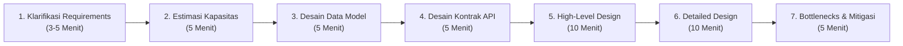

# 🎯 Bab V: Panduan System Design Interview & 5 Studi Kasus Dunia Nyata

> **🎯 Tujuan Belajar Bab Ini:**
> Di bab puncak ini, kita akan menggabungkan seluruh fondasi dari Bab I hingga Bab IV ke dalam **Kerangka Kerja (Framework) 7 Langkah System Design Interview**, lalu membedah secara tuntas **5 Studi Kasus Paling Sering Keluar Saat Wawancara**:
> 1. **URL Shortener** (Bitly / TinyURL)
> 2. **Aplikasi Chat Real-Time** (WhatsApp / Telegram)
> 3. **Social Media & Newsfeed** (Twitter / X / Instagram)
> 4. **Video Streaming Platform** (Netflix / YouTube)
> 5. **Layanan Ride-Hailing** (Uber / Gojek / Grab)

---

## Daftar Isi Bab V
1. [Strategi & Kerangka Kerja 7 Langkah System Design Interview](#1-strategi--kerangka-kerja-7-langkah-system-design-interview)
2. [Studi Kasus 1: Merancang URL Shortener (Bitly / TinyURL)](#2-studi-kasus-1-merancang-url-shortener-bitly--tinyurl)
3. [Studi Kasus 2: Merancang Aplikasi Chat (WhatsApp)](#3-studi-kasus-2-merancang-aplikasi-chat-whatsapp)
4. [Studi Kasus 3: Merancang Social Media & Newsfeed (Twitter / X)](#4-studi-kasus-3-merancang-social-media--newsfeed-twitter--x)
5. [Studi Kasus 4: Merancang Video Streaming (Netflix / YouTube)](#5-studi-kasus-4-merancang-video-streaming-netflix--youtube)
6. [Studi Kasus 5: Merancang Layanan Ride-Hailing (Uber / Gojek / Grab)](#6-studi-kasus-5-merancang-layanan-ride-hailing-uber--gojek--grab)

---

## 1. Strategi & Kerangka Kerja 7 Langkah System Design Interview

Pertanyaan *System Design Interview* sengaja dibuat **abstrak dan terbuka** (misalnya: *"Tolong rancang WhatsApp"* atau *"Bagaimana cara membuat Bitly?"*). **Tidak ada satu jawaban mutlak yang 100% benar**—interviewer ingin menilai **cara kamu berpikir terstruktur, menggali kebutuhan, menghitung skala, memilih teknologi secara pragmatis, dan mendiskusikan *trade-off***.

Gunakan **Framework 7 Langkah (45 Menit)** berikut agar kamu tidak pernah panik atau bingung harus mulai dari mana:



### Langkah 1: Klarifikasi Requirements (Kebutuhan Sistem)
Jangan pernah langsung menggambar kotak-kotak server sebelum bertanya! Bagi kebutuhan menjadi 3 kategori:
1. **Functional Requirements (Kebutuhan Fungsional)**: Fitur inti apa saja yang wajib bisa dilakukan pengguna? (3–4 fitur utama saja agar fokus).
2. **Non-Functional Requirements (Kebutuhan Non-Fungsional)**: Bagaimana kualitas sistemnya? (*High Availability* vs *Strong Consistency*, target *Latency*, *Scalability*, *Durability*).
3. **Extended Requirements (Fitur Tambahan)**: Fitur pelengkap seperti pencatatan *analytics/metrics*, *rate limiting* anti-spam, atau *push notification*.

### Langkah 2: Estimasi Kapasitas & Batasan (*Back-of-the-Envelope Estimation*)
Hitung perkiraan kasar skala sistem untuk menentukan apakah kita butuh Caching, Sharding, atau CDN:
- **Traffic & RPS (*Requests Per Second*)**: Berapa jumlah pengguna aktif harian (**DAU**)? Berapa rasio **Baca : Tulis (`Read : Write Ratio`)**?
  - *Trik Hitung Cepat Mentor*: **1 Hari $\approx 86.400 \text{ detik} \approx 100.000 \text{ detik} (10^5)$**.
- **Storage (Penyimpanan)**: Berapa GB/TB data yang bertambah per hari? Kalikan untuk masa simpan **5 atau 10 tahun**.
- **Bandwidth (Jaringan Masuk/Keluar)**: Berapa MB/detik data yang mengalir masuk (*Ingress*) dan keluar (*Egress*)?
- **Cache (Aturan Pareto 80/20)**: **80% trafik biasanya hanya mengakses 20% data terpopuler**. Maka cukup siapkan RAM Cache untuk menyimpan **20% dari data harian**!

### Langkah 3: Desain Data Model (Skema Database)
Tentukan entitas/tabel apa saja yang dibutuhkan, atribut utamanya, relasi antar tabel (`1:N`, `N:M`), serta pilih jenis database yang tepat (**SQL vs NoSQL**) berdasarkan pola aksesnya.

### Langkah 4: Desain Kontrak API (API Design)
Tuliskan tanda tangan (*signature*) fungsi atau endpoint REST/gRPC utama beserta parameter input dan tipe kembaliannya. Buat sesederhana dan sejelas mungkin.

### Langkah 5: High-Level Component Design (Arsitektur Tingkat Tinggi)
Gambar alur utama dari **Client → Load Balancer / API Gateway → Services → Cache → Database** yang sudah bisa memenuhi *Functional Requirements* dari ujung ke ujung.

### Langkah 6: Detailed Design (Pendalaman Komponen Kritis)
Diskusikan secara mendalam 2–3 tantangan tersulit dari sistem tersebut (misalnya: *Bagaimana cara men-generate kode unik URL tanpa tabrakan? Bagaimana mekanisme Newsfeed Fan-out untuk artis dengan 50 juta follower? Bagaimana cara melacak lokasi jutaan driver dengan Quadtree?*). Selalu sebutkan **kelebihan dan kekurangan (*trade-off*)** dari setiap opsi!

### Langkah 7: Identifikasi & Selesaikan Bottlenecks
Tutup sesi wawancara dengan meninjau ulang desainmu secara kritis:
- *"Apakah ada Single Point of Failure (SPOF)?"* → Pasang *Active-Passive/Active-Active Load Balancer* & multi-instance service.
- *"Bagaimana jika Database kewalahan melayani pembacaan?"* → Tambahkan *Read Replicas* dan *Distributed Cache (Redis)*.
- *"Bagaimana jika ukuran tabel terlalu besar?"* → Terapkan *Database Sharding* dengan *Consistent Hashing*.

> **💡 Nasihat Emas Mentor Saat Interview:**
> Hindari pernyataan dogmatis seperti *"Menurut saya NoSQL jelas lebih bagus, SQL itu kuno dan tidak scalable."* Katakanlah secara objektif: *"Untuk layanan pembayaran ini saya memilih PostgreSQL karena membutuhkan jaminan transaksi ACID yang kuat, sedangkan untuk menyimpan miliaran log pesan chat saya memilih Apache Cassandra karena pola aksesnya write-heavy dan mudah di-scale secara horizontal."*

---

## 2. Studi Kasus 1: Merancang URL Shortener (Bitly / TinyURL)

Mari kita rancang layanan pemendek tautan seperti **Bitly** atau **TinyURL**.

### A. Apa itu URL Shortener & Mengapa Dibutuhkan?
Layanan yang membuat alias pendek yang unik untuk sebuah URL panjang. Ketika pengguna membuka tautan pendek tersebut, browser mereka otomatis dialihkan (*redirect*) ke URL asli.
- **URL Asli**: `https://karanpratapsingh.com/courses/system-design/url-shortener`
- **URL Pendek**: `https://bit.ly/3I71d3o`
- **Manfaat**: Menghemat karakter saat dibagikan di SMS/sosmed, mencegah salah ketik, dan memungkinkan pelacakan analitik klik (*click tracking*).

### B. Requirements (Kebutuhan Sistem)
- **Functional Requirements**:
  1. Diberikan sebuah URL panjang, sistem menghasilkan URL pendek yang **unik**.
  2. Ketika pengguna mengakses URL pendek, sistem mengalihkan (*redirect*) ke URL asli.
  3. Tautan memiliki batas waktu kedaluwarsa (*expiration*) default, atau bisa ditentukan pengguna.
- **Non-Functional Requirements**:
  1. **High Availability** (jika Bitly mati, jutaan tautan di seluruh dunia tidak bisa dibuka!).
  2.Pengalihan URL harus memiliki **latensi sangat rendah** (hitungan milidetik).
  3. Tautan pendek tidak boleh bisa ditebak (*non-predictable*).
- **Extended Requirements**:
  1. Mencegah penyalahgunaan layanan (*rate limiting* dengan API Key).
  2. Mencatat metrik & analitik klik (jumlah klik, negara asal pengunjung, perangkat).

### C. Estimasi Kapasitas & Batasan (Estimation & Constraints)
Sistem ini bersifat **Read-Heavy** (sedikit yang membuat link, sangat banyak yang mengklik link). Mari asumsikan:
- **Rasio Baca : Tulis (`Read : Write`)** = **`100 : 1`**
- **Jumlah URL Baru (Writes) per Bulan** = **100 Juta URL/bulan**

#### 1. Perhitungan Trafik (RPS)
- **Reads per Bulan**: $100 \times 100 \text{ juta} = 10 \text{ Miliar redirect/bulan}$.
- **Writes Per Detik (URL Baru)**:
  $$\frac{100.000.000}{30 \text{ hari} \times 24 \text{ jam} \times 3600 \text{ detik}} \approx \mathbf{40 \text{ URL/detik}}$$
- **Reads Per Detik (Redirections)**:
  $$100 \times 40 \text{ URL/detik} = \mathbf{4.000 \text{ request/detik}}$$

#### 2. Perhitungan Bandwidth
Asumsikan ukuran rata-rata setiap request/record adalah **500 Bytes**:
- **Bandwidth Masuk (Ingress / Write)**: $40 \times 500 \text{ Bytes} = \mathbf{20 \text{ KB/detik}}$.
- **Bandwidth Keluar (Egress / Read)**: $4.000 \times 500 \text{ Bytes} = \mathbf{2 \text{ MB/detik}}$.

#### 3. Perhitungan Storage (Penyimpanan 10 Tahun)
Jika kita menyimpan setiap URL selama **10 tahun**:
- **Total Baris Data (10 Tahun)**: $100 \text{ juta/bulan} \times 12 \text{ bulan} \times 10 \text{ tahun} = \mathbf{12 \text{ Miliar URL}}$.
- **Total Storage Database**: $12 \text{ miliar} \times 500 \text{ Bytes} = \mathbf{6 \text{ TB}}$.

#### 4. Perhitungan Memori Cache (Aturan Pareto 80/20)
Kita ingin meng-cache **20% URL paling populer** dari trafik harian:
- **Total Request Baca per Hari**: $4.000 \text{ req/detik} \times 86.400 \text{ detik} \approx \mathbf{350 \text{ Juta request/hari}}$.
- **Kebutuhan RAM Cache Harian**: $20\% \times 350 \text{ juta} \times 500 \text{ Bytes} = \mathbf{35 \text{ GB/hari}}$ (Sangat muat di 1 mesin Redis modern yang punya RAM 64GB–128GB!).

| Parameter Estimasi | Hasil Perhitungan |
| :--- | :--- |
| **Writes (URL Baru)** | `40 URL / detik` |
| **Reads (Redirect)** | `4.000 request / detik` |
| **Bandwidth Masuk (Ingress)** | `20 KB / detik` |
| **Bandwidth Keluar (Egress)** | `2 MB / detik` |
| **Storage Database (10 Tahun)** | `6 TB` |
| **Memori Cache (Redis)** | `~35 GB / hari` |

### D. Desain Data Model


Kita hanya membutuhkan 2 tabel/koleksi sederhana:
1. **`users`**: Menyimpan `id (PK)`, `name`, `email`, `createdAt`.
2. **`urls`**: Menyimpan `id (PK)`, `hash (Index Unik, misal "3I71d3o")`, `originalURL`, `expiration`, `userID (FK)`, `createdAt`.
- **Pilihan Database**: Karena datanya tidak membutuhkan relasi `JOIN` yang kompleks dan harus melayani miliaran baris dengan pembacaan cepat berbasis kunci (`hash`), database **NoSQL** seperti **Amazon DynamoDB**, **Apache Cassandra**, atau **MongoDB** sangat cocok (atau **PostgreSQL/MySQL** yang di-index pada kolom `hash`).

### E. Desain Kontrak API
Kita menyertakan `apiKey` pada setiap pemanggilan API untuk autentikasi sekaligus mencegah penyalahgunaan (*Rate Limiting* per API Key):

```tsx
// 1. Membuat URL Pendek Baru
createURL(apiKey: string, originalURL: string, expiration?: Date): string

// 2. Mengambil URL Asli berdasarkan Kode URL Pendek
getURL(apiKey: string, shortURL: string): string

// 3. Menghapus URL Pendek
deleteURL(apiKey: string, shortURL: string): boolean
```

### F. High-Level Design & Algoritma Pembuatan Kode Unik

Inti terdalam dari masalah URL Shortener adalah: **Bagaimana cara menghasilkan kode pendek (`hash`) sepanjang 6 atau 7 karakter yang dijamin 100% unik tanpa tabrakan (*collision*)?**

#### 1. Berapa Panjang Karakter yang Dibutuhkan? (Pendekatan Base62)
Kita menggunakan **Base62** yang terdiri dari **62 karakter**: angka `0-9` (10), huruf kecil `a-z` (26), dan huruf besar `A-Z` (26).
$$
\text{Jumlah Kombinasi URL} = 62^N
$$
- Jika $N = 5$ karakter: $62^5 \approx 916 \text{ Juta URL}$ (Kurang untuk 12 miliar URL!).
- Jika $N = 6$ karakter: $62^6 \approx \mathbf{56,8 \text{ Miliar URL}}$ (Sangat cukup!).
- Jika $N = 7$ karakter: $62^7 \approx \mathbf{3,5 \text{ Triliun URL}}$ (Hampir tak terbatas!).

#### 2. Mengevaluasi 3 Pendekatan Pembuatan Kode:
- **Opsi 1: Hashing MD5 + Base62**:
  - $\text{MD5}(\text{original\_url}) \to \text{Base62Encode} \to \text{Ambil 7 karakter pertama}$.
  - **Masalah**: Karena hasil MD5 (128-bit) dipotong paksa menjadi 7 karakter saja, **pasti bisa terjadi tabrakan (*collision*)**, dan dua pengguna yang memendekkan URL yang sama akan menghasilkan kode yang sama. Mengecek tabrakan berulang kali ke database akan memperlambat sistem.
- **Opsi 2: Counter Terdistribusi dengan Apache ZooKeeper**:
  - Setiap URL baru diberi nomor urut unik ($1 \text{ s/d } 3,5 \text{ triliun}$) lalu diubah ke Base62.
  - Agar tidak terjadi *Single Point of Failure* pada 1 server counter, kita menggunakan **Apache ZooKeeper** untuk membagikan **Rentang Angka (*Counter Ranges*)** ke setiap server aplikasi:
    - Server App 1 mendapat jatah: `1 → 1.000.000`
    - Server App 2 mendapat jatah: `1.000.001 → 2.000.000`
  - **Kelebihan**: Dijamin **0% tabrakan (*collision-free*)** dan sangat cepat karena tiap server tinggal menghitung naik di memorinya sendiri!
- **Opsi 3: Key Generation Service (KGS) — *Solusi Paling Elegan*** ⭐:
  - Daripada menghitung hash/encode saat pengguna sedang menunggu, kita membuat layanan terpisah bernama **KGS (*Key Generation Service*)** yang **men-generate miliaran kode unik 6–7 karakter jauh-jauh hari sebelumnya** dan menyimpannya di dalam **Keys Database** khusus!
  - **Bagaimana menangani *concurrency* (2 server meminta kunci bersamaan)?**
    KGS memisahkan kunci ke dalam 2 tabel: tabel **`unused_keys`** (belum dipakai) dan **`used_keys`** (sudah dipakai). KGS mengambil sejumlah blok kunci ke memori RAM lokalnya dan langsung memindahkannya ke `used_keys` menggunakan penguncian atomik, sehingga tidak mungkin ada 2 server yang mendapat kunci kembar!
  - **Ukuran Database KGS**: $6 \text{ karakter} \times 56,8 \text{ miliar} \approx \mathbf{390 \text{ GB}}$ untuk seumur hidup layanan!

#### Diagram High-Level Design URL Shortener


- **Alur Membuat URL Baru**:
  1. Klien mengirim request `POST` membuat URL pendek ke API Server.
  2. API Server meminta 1 kode unik siap pakai dari **KGS**.
  3. API Server menyimpan pasangan `(hash, originalURL)` ke Database dan Cache, lalu mengembalikan status **`HTTP 201 Created`** beserta URL pendeknya ke pengguna.
- **Alur Mengakses URL Pendek**:
  1. Pengguna membuka `bit.ly/3I71d3o`. Request masuk ke API Server.
  2. Server mencari kode `3I71d3o` di **Cache (Redis)**. Jika *Cache Miss*, baca dari Database lalu simpan ke Cache.
  3. Jika ditemukan dan belum kedaluwarsa, Server mengembalikan respons **`HTTP 301 Redirect`** (atau `302 Found` jika ingin melacak setiap klik di server) menuju `originalURL`. Jika tidak ditemukan, kembalikan **`HTTP 404 Not Found`**.

### G. Detailed Design & Penyelesaian Bottlenecks


1. **Data Partitioning (Sharding)**: Gunakan **Consistent Hashing** berdasarkan `hash` URL pendek agar data dan beban baca tersebar merata di seluruh *shard* database tanpa *hotspot*.
2. **Pembersihan Link Kedaluwarsa (*Database Cleanup*)**:
   - **Passive Cleanup (Lazy)**: Hanya menghapus link ketika ada pengguna yang mencoba mengakses link tersebut dan ternyata waktu kedaluwarsanya sudah lewat.
   - **Active Cleanup**: Menjalankan layanan ringan terjadwal (**Cron Job**) di jam sepi untuk menyapu bersih link yang sudah kedaluwarsa dari database dan cache agar menghemat ruang penyimpanan.
3. **Cache Eviction Policy**: Gunakan **LRU (*Least Recently Used*)** pada klaster Redis agar link lama yang sudah tidak viral otomatis tergeser oleh link baru yang sedang ramai diklik.
4. **Menghilangkan Single Point of Failure (SPOF)**:
   - Jalankan banyak *instance* API Server dan KGS di belakang **Load Balancer**.
   - Siapkan **Standby Replica** untuk Keys Database milik KGS dan **Read Replicas** untuk database utama.

---

## 3. Studi Kasus 2: Merancang Aplikasi Chat (WhatsApp)

Mari kita rancang layanan pesan instan *real-time* berskala global seperti **WhatsApp**, **Facebook Messenger**, atau **Telegram**.

### A. Requirements (Kebutuhan Sistem)
- **Functional Requirements**:
  1. Mendukung percakapan pribadi **1- lawan -1 (*One-on-One Chat*)**.
  2. Mendukung percakapan grup (**Group Chat**, maksimal 100–1.000 anggota).
  3. Mendukung pengiriman file media (gambar, video, dokumen).
- **Non-Functional Requirements**:
  1. Pengiriman pesan harus bersifat **Real-Time dengan latensi minimal**.
  2. **High Availability & Skalabilitas Tinggi**.
- **Extended Requirements**:
  1. Indikator status pesan: **Terkirim (*Sent*), Sampai (*Delivered*), dan Dibaca (*Read / Centang Biru*)**.
  2. Menampilkan status waktu aktif terakhir (**Last Seen / Online**).
  3. **Push Notifications** ketika penerima sedang *offline*.

### B. Estimasi Kapasitas & Batasan
Asumsikan skala **50 Juta pengguna aktif harian (DAU)**, di mana rata-rata tiap pengguna mengirim **10 pesan ke 4 orang berbeda (40 pesan/hari)**:
- **Total Pesan Teks per Hari**: $50 \text{ juta} \times 40 \text{ pesan} = \mathbf{2 \text{ Miliar pesan/hari}}$.
- **Total File Media per Hari (Asumsi 5% pesan berisi media)**: $5\% \times 2 \text{ miliar} = \mathbf{100 \text{ Juta file media/hari}}$.
- **Requests Per Second (RPS)**:
  $$\frac{2.000.000.000}{24 \times 3600 \text{ detik}} \approx \mathbf{24.000 \text{ pesan/detik}}$$
- **Storage Harian & 10 Tahun**:
  - **Pesan Teks (Rata-rata 100 Bytes/pesan)**: $2 \text{ miliar} \times 100 \text{ Bytes} \approx \mathbf{200 \text{ GB/hari}}$.
  - **File Media (Rata-rata 100 KB/file)**: $100 \text{ juta} \times 100 \text{ KB} = \mathbf{10 \text{ TB/hari}}$.
  - **Total Storage 10 Tahun**: $(10 \text{ TB} + 0,2 \text{ TB}) \times 365 \text{ hari} \times 10 \text{ tahun} \approx \mathbf{38 \text{ Petabyte (PB)}}$.
- **Bandwidth Masuk (Ingress)**:
  $$\frac{10,2 \text{ TB}}{86.400 \text{ detik}} \approx \mathbf{120 \text{ MB/detik}}$$

| Parameter Estimasi | Hasil Perhitungan |
| :--- | :--- |
| **Daily Active Users (DAU)** | `50 Juta Pengguna` |
| **Requests Per Second (RPS)** | `24.000 pesan / detik` |
| **Storage per Hari** | `~10,2 TB / hari` (200 GB teks + 10 TB media) |
| **Storage 10 Tahun** | `~38 PB` |
| **Bandwidth Minimum** | `~120 MB / detik` |

### C. Desain Data Model


Entitas utama yang kita butuhkan:
1. **`users`**: Menyimpan profil pengguna (`id`, `name`, `phoneNumber`, `createdAt`).
2. **`chats`** & **`users_chats`**: Mewakili ruang obrolan pribadi dan tabel relasi $N:M$ antar pengguna.
3. **`groups`** & **`users_groups`**: Mewakili grup obrolan beserta daftar anggotanya ($N:M$).
4. **`messages`**: Menyimpan isi pesan (`id`, `chatID/groupID`, `senderID`, `type` [text/image/video], `content`, `deliveredAt`, `seenAt`, `createdAt`).
- **Pilihan Database**:
  - Untuk data relasi profil pengguna dan keanggotaan grup: **PostgreSQL**.
  - Untuk tabel `messages` yang menampung 2 miliar pesan baru setiap hari: gunakan database **Wide-Column NoSQL** seperti **Apache Cassandra / ScyllaDB** (seperti yang digunakan Discord & WhatsApp) karena sangat cepat untuk penulisan masif dan pembacaan riwayat chat berurutan berdasarkan waktu.

### D. Desain Kontrak API

```tsx
// 1. Mengambil seluruh daftar chat dan grup milik user
getAll(userID: UUID): Chat[] | Group[]

// 2. Mengambil riwayat pesan pada suatu ruang chat/grup (dengan paginasi)
getMessages(userID: UUID, channelID: UUID): Message[]

// 3. Mengirim pesan ke ruang chat atau grup
sendMessage(userID: UUID, channelID: UUID, message: Message): boolean

// 4. Bergabung atau keluar dari grup
joinGroup(userID: UUID, channelID: UUID): boolean
leaveGroup(userID: UUID, channelID: UUID): boolean
```

### E. High-Level Design & Komponen Inti


Kita membagi arsitektur ke dalam beberapa *microservices* spesifik (berkomunikasi secara internal menggunakan **gRPC**):
1. **API Gateway**: Menerima koneksi HTTP maupun WebSocket, menangani autentikasi, *rate limiting*, dan penyeimbangan beban.
2. **User Service**: Mengelola registrasi nomor telepon, autentikasi, dan profil pengguna.
3. **Chat Service (& Group Service)**: Memegang koneksi **WebSockets** dua arah yang terus terbuka dengan perangkat pengguna yang sedang *online*, serta menyimpan status sesi koneksi aktif di **Redis**.
4. **Presence Service (Fitur Online & Last Seen)**:
   - Bagaimana cara tahu pengguna sedang *Online* atau kapan terakhir kali aktif (*Last Seen*)?
   - Klien mengirimkan sinyal **Heartbeat** ringan secara berkala (atau kita mencatat *timestamp* aksi terakhir pengguna) ke **Presence Service** yang menyimpannya di dalam **Redis Key-Value**:
     - `User A` → `2026-11-12T10:32:50`
   - Jika tidak ada sinyal aktivitas selama lebih dari 30 detik, pengguna otomatis ditampilkan sebagai *Offline* dengan jam *Last Seen* terakhir tersebut!
5. **Read Receipts (Centang Satu, Centang Dua, & Centang Biru)**:
   - Saat pesan masuk ke server → status **Sent (Centang 1)**.
   - Saat *Chat Service* mendorong pesan lewat WebSocket ke HP penerima, HP penerima membalas paket **ACK (`Acknowledgment`)** → server memperbarui `deliveredAt` dan memberi tahu pengirim (**Delivered / Centang 2**).
   - Saat penerima membuka layar ruang chat tersebut, HP penerima mengirim event `MessageSeen ACK` → server memperbarui `seenAt` (**Read / Centang Biru**).
6. **Notification Service (Saat Penerima Offline)**:
   - Jika penerima sedang tidak terhubung ke WebSocket (*Offline*), *Chat Service* menaruh event notifikasi ke **Message Queue (RabbitMQ / Amazon SQS / Kafka)** beserta metadata jenis HP penerima.
   - *Notification Service* mengambil pesan dari antrean lalu mengirimkannya ke **Firebase Cloud Messaging (FCM)** untuk Android atau **Apple Push Notification Service (APNS)** untuk iOS.
7. **Media Service**:
   - File gambar/video **tidak dikirim lewat jalur WebSocket** agar tidak menyumbat koneksi chat!
   - Media diunggah via HTTP ke **Media Service**, dikompresi, lalu disimpan ke **Object Storage (Amazon S3 / GCS)** dan disajikan lewat **CDN (CloudFront / Cloudflare)**. Hanya tautan URL medianya saja yang dikirim lewat pesan WebSocket! *(Fakta menarik: WhatsApp menghapus file media dari servernya segera setelah berhasil diunduh ke penyimpanan lokal HP penerima untuk menghemat biaya storage petabyte!).*

### F. Detailed Design & Penyelesaian Bottlenecks


- **Paginasi Riwayat Chat**: Grup chat bisa berisi puluhan ribu pesan. Jangan pernah mengirim seluruh riwayat sekaligus! Gunakan **Cursor-based Pagination** (ambil 50 pesan terbaru dulu, dan muat pesan lama hanya ketika pengguna menggulir layar ke atas) dan simpan pesan populer grup di **Redis Cache (LRU)**.
- **Memisahkan Group Service dari Chat Service**: Agar *Chat Service* 1-lawan-1 tidak terbebani oleh proses *fan-out* pesan ke 500 anggota grup, pisahkan logika grup ke **Group Service** tersendiri dan gunakan **Apache Kafka / NATS** untuk menjaga urutan pengiriman pesan.

---

## 4. Studi Kasus 3: Merancang Social Media & Newsfeed (Twitter / X)

Mari kita rancang platform mikroblog dan lini masa sosial seperti **Twitter (X)**, **Instagram**, atau **Facebook Feed**.

### A. Requirements (Kebutuhan Sistem)
- **Functional Requirements**:
  1. Pengguna dapat memposting **Tweet** baru (teks hingga 280 karakter, gambar, atau video).
  2. Pengguna dapat mengikuti (**Follow / Unfollow**) pengguna lain.
  3. Pengguna dapat melihat **Newsfeed (Timeline)** berisi tweet dari orang-orang yang mereka ikuti.
  4. Pengguna dapat mencari (**Search**) tweet berdasarkan kata kunci atau hashtag.
- **Non-Functional Requirements**:
  1. **High Availability** dengan latensi pembacaan Newsfeed yang sangat rendah (di bawah 200ms).
  2. *Eventual Consistency* dapat diterima (jika seseorang nge-tweet, tidak masalah jika follower-nya baru melihat tweet tersebut 1–2 detik kemudian).
- **Extended Requirements**:
  1. Fitur **Retweet** dan **Favorite (Like)**.
  2. Menampilkan **Trending Topics** dan rekomendasi teman (**Mutual Friends**).
  3. Analitik dan metrik tayangan.

### B. Estimasi Kapasitas & Batasan
Asumsikan **1 Miliar total pengguna**, dengan **200 Juta pengguna aktif harian (DAU)** yang rata-rata memposting **5 tweet/hari**:
- **Total Tweet Baru per Hari**: $200 \text{ juta} \times 5 = \mathbf{1 \text{ Miliar tweet/hari}}$.
- **Tweet Berisi Media (Asumsi 10%)**: $10\% \times 1 \text{ miliar} = \mathbf{100 \text{ Juta file media/hari}}$.
- **Requests Per Second (RPS)**:
  $$\frac{1.000.000.000}{86.400 \text{ detik}} \approx \mathbf{12.000 \text{ request/detik}}$$
- **Storage Harian & 10 Tahun**:
  - **Teks Tweet (100 Bytes)**: $1 \text{ miliar} \times 100 \text{ Bytes} \approx \mathbf{100 \text{ GB/hari}}$.
  - **Media (Rata-rata 50 KB)**: $100 \text{ juta} \times 50 \text{ KB} = \mathbf{5 \text{ TB/hari}}$.
  - **Total Storage 10 Tahun**: $5,1 \text{ TB/hari} \times 365 \times 10 \approx \mathbf{19 \text{ Petabyte (PB)}}$.
- **Bandwidth Masuk**: $5,1 \text{ TB} / 86.400 \text{ detik} \approx \mathbf{60 \text{ MB/detik}}$.

### C. Desain Data Model


Tabel utama yang digunakan:
- **`users`**: Data profil pengguna.
- **`tweets`**: Menyimpan `id`, `userID`, `type` (`text`, `image`, `video`, `tweet` untuk retweet), `content`, `createdAt`.
- **`followers`**: Memetakan relasi `followerID` dan `followeeID` ($N:M$).
- **`favorites`**: Memetakan pengguna yang menyukai sebuah tweet.
- **`feeds`** & **`feeds_tweets`**: Menyimpan daftar tweet pada lini masa masing-masing pengguna.

### D. Desain Kontrak API

```tsx
// 1. Memposting Tweet baru
postTweet(userID: UUID, content: string, mediaURL?: string): boolean

// 2. Mengikuti atau berhenti mengikuti pengguna lain
follow(followerID: UUID, followeeID: UUID): boolean
unfollow(followerID: UUID, followeeID: UUID): boolean

// 3. Mengambil Newsfeed lini masa pengguna
getNewsfeed(userID: UUID): Tweet[]
```

### E. High-Level Design & Masalah Inti: Newsfeed Generation & Fan-out!

Bagian paling krusial saat wawancara desain Twitter/Instagram adalah menjelaskan bagaimana **Newsfeed Service** menghasilkan dan mendistribusikan lini masa ke jutaan pengikut (**Fan-out Problem**).

#### 1. Bagaimana Cara Menyebarkan Tweet ke Newsfeed Pengikut? (3 Model Fan-out)

##### Opsi A: Pull Model (Fan-out on Load)


- **Cara Kerja**: Saat seseorang memposting tweet, kita hanya menulis 1 baris ke database `tweets` (proses tulis sangat ringan). Baru ketika seorang follower membuka aplikasi dan me-*refresh* berandanya, sistem mencari semua orang yang ia ikuti, mengambil tweet terbaru mereka, mengurutkannya, dan menampilkannya.
- **Kelemahan Fatal**: Membaca beranda menjadi **sangat lambat dan berat** jika pengguna mengikuti 1.000 orang!

##### Opsi B: Push Model (Fan-out on Write)


- **Cara Kerja**: Begitu Pengguna X memposting tweet baru, sistem langsung **mendorong (*push*) ID tweet tersebut ke dalam daftar Newsfeed Cache (Redis) milik seluruh follower Pengguna X**! Saat follower membuka aplikasi, beranda mereka sudah siap saji di Redis dan terbuka dalam 5 milidetik!
- **Kelemahan Fatal (Masalah Selebriti / Justin Bieber Problem)**: Bagaimana jika **Elon Musk atau Justin Bieber yang memiliki 100 Juta Followers** memposting 1 tweet? Sistem harus melakukan **100 Juta operasi tulis ke Redis sekaligus** hanya untuk 1 tweet tersebut! Server akan langsung macet total!

##### Opsi C: Hybrid Model ⭐ *(Jawaban Juara saat System Design Interview!)*
Kita menggabungkan kelebihan **Push Model** dan **Pull Model**:
1. **Untuk Pengguna Biasa (memiliki ratusan atau beberapa ribu followers)**: Gunakan **Push Model (*Fan-out on Write*)**. Saat mereka nge-tweet, langsung dorong ke cache beranda para pengikutnya.
2. **Untuk Akun Selebriti / VIP (memiliki puluhan juta followers)**: **JANGAN gunakan Push Model!** Gunakan **Pull Model (*Fan-out on Load*)**: tweet selebriti cukup disimpan di tabelnya sendiri. Ketika seorang follower membuka beranda, sistem mengambil beranda siap saji dari cache mereka lalu **menggabungkannya (*merge*) dengan tweet terbaru dari daftar selebriti yang mereka ikuti**!

#### 2. Algoritma Ranking Newsfeed (EdgeRank)
Agar tweet yang tampil paling atas adalah yang paling menarik bagi pengguna, kita menerapkan algoritma pemeringkatan seperti **EdgeRank**:

$$
\text{Rank} = \text{Affinity} \times \text{Weight} \times \text{Decay}
$$
- **Affinity (Kedekatan)**: Seberapa sering pengguna berinteraksi (like/reply/DM) dengan pembuat tweet tersebut.
- **Weight (Bobot Interaksi)**: Jenis interaksi pada tweet (Komentar dan Retweet memiliki bobot lebih tinggi daripada sekadar Like).
- **Decay (Peluruhan Waktu)**: Semakin tua usia tweet, semakin turun skor peringkatnya agar beranda selalu segar.

#### 3. Fitur Retweet, Search, Trending Topics, dan Mutual Friends
- **Retweet**: Cukup buat baris baru di tabel `tweets` dengan `type = 'tweet'` dan kolom `content` berisi `ID` dari tweet asli yang di-retweet:

| id | userID | type | content | createdAt |
| :--- | :--- | :--- | :--- | :--- |
| `ad34-291a...` | `7a2c-62c4...` | `text` | `Halo, ini tweet pertamaku!` | `1658905644054` |
| `f064-49ad...` | `6aa2-2bc9...` | `tweet` | `ad34-291a...` *(ID tweet asli)* | `1658906165427` |

- **Search & Trending Topics**: Gunakan **Elasticsearch** (berbasis Apache Lucene) untuk pencarian teks cepat dalam milidetik. Untuk *Trending Topics*, hitung dan simpan di cache kata kunci/hashtag yang paling sering dicari/diposting dalam $N$ detik terakhir menggunakan *stream processing* (**Apache Kafka + Apache Spark**).
- **Mutual Friends (Saran Pertemanan)**: Gunakan **Graph Database (Neo4j / ArangoDB)** di mana pengguna adalah *Node* dan aksi *Follow* adalah *Directional Edge*, sehingga sangat cepat mencari *"teman dari teman saya"*.

### F. Arsitektur Lanjutan & Penyelesaian Bottlenecks


---

## 5. Studi Kasus 4: Merancang Video Streaming (Netflix / YouTube)

Mari kita rancang platform streaming video berskala global seperti **Netflix**, **YouTube**, atau **Disney+ Hotstar**.

### A. Requirements (Kebutuhan Sistem)
- **Functional Requirements**:
  1. Pengguna dapat menonton (*stream*) dan membagikan video dengan lancar di berbagai perangkat (TV, Web, HP).
  2. Tim konten (atau kreator di YouTube) dapat mengunggah (*upload*) video baru berukuran besar.
  3. Pengguna dapat mencari video berdasarkan judul atau *tag*, serta memberikan komentar.
- **Non-Functional Requirements**:
  1. **High Availability & Low Latency** saat pemutaran video (tanpa *buffering*).
  2. **High Reliability** saat upload (video yang sudah diunggah tidak boleh hilang).
- **Extended Requirements**:
  1. Pembatasan wilayah tayangan (**Geo-blocking**) sesuai lisensi hak siar negara.
  2. Melanjutkan tontonan dari detik terakhir pengguna berhenti (**Resume Playback**).
  3. Rekomendasi film personal dan pencatatan analitik.

### B. Estimasi Kapasitas & Batasan
Asumsikan **200 Juta pengguna aktif harian (DAU)** yang rata-rata menonton **5 video/hari**, dengan rasio **Baca : Tulis = `200 : 1`**:
- **Total Video Ditonton per Hari**: $200 \text{ juta} \times 5 = \mathbf{1 \text{ Miliar tayangan/hari}}$ ($\approx \mathbf{12.000 \text{ RPS}}$).
- **Total Video Diunggah per Hari**: $\frac{1}{200} \times 1 \text{ miliar} = \mathbf{5 \text{ Juta video/hari}}$.
- **Storage Harian & 10 Tahun (Asumsi rata-rata 1 video = 100 MB)**:
  - **Storage per Hari**: $5 \text{ juta} \times 100 \text{ MB} = \mathbf{500 \text{ Terabyte (TB) / hari}}$.
  - **Storage 10 Tahun**: $500 \text{ TB} \times 365 \times 10 \approx \mathbf{1.825 \text{ Petabyte (PB)}}$ (atau $\sim 1,8 \text{ Exabyte}$!).
- **Bandwidth Masuk Minimum**: $500 \text{ TB} / 86.400 \text{ detik} \approx \mathbf{5,8 \text{ GB/detik}}$.

### C. Desain Data Model & API


- **Tabel Utama**: `users`, `videos` (`id`, `title`, `streamURL`, `userID`), `tags`, `views` (menyimpan `offset` detik terakhir yang ditonton pengguna untuk fitur *Resume Playback*!), dan `comments`.

```tsx
// 1. Mengunggah aliran byte video baru
uploadVideo(title: string, description: string, data: Stream<byte>, tags?: string[]): boolean

// 2. Streaming video berdasarkan codec, resolusi layar, dan detik terakhir (offset)
streamVideo(videoID: UUID, codec: Enum<string>, resolution: Tuple<int>, offset?: int): VideoStream

// 3. Mencari video dengan paginasi
searchVideo(query: string, nextPage?: string): Video[]

// 4. Menambahkan komentar pada video
comment(videoID: UUID, comment: string): boolean
```

### D. High-Level Design: Pipeline Pemrosesan Video (*Video Processing Pipeline*)

Sebuah file video mentah (*raw 8K footage*) berdurasi 2 jam dari kamera studio bisa berukuran hingga **4 TB**! Kita tidak mungkin mengirimkan file 4 TB langsung ke HP pengguna. Oleh karena itu, begitu video diunggah, tugas pemrosesannya dimasukkan ke **Message Queue (Amazon SQS / RabbitMQ)** untuk melewati **4 Tahap Video Processing Pipeline** secara asinkron:


1. **Tahap 1 — File Chunker (Pemecahan Potongan Adegan)**:
   - Memecah file video raksasa menjadi potongan-potongan kecil yang disebut **Chunks**.
   - *Rahasia Engineering Netflix*: Alih-alih memotong video berdasarkan durasi detik yang kaku, Netflix memotong *chunk* **berdasarkan pergantian adegan (*Scene-based chunking*)**! Dengan begitu, saat pengguna menonton satu *chunk*, seluruh adegan utuh sudah terunduh sehingga minim gangguan *buffering* di tengah adegan seru.


2. **Tahap 2 — Content Filter (Filter Kebijakan & Hak Cipta dengan ML)**:
   - Model *Machine Learning* memeriksa apakah potongan video melanggar hak cipta (*copyright*), pembajakan, atau konten terlarang (NSFW). Jika terdeteksi masalah, tugas dipindahkan ke **Dead-Letter Queue (DLQ)** untuk ditinjau tim moderator.
3. **Tahap 3 — Transcoder (Konversi Format & Codec)**:
   - Menggunakan **FFmpeg** atau **AWS Elemental MediaConvert** untuk menyandikan video ke berbagai *codec* modern (`H.264`, `H.265/HEVC`, `VP9`, `AV1`) agar ukuran file jauh lebih kecil namun tetap tajam di berbagai jenis perangkat (TV, iPhone, Android).
4. **Tahap 4 — Quality Conversion (Konversi Multi-Resolusi)**:
   - Menghasilkan variasi resolusi untuk setiap *chunk*: **4K, 1440p, 1080p, 720p, 480p, 360p**, lalu menyimpannya ke **Object Storage (Amazon S3 / HDFS)** dan menyebarkannya ke **CDN**.

### E. Arsitektur Streaming: Netflix Open Connect CDN & Adaptive Bitrate
- **Netflix Open Connect (OCAs)**: Netflix membangun jaringan CDN khusus di mana mereka menaruh perangkat server penyimpanan video (**Open Connect Appliances**) **langsung di dalam gedung data center milik ribuan ISP lokal** (seperti Telkom/Biznet) di lebih dari 1.000 lokasi dunia! Hasilnya, **95% trafik video Netflix mengalir langsung dari server ISP lokal ke rumah pelanggan** tanpa membebani jalur internet lintas benua.
- **Adaptive Bitrate Streaming (HLS / MPEG-DASH)**: Saat sinyal Wi-Fi/4G pengguna sedang kencang, aplikasi otomatis meminta *chunk* resolusi **4K/1080p**. Jika tiba-tiba sinyal pengguna melemah di dalam kereta, aplikasi otomatis menurunkan permintaan *chunk* detik berikutnya ke **480p** secara mulus tanpa menghentikan pemutaran video!
- **Geo-blocking**: Menggunakan deteksi IP pada **Amazon Route53 (Geolocation Routing)** dan **CloudFront Geo-Restriction** untuk membatasi tayangan sesuai lisensi negara.


---

## 6. Studi Kasus 5: Merancang Layanan Ride-Hailing (Uber / Gojek / Grab)

Mari kita rancang sistem pemesanan transportasi *real-time* berbasis lokasi seperti **Uber**, **Gojek**, atau **Grab**.

### A. Requirements (Kebutuhan Sistem)
- **Functional Requirements**:
  - **Bagi Penumpang (*Customers*)**: Dapat memesan kendaraan dari titik jemput ke titik tujuan, serta melihat lokasi pergerakan pengemudi secara *real-time* di peta.
  - **Bagi Pengemudi (*Drivers*)**: Dapat menerima (*accept*) atau menolak (*deny*) pesanan masuk, melihat lokasi jemput penumpang, serta memulai dan menyelesaikan perjalanan (*start/end trip*).
- **Non-Functional Requirements**:
  1. Pencocokan pengemudi terdekat (**Ride Matching**) dan pembaruan lokasi harus memiliki **latensi sangat rendah (Real-time)**.
  2. **Konsistensi Tinggi pada Pemesanan**: Satu pengemudi yang sama tidak boleh berhasil dipesan oleh 2 penumpang berbeda di detik yang sama (*No Double-Booking*)!
- **Extended Requirements**:
  1. Pemberian rating & ulasan perjalanan.
  2. Pemrosesan pembayaran dan harga dinamis saat jam sibuk (**Surge Pricing**).

### B. Estimasi Kapasitas & Batasan
Asumsikan **100 Juta penumpang aktif harian (DAU)**, **1 Juta pengemudi aktif**, dan **10 Juta perjalanan/hari**. Rata-rata tiap pengguna melakukan 10 aksi/hari:
- **Total Request per Hari**: $100 \text{ juta} \times 10 = \mathbf{1 \text{ Miliar request/hari}}$ ($\approx \mathbf{12.000 \text{ RPS}}$).
- **Storage Harian & 10 Tahun (Asumsi 400 Bytes/pesan)**:
  - **Storage per Hari**: $1 \text{ miliar} \times 400 \text{ Bytes} \approx \mathbf{400 \text{ GB/hari}}$.
  - **Storage 10 Tahun**: $400 \text{ GB} \times 365 \times 10 \approx \mathbf{1,4 \text{ Petabyte (PB)}}$.
- **Bandwidth Masuk Minimum**: $400 \text{ GB} / 86.400 \text{ detik} \approx \mathbf{5 \text{ MB/detik}}$.

### C. Desain Data Model & API


- **Tabel Utama**: `customers`, `drivers`, `cabs` (nomor plat & tipe kendaraan seperti GoRide/GoCar/UberXL), `trips` (`source`, `destination`, `status`), `ratings`, dan `payments`.

```tsx
// 1. Penumpang memesan perjalanan
requestRide(customerID: UUID, source: Tuple<float>, destination: Tuple<float>, cabType: Enum<string>, paymentMethod: Enum<string>): Ride

// 2. Penumpang membatalkan pesanan
cancelRide(customerID: UUID, reason?: string): boolean

// 3. Pengemudi menerima atau menolak tawaran perjalanan
acceptRide(driverID: UUID, rideID: UUID): boolean
denyRide(driverID: UUID, rideID: UUID): boolean

// 4. Pengemudi memulai dan mengakhiri perjalanan
startTrip(driverID: UUID, tripID: UUID): boolean
endTrip(driverID: UUID, tripID: UUID): boolean

// 5. Penumpang memberi rating perjalanan
rateTrip(customerID: UUID, tripID: UUID, rating: int, feedback?: string): boolean
```

### D. High-Level Design: Bagaimana Alur Kerja Uber / Gojek dari Awal sampai Akhir?


1. **Penumpang** memesan perjalanan dengan menentukan titik jemput, tujuan, tipe kendaraan, dan metode pembayaran.
2. **Ride Service** menerima pesanan, mencari daftar pengemudi terdekat yang sedang *idle*, dan menghitung perkiraan waktu tiba (**ETA**).
3. Tawaran perjalanan dikirimkan ke pengemudi terdekat untuk diterima atau ditolak.
4. Begitu seorang **Pengemudi menerima pesanan**, penumpang diberi tahu dan bisa melihat pergerakan lokasi pengemudi secara langsung di peta sambil menunggu dijemput.
5. Setelah sampai di tujuan, pengemudi menyelesaikan perjalanan, sistem memproses **Pembayaran** (via integrasi *Payment Gateway* seperti Stripe/GoPay + *Webhook*), dan penumpang memberikan **Rating**.

### E. Detailed Design: Pelacakan Lokasi Live & Pencarian Driver Terdekat

#### 1. Pelacakan Lokasi Real-Time dengan WebSockets
Aplikasi HP pengemudi terus mengirimkan koordinat GPS terbaru setiap beberapa detik ke backend meskipun aplikasi sedang di latar belakang (*background*).
- Kita menggunakan koneksi **WebSockets** dua arah (bukan HTTP Polling!) agar pembaruan titik GPS dari jutaan pengemudi mengalir masuk dengan overhead minimal dan langsung dapat didorong ke layar peta penumpang tanpa jeda.

#### 2. Algoritma Ride Matching: Mengapa Memilih Quadtree + Redis?
Sebagaimana telah kita pelajari di Bab IV:
1. Query SQL biasa (`WHERE lat BETWEEN ... AND long BETWEEN ...`) terlalu lambat untuk jutaan titik yang bergerak setiap 3 detik.
2. Kita menyimpan posisi terkini pengemudi di dalam struktur **Quadtree di memori (Quadtree Servers)** yang dipadukan dengan **Redis Cache** untuk menampung update lokasi terbaru, serta kurva pemetaan spasial (**Hilbert Curve**) untuk mempercepat *range query*.
3. Ketika penumpang memesan ojek/taksi, *Ride Service* menanyakan ke *Quadtree Server* untuk mendapatkan daftar pengemudi dalam radius terdekat, lalu mengurutkannya berdasarkan **Rating Pengemudi, Riwayat Performa, dan Jarak Tempuh**.

#### 3. Bagaimana Mencegah Race Condition & Double-Booking?
Bagaimana jika 100 penumpang di stasiun kereta memesan kendaraan pada detik yang persis sama, dan semuanya mencoba mengklaim 1 pengemudi yang sama?
- Bungkus proses pencocokan dan penguncian status pengemudi di dalam **Distributed Lock / Mutex** (misal dengan Redis Lock yang memiliki TTL singkat 10 detik saat tawaran sedang berdering di HP pengemudi) dan pastikan perubahan status perjalanan berjalan di dalam **Transaksi Database yang Atomik serta Idempotent**!

#### 4. Menangani Lonjakan Permintaan (Surge Pricing)
Ketika jumlah penumpang yang memesan di suatu kotak area Geohash/Quadtree (misal saat hujan deras atau bubaran konser) jauh melebihi jumlah pengemudi yang tersedia di kotak tersebut, sistem mengaktifkan **Surge Pricing (Tarif Dinamis)**: menaikkan pengali harga sementara untuk menarik lebih banyak pengemudi datang ke area tersebut sekaligus menyeimbangkan permintaan dan penawaran.


